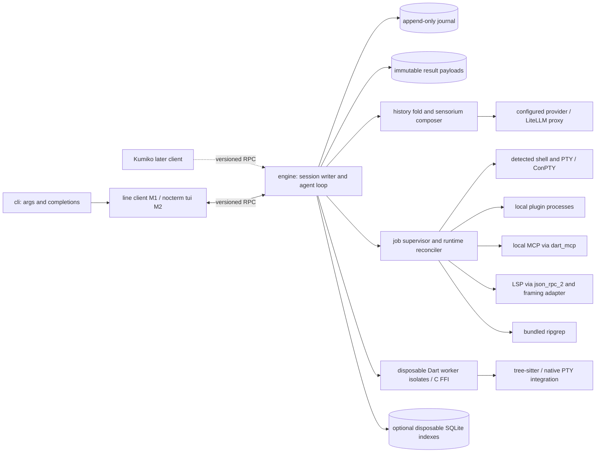
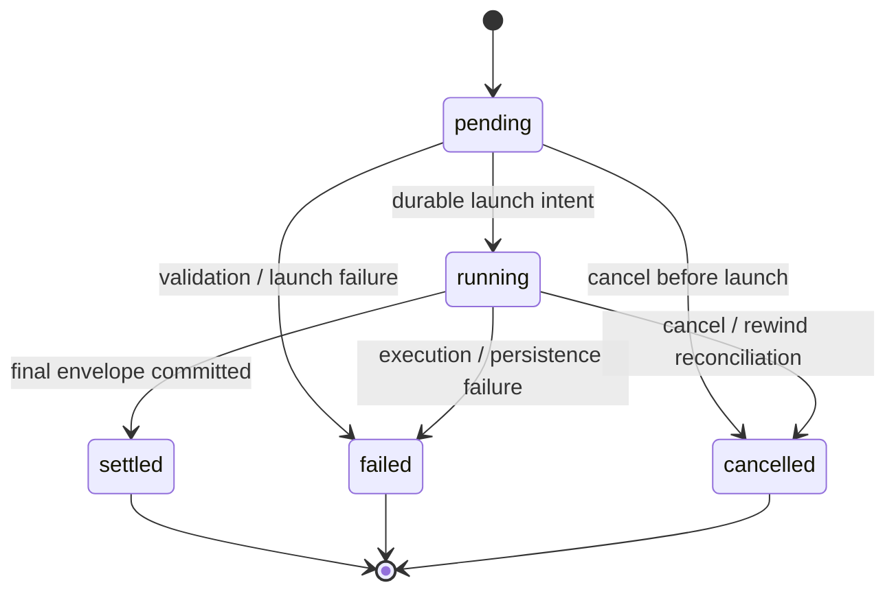
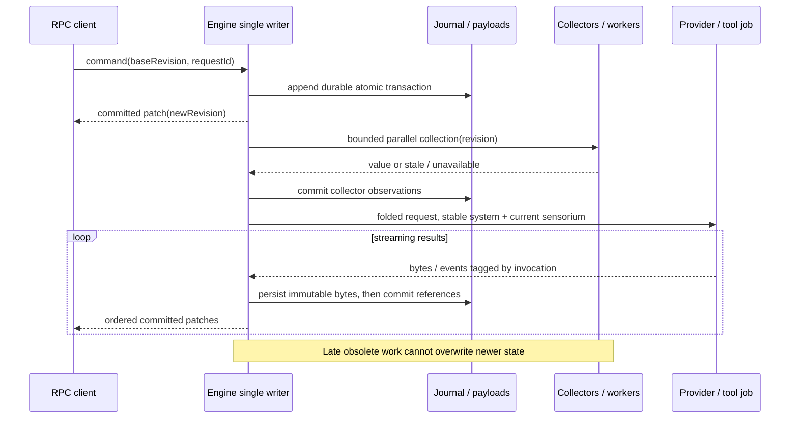
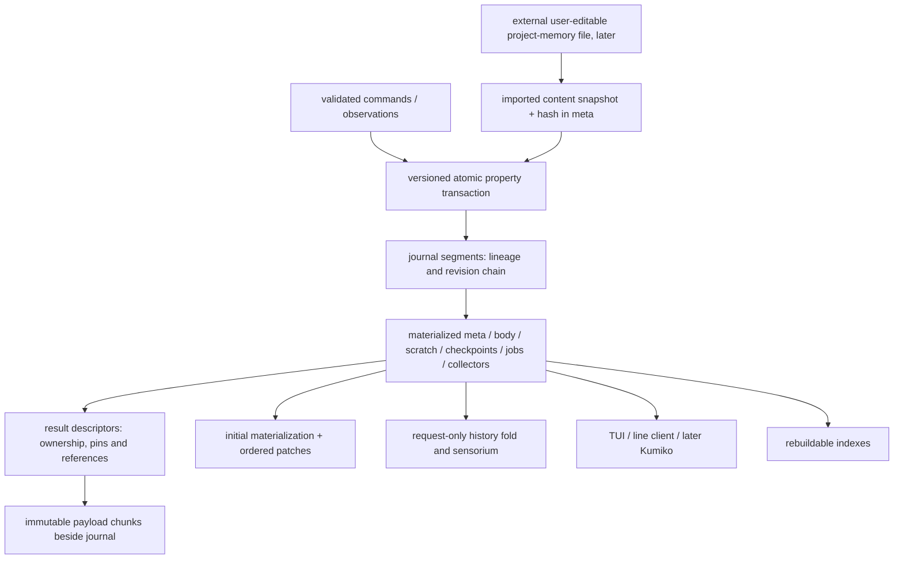

# kehai Architecture

## System triage

TIER: FULL

| Trigger | Applies | Evidence in the adopted design |
|---|---|---|
| T1 Components | Yes | Engine, clients, supervised processes and providers have directed relationships. |
| T2 State | Yes | Session tree, append-only journal, job/tool lifecycles and collector baselines. |
| T3 Concurrency | Yes | Streaming providers, jobs, collectors, FFI workers and speculative compaction. |
| T4 Boundaries | Yes | Journal schema, RPC, plugin protocol, LSP/MCP and native integration. |
| T5 Volume | Yes | Transcript, result bytes, workspace scans and subscriptions grow with use. |
| T6 Risk | Yes | Irreplaceable session history, filesystem effects, credentials and source disclosure. |

## Context and authority

Planning baseline, not implemented behavior. [Strategy](strategy.md) sets users and scope. Adopt [sensorium-spec.md](../docs/sensorium-spec.md) unchanged: [session model](../docs/sensorium-spec.md#session-model), [delivery](../docs/sensorium-spec.md#delivery-model), [snapshot](../docs/sensorium-spec.md#the-per-turn-snapshot), [tool results](../docs/sensorium-spec.md#tool-result-contract), [scratch](../docs/sensorium-spec.md#agent-scratchpad), [checkpoints](../docs/sensorium-spec.md#checkpoints-via-jj) and [folding](../docs/sensorium-spec.md#example-rendering-and-token-budget) are authority, not duplicated specifications. Its three locked decisions remain locked; ADR draft status does not reopen them. The current brief replaces its historical delivery slice labels, not its invariants.

M1 proves headless tree/journal/rewind/fork/resume, full results and handles, unified jobs, Anthropic and core `read`, hash-anchor `edit`, `write`, `bash`, `grep`, `find`, `ls`, handle paging/search, through a dumb line RPC client. No TUI. M2 adds nocterm, multiline input, Markdown/code, turn/budget/VCS/change/scratch projections and the renderer experiment. M3 adds diagnostics deltas, checkpoints/notices, journal-snapshot compaction, plugin hooks/tools/commands and more providers. Data-tier extensions, plugin collectors, typed subagents and OAuth remain later; no detailed design is implied here.

## Decisions

The [seven proposed ADRs](#adrs) record choices, structurally rejected alternatives and reversal costs. D1–D3 adopt the locked tree, truncation and job decisions separately. D4 chooses Dart-native headless engine/client boundaries over Rust core or a UI-owned engine. D5 proposes minimal atomic property transactions rather than JSON Patch or CRDTs. D6 chooses supervised process extensions over in-process code. D7 proposes perception/history folding, Windows attribution and measurable renderer bounds. All numerical implementation defaults below are **proposed for review**, not measured guarantees; inherited sensorium limits remain those in the linked authority.

## Components and diagrams

### T1 — component/process boundary

| Component | Responsibility / ownership boundary | Contract |
|---|---|---|
| `engine` | Headless session, journal, loop, tools, providers, jobs, collectors; single tree writer | Commands in; committed versioned patches out |
| `tui` / `cli` | nocterm projection only / argument and completion entry points; no session authority | Same RPC as line client; Kumiko later is a second client |
| Job supervisor | Process lifecycle, stdio persistence, deadlines, native resource reconciliation | Logical job nodes; ephemeral runtime capability map |
| Worker isolates | Hashing/parsing and synchronous FFI away from engine/UI event loops | Bounded typed messages tagged with revision and request ID |
| Integrations | Real detected Git Bash, PowerShell, nushell or fish where installed; bundled rg; native PTY | Explicit argv/cwd/environment; no embedded interpreter/runtime |
| Adapters | Thin Anthropic, OpenAI-compatible, Gemini and Bedrock; LiteLLM for others | Versioned normalized stream; credentials resolved outside tree |

Dart 3.x AOT targets native Windows without WSL, Linux x64/arm64 and macOS. AOT produces a native executable, **not** an all-assets-in-one-file promise: rg, C libraries and grammars require per-platform release packaging. Build/qualify on supported OS targets; Dart's documented cross-compilation support is limited to Linux targets. No Rust core, QuickJS, Python runtime or TypeScript-extension compatibility.

### T2 — tool state versus result status

Tool lifecycle and envelope statuses `ok/error/partial/denied/timeout` are distinct: a call can settle with an `error` envelope. Resume records interrupted/cancelled on former live **jobs** and finalizes unfinished tools as failed/cancelled; it adds no tool lifecycle state. A durable job stores logical identity/state and signal intent, never a raw OS handle or reusable PID as authority.

### T3 — ordered turn and concurrent work

### T4 — durable data and disposable projections

## State ownership

All tree changes, including observations proposed by workers/plugins, pass through the engine writer; producers are not additional writers.

| State | Sole writer | Lifetime / invalidation | Authoritative copy |
|---|---|---|---|
| `meta`, lineage, versions and imported configuration/input snapshots | Engine | Session; changes are transactions | Tree reconstructed from journal |
| `body`, call lifecycle, usage, result descriptors/ownership/pins/refs | Engine | Session; rewind appends restoration, compaction replaces only eligible transcript | Tree, not provider/client memory |
| `scratch` | Engine via validated commands | Until deletion or rewind past anchor; excluded from compaction | Tree; never recovered from project memory |
| `checkpoints` | Engine | Session; auto ring policy from spec, named entries retained | Tree; external VCS state may disappear |
| `jobs` and logical signal intent | Engine | Until terminal/removal; resume resolves lost live capabilities before commands | Tree |
| `collectors`, hash baselines, provenance and last-observed revisions | Engine | Rebuildable observations; invalidate on mutation/restore or stale revision | Tree, including attribution baseline |
| Journal segments and immutable result chunks | Engine persistence coordinator | Session-owned; payloads never mutated after sealing | Journal is replay authority; bytes have no independent session meaning |
| OS process/signal handles, transports, RPC cursors and worker requests | Runtime supervisor / each connection | Current process/connection only; recreate or discard, never replay | Runtime capabilities, **not session state** |
| Client render caches / optional SQLite indexes | Respective client / index builder | Bounded and disposable; rebuild from tree/journal | Never authoritative |
| Workspace, user plan/project-memory files, VCS repository | User and external tools; kehai is one participant | External to session; capture observations, do not claim sole ownership | Filesystem/VCS; imported memory snapshot is tree input only |
| Credentials | OS keychain/environment owner | Resolve when needed; not copied into journal/config snapshots | OS keychain or environment |

## Boundaries and contracts

**Persistence (D5, proposed).** UTF-8 NDJSON transaction envelopes contain format/schema version, lineage, transaction ID, base/result revision, ordered property operations and integrity digest. One line is one atomic transaction, not independent per-property commits. Large restorations are streamed through bounded I/O rather than constrained to one IPC frame. Minimal operations address stable node IDs. Reject JSON Patch for generic array/path addressing and unnecessary operation surface, not an inability to wrap it in versioned atomic envelopes; CRDT merge semantics are unnecessary for one writer. Validate the entire transaction before append, flush referenced immutable payload chunks first, durably append/flush the transaction, then acknowledge/publish it. An incomplete final line after a crash is uncommitted: preserve it and continue in a new segment linked to the last valid revision. Interior corruption, a complete invalid line or broken revision chain stops writes and reports recovery failure; never silently skip it. Version migrations are explicit, preserve original data and must not replay external effects. Settle the exact v1 operation/schema/migration fixtures in M1 before schema implementation, not after sessions ship.

**Rewind/fork/resume (D1/D3).** Rewind appends an atomic tree restoration; it never edits history or calls feature-specific rewind handlers. A generic reconciler compares live resources with current job nodes and kills resources no longer owned. Workspace restore is a separate VCS action; combined rewind cannot promise atomic rollback of external effects. Fork creates new lineage metadata and independently owned immutable payloads (copies/reflinks or deletion-safe reference ownership established before publishing the fork). Deleting the parent must not break the fork. Resume materializes and finalizes former live jobs as interrupted/cancelled before admitting commands. Never auto-reexecute a tool, provider request or workspace effect.

**RPC (D5).** Versioned commands/subscriptions over local stdio NDJSON; no network service. Send a versioned materialization at revision R in bounded begin/chunk/end frames, then ordered committed transactions after R. Large transactions also use begin/chunk/end framing and apply atomically only after the complete validated transaction arrives. Snapshot transfer and catch-up share bounded backpressure; if the retained window is lost, explicitly restart materialization. Commands carry request ID and expected revision; reject stale commands, never silently rebase. Before any effect, durably record admission in existing `body`/`meta`: request ID scoped to session/lineage, command type and matching input identity, resulting node/operation references and status. Reject ID collisions or mismatching commands; matching duplicates return the recorded outcome, not another execution. Reconnect inspection derives outcomes from tree/journal: `not-admitted` only with proven coverage of the queried session/lineage and log scope; `admitted/pending`; `completed/failed/cancelled`; or `interrupted/effect-uncertain` when external effects cannot be established. Lost external acknowledgement never permits automatic replay. Correlation and references survive bounded-history compaction; if relevant retained history cannot establish an outcome, return `unavailable`, never infer absence. There is no separate request database or exactly-once external-effect guarantee. Runtime cursors are advisory, never session truth. LSP framing is separate.

**Tools/results (D2).** Use the adopted [envelope, handles, paging/search and truncation rules](../docs/sensorium-spec.md#tool-result-contract). Full accepted user-process output is persisted, including raw tool stderr; streaming creates sealed chunks whose descriptors are patched into the tree. This output is distinct from harness-generated adapter/launch diagnostics, which must satisfy the credential boundary below before persistence. Rendering alone applies model-facing cuts. `notrunc` bypasses presentation caps, not transport/resource limits or provider context size; reject an oversized request explicitly rather than silently cut it. Hash-anchor edits re-read and verify current content at mutation time and reject stale anchors. Large files/results use bounded pages and streams, never whole-output buffers. `summarize_result` is optional/off by default and not an M1 requirement.

**Plugins/integrations (D6).** Lazy persistent, any-language local process plugins speak versioned stdio NDJSON with IDs, capabilities and typed request/result/event messages. Hooks participate in nonblocking orchestration with hard engine-enforced deadlines: mandatory policy failure denies; optional enrichment failure becomes no-op plus visible failure. No approvals subsystem is implied. Plugins offer tools/commands/hooks and declarative picker/form/status/panel/tool-card descriptions, never arbitrary Dart/nocterm widgets. Core-fork extension means intentionally changing/rebuilding core, not a bypass allowing external plugins in-process. MCP uses `dart_mcp` local stdio; its experimental status and cancellation limitations require supervisor deadlines. LSP uses `json_rpc_2` plus an application-owned **Content-Length framing adapter**, not NDJSON. C FFI work that can block runs away from the event loop; isolate messages do not share mutable Dart memory. Isolates do not contain native memory corruption: an FFI crash can kill the engine, which must recover from the journal without replaying effects. Missing shell/native assets fail the affected capability visibly, never fall back to an embedded interpreter.

**Trust/outbound.** Configured provider/proxy is the only harness outbound prompt sink; no telemetry, accounts or cloud service. MCP/plugins are local processes. Any future remote MCP requires separate explicit authorization, not a roadmap commitment. User-installed plugins and shell subprocesses have OS-user privileges and can themselves use the network: locality is not a sandbox or an egress guarantee. No automatic upload/endpoint discovery. Resolved provider/OAuth credentials, authorization headers, credential-bearing URLs and launch-environment dumps must never be persisted in tree, payloads or error logs. Adapter errors persist only allowlisted structured fields and a sanitized provider body; redact known credential/auth material before persistence, never store raw provider exceptions or request dumps. Integration failures remain visible with useful sanitized category/status/message. Give resolved credentials only to the relevant adapter; construct least-needed shell/plugin/MCP/LSP environments without inheriting provider keys by default. Explicit user-configured environment opt-in carries a clear trust caveat: subprocesses have user privileges and can expose supplied secrets. This prevents accidental inclusion of configured credentials by the harness, not secrets the user intentionally outputs or includes in source/raw tool stderr; no sandbox or all-user-output redaction is promised. Plain local journals remain sensitive, user-owned and deletable. Plugin UI text, tool output and repository files are untrusted data, not authority to change policy.

**Perception (D7).** Stable system content; ephemeral current sensorium is last user-role content before generation. Tree-derived rendering follows the exact [snapshot order](../docs/sensorium-spec.md#the-per-turn-snapshot), [fold order and immutable-section error](../docs/sensorium-spec.md#example-rendering-and-token-budget). Enforce hard ceilings with exact tokenizer measurement when available, otherwise a documented provider-safe conservative bound, never a hopeful estimate. The spec's mode table defines `delta` as changed fields since the last `full`, yet delivery removes all previous blocks: a truly delta-only block loses unchanged baseline facts when that full block is stripped. As a conservative supplement to the spec's open history-fold question, not a rewrite of its literal mode table, keep canonical tree/history unchanged and default one request-render fold switch to stripping previous blocks. Whenever stripping would remove unchanged facts needed to interpret the delta, render the current full snapshot and honestly mark it `full`, subject to the exact inherited fold order, hard ceiling and immutable-section error. Most stripped turns therefore send full snapshots, increasing per-turn tokens; never relabel a delta-only block as self-contained. Delta delivery is experimental only when its model-visible full baseline is preserved, for example the same switch's retention arm in M2 A/B; retaining multiple blocks is not the adopted default. Compare equivalent task outcomes and retention of unchanged VCS, user-change and diagnostic facts alongside tokens and prefix-cache metrics. Removing earlier blocks can invalidate a historical cache suffix even with a stable system prompt; no cache neutrality is claimed. Verify provider behavior, especially Gemini/Bedrock, when each adapter lands.

Windows change detection uses bounded hash-on-turn-boundary scans as authority, watchers only as hints; mtime alone is insufficient. Persist baselines/provenance in collector nodes. Partial scans retain explicit stale/partial coverage. `by: user` means outside recorded tool provenance, not verified human identity. External project memory remains later: import content/hash into `meta`, never reconstruct scratch from it; pin export is deferred. Compaction uses a journal-derived snapshot, validates lineage and revision before atomic splice and discards stale work; retain scratch, result ownership/handles and request correlation/references in existing `body`/`meta`.

## Resource bounds and failure visibility

This table owns proposed tunable runtime defaults; references elsewhere do not introduce additional caps. Sensorium/tool presentation, scratch, checkpoint ring and diagnostics-settle limits are owned by the linked spec. Reject invalid configurations before a turn.

| Flow / store | Bound and behavior at bound | Failure/recovery; visibility and retry |
|---|---|---|
| Commands / journal writer | 64 pending commands and 4 MiB queued metadata; 1 MiB IPC frame; journal transactions streamed with working sets bounded by the session tree budget, including large rewind diffs | Reject admission before effects when full/oversized. Writer failure stops mutations, visible to client/stderr. Inspect durable revision before retry; effects never auto-retried. |
| Streams / worker transfers | 64 KiB chunks; 1 MiB queued per producer; pause reads/apply backpressure, never drop bytes | If producer cannot pause safely, cancel and record explicit partial/error. Disk-full stops ingestion and execution; show persistence failure even if it cannot itself be journaled. |
| Session tree / journal / payloads | Configurable admission budget, proposed 256 MiB decoded tree and 10 GiB durable session data; reserve 1 MiB for terminal failure records. No automatic deletion; refuse new work at high-water | Existing result pages remain readable; user sees storage pressure. Append final status using reserve; if unavailable, stop and report out-of-band. 10x/100x requires paging, archiving/deletion or explicit larger budgets, not hidden eviction. |
| RPC / plugin / LSP / MCP messages | Per-connection queue 1 MiB; protocol frame cap above. Large bodies use handles/pages. Oversized external frames fail that connection visibly | Slow RPC gets resync/disconnect, not a missing patch. Restart a transport explicitly; never retry tool effects. LSP header parser applies the cap before allocating its body. |
| Jobs / blocking work | 8 active jobs, 32 waiting; overflow rejected. Single 1 s foreground blocking budget then job handle. Cancel grace 2 s then forced termination | Supervisor owns deadlines and continues draining/spooling, not UI. Launch/death/cancel visible in tree; process-group/ConPTY cleanup qualified per platform. No automatic relaunch. |
| Collectors / hashing / workers | 4 concurrent workers; collector deadline from spec; scans stop after 10k files or 64 MiB per turn and show coverage, continuing via tree-held cursor | Discard obsolete results; keep visibly stale values. Worker death fails its request; restart observations only. Native engine crash resumes from journal. No false complete attribution at 10x/100x. |
| Provider streams | 1 active turn/session; 60 s idle and 10 min overall deadlines, user configurable; stream through bounded producer path | Timeout records available partial result and usage uncertainty. Network/auth errors show actual failure; no blind paid-request retry. |
| Plugin hooks / other requests | Policy/enrichment hook 300 ms; tool requests use the unified job budget; startup/handshake 5 s | Deadline enforced outside plugin. Default deny or visible no-op by hook class; user can explicitly restart failed process. |
| History / composer / compaction | One active compaction; request bounded by provider context and sensorium ceilings; transcript/result payloads paged; reject an over-context `notrunc` request | Stale compaction discarded. Composer budget/configuration failure blocks generation visibly; canonical history remains intact. |
| Projection / indexes | Visible viewport + overscan only; proposed 8 MiB render cache, 64 MiB disposable index cache; evict/rebuild; paged query results | Client crash reconnects/resyncs without losing session. Index failure falls back to journal/tree access with visible degraded status. |

At 10x/100x normal transcript/output/workspace volume, correctness stays unchanged: disk payloads and journal grow within explicit budgets, projections page, producers backpressure, scan coverage becomes partial, and admissions fail visibly rather than allocating in proportion to total output. Performance at these sizes is an acceptance experiment, not yet a result.

**Renderer experiment (M2, proposed).** On a 5k-line transcript, target p95 full **visible-viewport** redraw ≤16 ms and streaming append ≤1 ms. Use release/AOT, warmed runs, declared Windows and Linux terminal versions, viewport sizes, hardware and dataset. Time build/layout/paint/diff/emission to a controlled sink; record terminal flush separately. Benchmark early M2 before relying on nocterm's differential/batched rendering. If it misses, implement a custom one-pass viewport transcript renderer under nocterm components, not a framework replacement. M1 contains no TUI code or renderer benchmark implementation.

## Flow and state gaps

| Gap | Required behavior / proposed resolution |
|---|---|
| Payload persisted but transaction not committed | Bytes alone are not session facts. M1 performs no automatic payload GC; later cleanup must preserve all retained journal revisions and fork owners, not merely the current materialization. |
| Durable launch intent but crash before/after process launch | Resume marks unresolved job interrupted; cannot infer whether external effects occurred. Never relaunch. |
| Rewind races with output or worker completion | Serialize restoration; reject callbacks for removed node/invocation generation. Generic reconciler kills removed resources; already-written workspace bytes remain. |
| Fork/delete race | Establish child payload ownership before publishing child lineage; parent deletion cannot remove child-owned payloads. |
| Runtime signal fails or child outlives cancellation | Show cancellation/cleanup failure; retain resource until confirmed exited or capability is lost. No claim that rewind undoes effects or that all descendants always die. |
| Collector late/out of order; user edits during scan | Commit only matching observation revision/generation; mark partial/stale; next turn reobserves. Mutation-time hash anchors remain the last guard. |
| Workspace restore succeeds but session update fails | Report repository outcome separately; restart observes actual VCS state. Combined rewind is an ordered workflow, not a distributed transaction. |
| Connection drops before command acknowledgement | Inspect durable session/lineage-scoped request correlation in tree/journal; distinguish proven not-admitted, pending, terminal, effect-uncertain and unavailable. Never replay automatically or infer absence from compacted history. |
| Compaction races with new turn or rewind | Revision/lineage validation fails: discard candidate, keep original tree and handles. |
| Credential-like bytes appear in source/output | User-produced source/raw tool stderr is not automatically scrubbed or encrypted. Harness-generated adapter/launch diagnostics are sanitized before persistence and default subprocess environments exclude provider keys. |

## Mechanism ledger

| Mechanism | Build? | Why / evidence that would change the decision |
|---|---|---|
| Single writer, durable transactions, version/integrity checks | M1 | Crash/torn writes and concurrent callbacks can corrupt irreplaceable session state; stored format is costly to retrofit. |
| Resource reconciler, bounded queues, stale-generation rejection | M1 | Rewind can remove a running job while output is arriving; slow consumers can otherwise exhaust memory. |
| Separate immutable payloads plus deletion-safe fork ownership | M1 | Full outputs exceed memory; parent deletion must not invalidate a fork. |
| Watcher hints plus hash authority | M2 | Windows watcher/mtime misses can hide outside edits; scans must show incomplete coverage. |
| Hook deadline/default classification | M3 | A hung/crashed plugin must not hold a turn hostage or silently approve policy. |
| Speculative snapshot validation | M3 | A concurrent turn can invalidate a proposed splice. |
| SQLite index, retries, restart loops, filesystem snapshots, remote relay | Not required/built | Index only if measured query cost needs it; others add independent state/effect risks. Reconsider with measured bottlenecks or separately authorized scope, not speculative resilience. |
| Embedded runtime, in-process plugin UI/code, Rust core | Rejected | They enlarge crash/runtime and maintenance boundaries without evidence this Dart/process design fails. |

## Risks and trade-offs

- **Custom journal wire format (high reversal cost)** → freeze v1 only after M1 randomized replay/rewind/fork/resume, torn-write and migration fixtures; property tests must precede UI implementation.
- **Dart/native and terminal uncertainty** → platform packaging/PTY qualification; synchronous FFI on workers; renderer gate before rich-client expansion. No measured performance claimed.
- **Local code is powerful, not sandboxed** → explicit local installation/configuration, visible failures, no hidden outbound harness services; do not invent a security guarantee.
- **Whole-repo hashing is costly** → bounded partial coverage and honest staleness; reject stale writes rather than assert complete protection from races.
- **Plain journals may contain private data** → user ownership/deletion, credentials outside journal, no automatic uploads; encryption is not silently promised.

## ADRs

Accepted after [baseline review, round 2](architecture-review.md), 2026-10-28.

| ADR | Decision | Supersedes |
|---|---|---|
| [0001](../docs/adr/0001-one-session-tree.md) | One authoritative session tree — locked foundation | None |
| [0002](../docs/adr/0002-central-result-truncation.md) | Central model-rendering truncation and full-result handles — locked foundation | None |
| [0003](../docs/adr/0003-unified-job-lifecycle.md) | One supervised job lifecycle — locked foundation | None |
| [0004](../docs/adr/0004-dart-native-engine-and-clients.md) | Dart-native headless engine and projection clients; no Rust core | None |
| [0005](../docs/adr/0005-versioned-journal-and-rpc.md) | Minimal versioned atomic journal and local RPC | None |
| [0006](../docs/adr/0006-process-extensions-and-integrations.md) | Process plugins and explicit integration trust boundaries | None |
| [0007](../docs/adr/0007-tree-derived-perception-and-rendering.md) | Tree-derived perception, safe history folding and measured rendering | None |

## Open questions and evidence to collect

No unresolved choice is permitted to change the locked invariants. Proposed journal operations/defaults need review before M1 schema implementation; history-fold/cache behavior, Windows scan costs and renderer thresholds have the explicit experiments above. Later non-binding details: user-facing sensorium name, shell preference ordering among detected shells, and native asset packaging layout. Later feature design must separately settle pin-export UX and user scratch-write provenance without creating a side store.

## Stack evidence

Primary documentation checked for this baseline: [Dart AOT and cross-compilation](https://dart.dev/tools/dart-compile), [C interop](https://dart.dev/interop/c-interop), [isolate memory/execution](https://api.dart.dev/dart-isolate/), [nocterm](https://github.com/Norbert515/nocterm), [dart_mcp experimental API](https://pub.dev/documentation/dart_mcp/latest/), [json_rpc_2 String StreamChannel interface](https://pub.dev/documentation/json_rpc_2/latest/). These establish boundaries, not measured latency or complete platform qualification.
