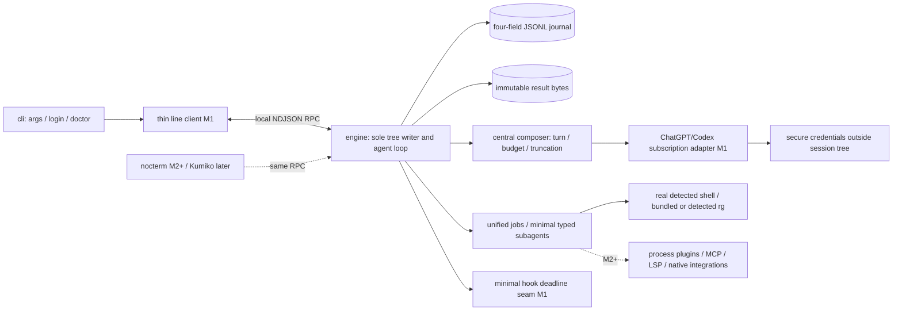
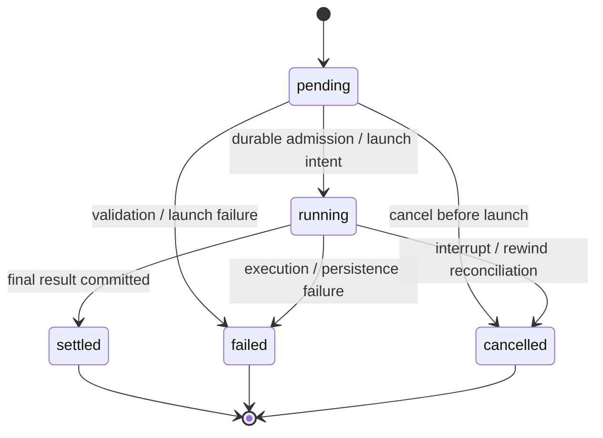
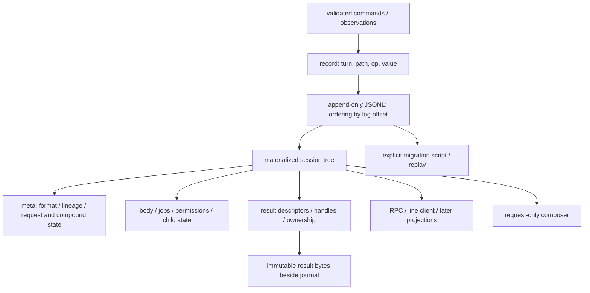

# kehai Architecture

## System triage

TIER: FULL

| Trigger | Applies | Evidence in the proposed design |
|---|---|---|
| T1 Components | Yes | Headless engine, thin clients, supervised processes and provider adapters. |
| T2 State | Yes | One session tree, append-only journal and tool/job lifecycle. |
| T3 Concurrency | Yes | Provider streams, parallel tools, interruption and late callbacks. |
| T4 Boundaries | Yes | Journal, local RPC, subscription auth and process integration. |
| T5 Volume | Yes | Transcript and complete result bytes grow with use. |
| T6 Risk | Yes | Session history, external effects, credentials and source disclosure. |

## Context and authority

Planning baseline, not implemented behavior. [Strategy](strategy.md) sets purpose; [roadmap](roadmap.md) owns milestones and exit criteria. Adopt [sensorium-spec.md](../docs/sensorium-spec.md) unchanged: [session model](../docs/sensorium-spec.md#session-model), [delivery](../docs/sensorium-spec.md#delivery-model), [snapshot](../docs/sensorium-spec.md#the-per-turn-snapshot), [tool results](../docs/sensorium-spec.md#tool-result-contract), [scratch](../docs/sensorium-spec.md#agent-scratchpad), [checkpoints](../docs/sensorium-spec.md#checkpoints-via-jj) and [folding](../docs/sensorium-spec.md#example-rendering-and-token-budget) remain authority. Its three locked foundations—one tree, central truncation/full-result handles and unified jobs—are unchanged. The user-directed M1 amendment replaces historical delivery labels, not these invariants.

**M1: Self-hosting skeleton.** Kehai builds Kehai: subscription OAuth for ChatGPT/Codex; tree/journal and result handles from the first change; core tools and minimal permissions; a parallel agent loop and thin line client; installed skills, commands and enough typed subagents to execute the real Specwright workflow. The sixth roadmap entry is the authorized bridge to the first real M2 change, performed with Kehai as sole agent before M1 promotion and counted once in M2. Loading markdown or completing a docs-only rehearsal is not that gate.

M1 sensorium is only `turn`, `budget` and central truncation. Broader VCS/changes/scratch/diagnostics/checkpoints sensorium is M2, built on the M1 tree. Nocterm, compaction, LSP, jj checkpoints, the full plugin protocol, MCP, Anthropic OAuth, a pricing/model registry and themes are deferred to M2+; no exact M3 delivery promise is made. More providers and data-tier extras are later. M1 requires native Windows line client and login; full Windows tool parity is an M2 exit. Linux remains the primary real workflow. No TUI, full PTY/ConPTY integration or native parsing/packaging program is an M1 prerequisite unless a specific self-hosting need proves essential.

## Decisions and per-M1 design contract

The [seven accepted ADRs](#adrs) capture locked foundations and implementation boundaries. D4 chooses Dart-native headless execution; D5 fixes the minimal journal shape and thin RPC; D6 separates minimal M1 hooks/auth/workflow integration from later extensions; D7 scopes perception and measurement. Defaults below are proposals, not measured guarantees or mandatory feature breadth.

Every M1 change design must apply the [roadmap](roadmap.md) and [OpenSpec configuration](config.yaml), explicitly restating the locked foundations, M1 sensorium/deferred scope, Windows qualification and dogfood attempt rule. Entries 1–5 keep the skeleton scope; after they are ready, entry 6 permits only its selected first M2 capability, not broad M2 pull-forward or a wrapper planning PR. Dart/native/tree constraints still apply to that bridge. From entry 4 onward, attempt each apply inside Kehai (entry 4 once its earliest runnable loop exists), recording work it could not do; most M1 implementation may use Claude Code. Entry 6 must use Kehai alone, including usable internal reviewer roles, for the actual plan/implement/commit/finish/merge workflow; another agent harness is not required to pass. Each design pins full commit revisions and exact source files for adopted behavior rather than rederiving existing implementations. Entry 1 settles journal operations, compound-update crash behavior, migration script and randomized replay tests; entry 2 verifies all three auth implementations below and records exact OAuth/service parameters, expiry/refresh, breakage risk, reversal cost and any API-key fallback. The baseline review has passed (see [ADRs](#adrs)); each change still needs its own design review before implementation.

## Components and diagrams

### T1 — component/process boundary



The engine owns session, journal, loop, tools, provider normalization and jobs; clients render committed state and submit commands, never own sessions. Provider interface normalizes streaming, count/usage and tool calls; count may use a documented conservative estimate when exact counting is unavailable. A pricing registry is not needed for budget correctness. Jobs own process lifetime, stdio, deadlines and typed child results; role selection must map installed Specwright implementer and required review routes to runnable minimal subagents, not promise unavailable routes.

Use Dart 3.x AOT, no Rust core, WSL, embedded Python/QuickJS or TypeScript-extension compatibility. Run actual shells (including detected Git Bash or PowerShell on Windows), not shell emulation. C FFI, parser assets and PTY/ConPTY are later integrations unless essential to the scoped workflow; blocking native work must stay off the engine event loop. Native release packaging is per target, not an all-assets-in-one-file promise.

### T2 — tool state versus result status



Tool lifecycle differs from envelope statuses `ok/error/partial/denied/timeout`: a call can settle with an error result. Logical job state and signal intent belong to the tree; raw handles/PIDs are ephemeral capabilities. Resume finalizes unfinished tools/jobs as `cancelled` with reason `interrupted` (or `failed` when they had already failed) before admitting new commands; it never relaunches recorded effects.

### T3 — ordered turn and concurrent work

```mermaid
sequenceDiagram
  participant C as Thin RPC client
  participant E as Engine single writer
  participant J as Journal / result bytes
  participant P as Provider
  participant T as Parallel tools / child jobs
  C->>E: command(requestId, expected offset)
  E->>J: append admission property record(s)
  E-->>C: committed state / offset
  E->>P: composed request with turn / budget
  P-->>E: normalized stream / tool calls
  E->>T: approved independent calls
  loop concurrent results
    T-->>E: invocation-tagged bytes / typed result
    E->>J: persist bytes then append reference / state record
    E-->>C: ordered state / token / tool events
  end
  E->>J: append completion property record
  Note over E,T: Interrupt cancels live work; stale callbacks cannot restore removed state
```

### T4 — durable data and projections



## State ownership

All durable session facts pass through the single engine writer: messages, permissions/approval decisions, request admission/outcomes, child-agent state, result metadata and later scratch/checkpoints/collector baselines. They belong to the tree reconstructed from the journal, never a request database, child registry, snapshot-primary store or feature side store. Format version, lineage and correlation can live in `meta`; ordering derives from log offsets, not extra record fields. Immutable result bytes are session-owned payloads with tree descriptors, not independent session authority. Configuration and secure auth credentials are explicit external inputs/exceptions, not another durable session store; imported nonsecret inputs may be captured in tree state. User workspace/VCS files remain external facts, not Kehai-owned session state. OS handles, transport cursors and in-flight runtime maps are disposable capabilities; they cannot substitute for tree-held admission or lifecycle facts.

## Boundaries and contracts

**Journal (D5).** Each UTF-8 JSONL record has exactly `{turn,path,op,value}`. The atomic append boundary is one record, not a transaction envelope. No mandatory digest, transaction ID, revision chain, segments, SQLite or native-memory-cap storage architecture. Validate a property operation, persist any referenced immutable bytes, durably append its record, then publish it. Compound operations record admission/completion in the tree so interrupted multi-record updates are detectable. The first design settles the minimal operation vocabulary, path identity, recovery behavior for incomplete compound updates and torn trailing records, plus an explicit migration script preserving originals. Complete invalid records/interior corruption stop writes visibly; never silently skip history. Replay must deterministically reproduce the identical tree for randomized histories. Snapshots cannot become primary persistence, and migration/recovery never execute tool/provider/workspace effects.

**Rewind/fork/resume (D1/D3).** Rewind/fork are journal operations in M1, without UI or elaborate branch/resource-management features. Rewind appends restoration rather than editing history; generic reconciliation cancels live resources no longer owned and rejects obsolete callbacks. Fork must preserve referenced result access and parent-deletion safety wherever required by the journal invariants; defer broader fork management. Interrupted compound restoration must be detected and resolved under the first design's rules before commands resume. Workspace restore is separate; neither rewind nor cancellation rolls back external effects. Resume reconstructs logical state and marks unresolved effects uncertain, never automatically reexecuting them.

**RPC and loop (D5).** `kehai rpc` is local NDJSON stdio; the readline client is a thin projection, streaming tokens and one line per tool call. Establish initial materialization plus ordered updates using log offsets. Offsets are runtime cursors, not stable identity: migration or torn-tail truncation changes them, so clients must resync from a fresh materialization afterwards; exact framing/backpressure is entry 4 design work, not a storage-platform prerequisite. Commands use request correlation and expected state; reject stale/colliding inputs rather than silently rebase. Record admission before effects and completion in existing tree nodes; matching duplicates inspect the recorded outcome, not execute again. Rewind removes turn-anchored content but must not remove request admission/outcome correlation; otherwise a duplicate arriving after rewind would execute again. Entry 1 settles where these records anchor. Reconnect distinguishes proven not-admitted, pending, terminal, interrupted/effect-uncertain and unavailable; missing acknowledgement is not permission to retry. Support parallel independent tools and Ctrl-C cancellation. Bounded exponential backoff is only for known-unadmitted requests or transient setup failures proven safe to retry; never automatically duplicate tools, effects or uncertain paid requests. Exhaustion is visible. Context overflow stops clearly; compaction is M2+.

**Tools, results and permissions (D2).** M1 includes numbered/hash-tagged `read` (hash every N lines), loud hash-anchor `edit`, `write`, real-shell `bash`, `grep`, `find`, `ls` and structured `ask`, enough to run `dart test`, `dart analyze` and `jj`. Re-read at mutation time and loudly reject stale or moved anchors; do not import upstream drift-remapping or snapshot side stores. Use bundled or detected `rg`. A short read-only autoapprove allowlist, extended only by a user-owned allowlist in user configuration (never repository content), runs without prompting; all other calls ask, with explicit user `--yolo` override. Shell prefix matching is insufficient: metacharacters, substitutions and mixed commands ask unless the entire command is proven read-only. Decisions live in the tree, not UI memory. Foreground budget expiry returns a unified job handle while output continues to persist. Every result uses the central [envelope/handle/paging/search/truncation contract](../docs/sensorium-spec.md#tool-result-contract), beginning in change 1; no tool-local cuts. Full accepted stdout/stderr bytes persist; model-facing composer alone cuts. `notrunc` cannot bypass provider context capacity: reject impossible requests visibly. Large results stream/page rather than buffer whole output.

**Skills, commands and hooks (D6).** Load `SKILL.md` from `.claude/skills/` and `.agents/skills/`, inject applicable `AGENTS.md`, and adapt installed `/opsx:*` and `specwright-*` commands, including existing `.claude/commands/opsx/*.md` definitions/aliases, arguments and skill path substitutions such as `skill-dir`; not every command is a `SKILL.md`. Minimal typed-return subagents are unified jobs, mapping installed `.claude/agents/specwright-implementer*.md` and `specwright-reviewer.md` roles plus usable role/model configuration to the required workflow. M1 hooks are only an engine-enforced timeout seam and hung-process fixture: optional hook timeout is a visible safe no-op, a minimal deny-class policy fails closed. Neither can gate the turn indefinitely. Hook policy is independent of core tool approvals and does not imply a broad plugin framework. M2+ process plugins may use versioned stdio NDJSON and declarative UI, never arbitrary in-process widgets. MCP/LSP and their protocol framing are deferred; local subprocesses run with user privileges, not a sandbox.

**Subscription auth and trust (D6).** `kehai login openai` must complete ChatGPT/Codex subscription OAuth without an API key; `kehai doctor` displays account/model availability. Use a secure OS keychain on Windows; Unix may instead use `~/.kehai/auth.json` with mode `0600`. A chmod claim does not secure Windows: fail closed when a permitted secure backend is unavailable. Credential Manager caps a blob at about 2.5 KB, which ChatGPT tokens can exceed; entry 2 splits the secret or uses a DPAPI-protected file, through Dart FFI to system libraries with no bundled native assets. Refresh silently until reauthentication is necessary, then show a useful sanitized error. The entry 2 design source-verifies exact PKCE/state, redirect port/URI, scopes, token/refresh/expiry handling and the endpoint valid for that subscription token; do not assume it works against a standard `/v1` API. API-key OpenAI or Anthropic may share that PR only if genuinely free from the interface, otherwise M2; fallback never satisfies subscription acceptance.

The configured provider is the only harness prompt sink; OAuth intentionally contacts the verified auth service. No Kehai telemetry or hosted account service. Resolved credentials, auth headers, credential URLs and environment dumps never enter journal, payloads or logs. Persist only useful allowlisted/sanitized adapter failures, not raw exception/request dumps. Give credentials only to the adapter; do not inherit provider secrets into shell/child/plugin environments by default. User source/raw process output can contain secrets and is not universally redacted or encrypted. Repository content, skills and tool/plugin output are untrusted data, not authority to change approval policy. Future remote integrations require separate authorization.

**Perception (D7).** M1 renders only current turn/budget and central result truncation from tree state; exact counts where available, documented conservative estimates otherwise, with visible stop on overflow. No pricing registry or broad sensorium collectors are needed. M2 broader perception follows the unchanged snapshot/fold order and ceilings. A delta-only block loses unchanged facts if its full baseline is removed: proposed request-only folding emits an honestly marked full snapshot whenever stripping prior blocks would lose needed facts, while leaving canonical history unchanged. Preserve source authority and review this supplement before adoption; compare retained facts/task outcomes, tokens and cache effects rather than claim cache neutrality. Windows change scans later use hashes as authority and watchers as hints, with explicit partial/stale coverage. Compaction/checkpoints/LSP are M2+; any later compaction preserves scratch, handles and tree-held request/child correlation, validates lineage/state and never replaces the journal as authority.

## Resource bounds and failure visibility

Choose small, tunable defaults in each change design, not mandatory platform breadth here. Bound concurrent work and producer/consumer queues; stream full output to disk and page handles. Slow consumers backpressure or visibly disconnect/resync; no dropped bytes disguised as success. Storage failure stops ingestion/effects, preserving available results and reporting partial/error out-of-band if persistence itself fails. Foreground/job, provider-idle and hook deadlines are independently enforced by the engine. Cancellation shows cleanup failures and uncertain external outcomes; it never claims all descendants died without evidence. Hook deadlines are separate from the spec's 300 ms collector timeout: a hook spawns a process, and Git Bash or PowerShell startup on Windows can exceed 300 ms, which would skip every optional hook and make every deny-class hook deny. Entry 3 measures hook process startup on Linux and native Windows and sets the default above it; exact job/concurrency/transport sizes are design decisions, not a requirement for a session storage platform. No automatic session deletion, hidden eviction, retry loops or fixed decoded-tree/native-memory budget is introduced.

Later renderer experiment: early in nocterm work, measure a 5k-line transcript in release/AOT, visible viewport only, declared hardware/terminal/viewports, warmed controlled-sink layout/paint/diff/emission and terminal flush separately. Proposed targets are p95 redraw ≤16 ms and append ≤1 ms. If missed, consider a one-pass transcript renderer within nocterm before replacing the framework. These are unmeasured proposals, not M1 work or acceptance evidence.

## Risks and review gates

- **Job invariants:** entry 1 proves journal-only rewind/fork; entry 3 owns the job supervisor, rewind reconciler and resume finalization, and must prove rewind of running jobs, cancellation, crash recovery and stale-callback rejection.
- **Journal reversal cost:** entry 1 must prove randomized identical-tree replay, torn-write/compound recovery, migration, rewind/fork and result access. Minimal records do not imply atomic multi-record updates; the design must resolve interruption without metadata envelopes or side stores.
- **Subscription/service breakage:** use source-driven auth/service behavior, secure storage and visible reauth; API-key success is not the M1 gate. Refresh concurrency and secret-safe errors need review, not invented protocol constants now.
- **Real workflow viability:** installed commands, typed roles and review routes must actually complete a real first M2 change with Kehai alone. Do not substitute loading files or an empty planning PR.
- **Platform scope:** Windows login/line client in M1, tool parity in M2; no WSL. Native PTY/parser packaging and renderer experiments must not inflate the skeleton.
- **Effects and privacy:** uncertain provider/tool execution is never replayed; plain local session data remains sensitive. Local execution is powerful, not sandboxed; permission prompts and hook deny policy are distinct.

## ADRs

All seven ADRs accepted on 2026-10-28 after [amendment review, round 4 and required-change recheck](architecture-review.md). The three foundations remain locked.

| ADR | Decision | Supersedes |
|---|---|---|
| [0001](../docs/adr/0001-one-session-tree.md) | One authoritative session tree — locked foundation | None |
| [0002](../docs/adr/0002-central-result-truncation.md) | Central truncation and full-result handles — locked foundation | None |
| [0003](../docs/adr/0003-unified-job-lifecycle.md) | Unified supervised jobs — locked foundation | None |
| [0004](../docs/adr/0004-dart-native-engine-and-clients.md) | Dart-native headless engine and thin clients | None |
| [0005](../docs/adr/0005-four-field-journal-and-rpc.md) | Four-field JSONL journal and local RPC | None |
| [0006](../docs/adr/0006-subscription-auth-workflow-and-process-boundaries.md) | Subscription auth, workflow and process boundaries | None |
| [0007](../docs/adr/0007-tree-derived-perception-and-rendering.md) | Minimal M1 perception; later measured presentation | None |
| [0008](../docs/adr/0008-journal-format-v1.md) | Journal format v1: operations, paths, rewind and result handles | None |

## Source reference map

Pinned **discovery candidates**: file existence at these full revisions was checked through GitHub; this is not an inspected implementation audit, proof of service compatibility or Kehai format compatibility. Consuming designs must read the cited files, record what they learned, and reverify current OAuth/service behavior before adopting it. Do not freeze OAuth constants from snippets.

| Reference | Full revision | Exact files / investigation and limitation |
|---|---|---|
| OpenAI Codex login | `7c11b8074dbdbab2a3afedf30df7c55f0c6907d8` | [server.rs](https://github.com/openai/codex/blob/7c11b8074dbdbab2a3afedf30df7c55f0c6907d8/codex-rs/login/src/server.rs), [oauth/authorization.rs](https://github.com/openai/codex/blob/7c11b8074dbdbab2a3afedf30df7c55f0c6907d8/codex-rs/login/src/oauth/authorization.rs), [oauth_session_login.rs](https://github.com/openai/codex/blob/7c11b8074dbdbab2a3afedf30df7c55f0c6907d8/codex-rs/login/src/oauth_session_login.rs), [auth/manager.rs](https://github.com/openai/codex/blob/7c11b8074dbdbab2a3afedf30df7c55f0c6907d8/codex-rs/login/src/auth/manager.rs): inspect login/callback/PKCE/exchange/refresh in entry 2. |
| oh-my-pi Codex auth | `76772d0c9729d95db30b60a7949dfbfdf47fd7f0` | [packages/ai/src/registry/oauth/openai-codex.ts](https://github.com/can1357/oh-my-pi/blob/76772d0c9729d95db30b60a7949dfbfdf47fd7f0/packages/ai/src/registry/oauth/openai-codex.ts): inspect subscription login/account/expiry/refresh. |
| OpenCode built-in historical auth | `ec3ae17e4d6abb9685b1d558d5e51416c9bfad60` | [packages/opencode/src/plugin/codex.ts](https://github.com/anomalyco/opencode/blob/ec3ae17e4d6abb9685b1d558d5e51416c9bfad60/packages/opencode/src/plugin/codex.ts): historical discovery reference, not proof of current support. |
| Separate third-party OpenCode plugin | `bec2ad69b252ef4ad7dd33b9532ff8b4fdb6d016` | [index.ts](https://github.com/numman-ali/opencode-openai-codex-auth/blob/bec2ad69b252ef4ad7dd33b9532ff8b4fdb6d016/index.ts): distinct third-party entry, not OpenCode's built-in plugin; trace its auth modules before adopting behavior. |
| oh-my-pi hashline | `d94bdfa1bb25e50cf90fb57fefb1863e5aef86fc` | [patcher.ts](https://github.com/can1357/oh-my-pi/blob/d94bdfa1bb25e50cf90fb57fefb1863e5aef86fc/packages/hashline/src/patcher.ts), [recovery.ts](https://github.com/can1357/oh-my-pi/blob/d94bdfa1bb25e50cf90fb57fefb1863e5aef86fc/packages/hashline/src/recovery.ts), [snapshots.ts](https://github.com/can1357/oh-my-pi/blob/d94bdfa1bb25e50cf90fb57fefb1863e5aef86fc/packages/hashline/src/snapshots.ts): inspect hash validation, without adopting drift recovery or side stores; Kehai loudly rejects moved/stale anchors. |
| Pi session format | `ad702637fdf6fbd3f965c5dba0b14bae100b74eb` | [session-format.md](https://github.com/badlogic/pi-mono/blob/ad702637fdf6fbd3f965c5dba0b14bae100b74eb/packages/coding-agent/docs/session-format.md), [sessions.md](https://github.com/badlogic/pi-mono/blob/ad702637fdf6fbd3f965c5dba0b14bae100b74eb/packages/coding-agent/docs/sessions.md): inspect JSONL message-tree/branching concepts; not authority for Kehai's four-field journal. |

Stack boundary references: [Dart AOT/cross-compilation](https://dart.dev/tools/dart-compile), [C interop](https://dart.dev/interop/c-interop), [isolates](https://api.dart.dev/dart-isolate/), [nocterm](https://github.com/Norbert515/nocterm), [dart_mcp experimental API](https://pub.dev/documentation/dart_mcp/latest/), [json_rpc_2](https://pub.dev/documentation/json_rpc_2/latest/). They establish options, not measured latency, complete platform qualification or M1 dependencies.
