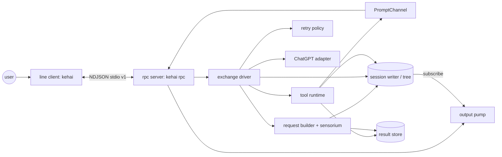
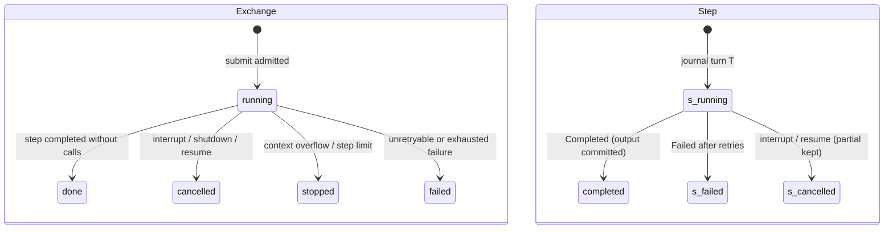
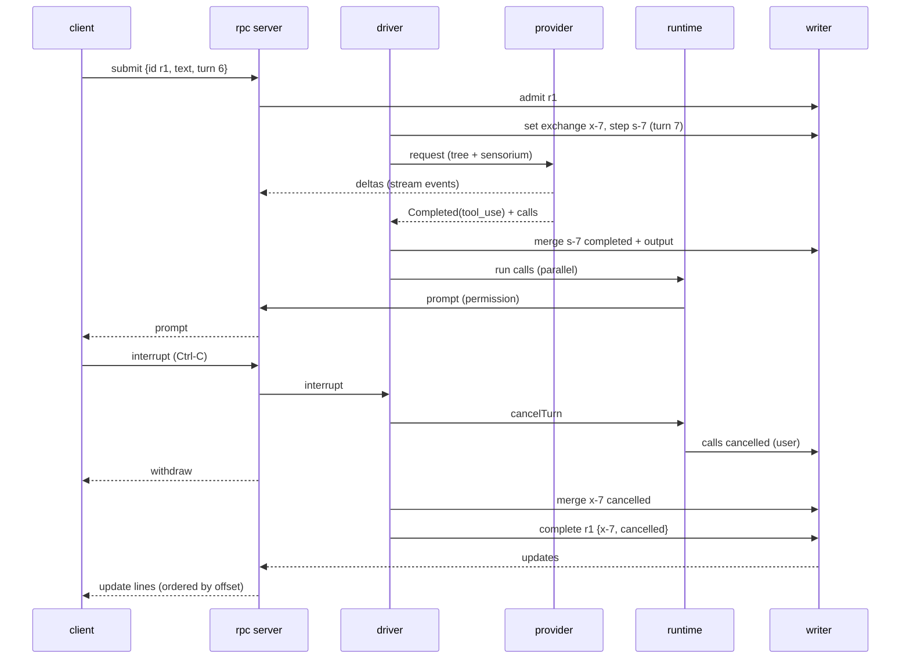
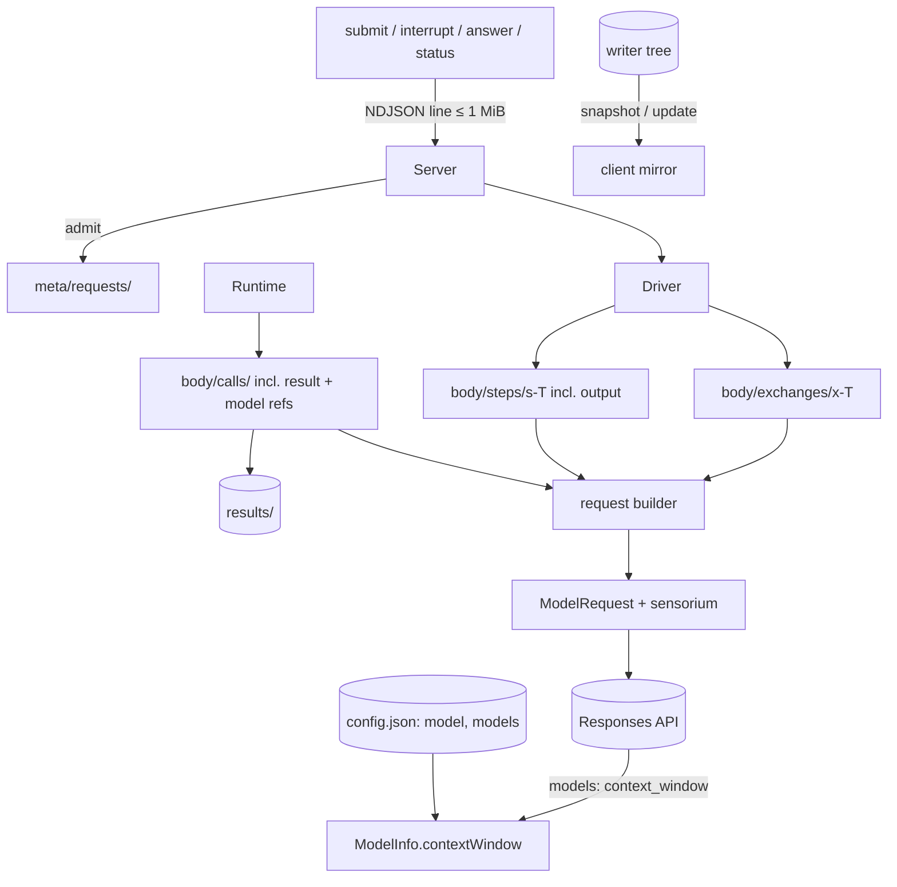

# Design

## Triage

| Trigger | Applies? | Evidence |
|---|---|---|
| T1 Components (new component, or 3+ with directed relationships) | Yes | New loop driver, request builder, RPC server, NDJSON codec and line client. A new two-process shape (client → `kehai rpc`). Directed edges into the writer (`lib/src/session/writer.dart:189`), the tool runtime (`lib/src/tools/runtime.dart:169`) and the provider (`lib/src/provider/provider.dart:21`). |
| T2 State (persistent state, caches, 3+ state machine) | Yes | New tree nodes `body/exchanges/*` and `body/steps/*`, five-state exchange and four-state step lifecycles, a new `model` reference on call nodes, the client's tree mirror. |
| T3 Concurrency (background work, workers/isolates, async, retries) | Yes | Provider stream racing interrupt, parallel calls, retry timers, the RPC output pump racing committed updates and prompts, Ctrl-C arriving at two processes. |
| T4 Boundaries (data format, migration, shared interface, IPC, external) | Yes | The RPC protocol (a public contract for later clients), the tree layout read by changes 5 and 6, the user configuration keys, the models response field. |
| T5 Volume (grows without a fixed bound) | Yes | Conversation length, steps per exchange, the output queue to a slow client, snapshot size. |
| T6 Risk (security, money, data loss, unrecoverable user data) | Yes | Paid model requests must never be duplicated; interrupt and shutdown must not lose committed work; session files hold source and output. |

TIER: FULL

## Context

The proposal gives the why and the scope; this section covers what the design builds on.

- **M1 contract.**
  - **Stack and state:** Dart 3.x AOT, no Rust core, no embedded script runtime. No durable session state lives outside the tree. The secure credentials (change 2) and the user configuration file are the explicit external inputs ([architecture state ownership](../../architecture.md#state-ownership)).
  - **Sensorium:** stays at `turn`, `budget` and central truncation.
  - **Deferred to M2+:** nocterm, compaction, LSP, jj checkpoints, the full plugin protocol, MCP, Anthropic OAuth, the pricing registry and themes. The broader sensorium, rewind/fork UI and full Windows tool parity are deferred too.
  - **Windows:** native Windows without WSL must run login and this line client in M1.
  - **Process:** change 4 of the roadmap chain, one PR. It is authored with Claude Code. Once the loop first runs, the rest of the apply is attempted inside Kehai and each unsupported step is recorded under **Dogfood record** below.
- **Writer.**
  - **Queue:** every operation goes through one queue, at most 64 pending (`writer.dart:25`); `apply` validates, flushes and publishes (`writer.dart:336`).
  - **Admission:** `admit`, `complete` and `fail` hold request correlation in `meta/requests` (`writer.dart:462-512`).
  - **Subscribers:** `subscribe` gives committed updates with offsets and ends a subscriber with `ResyncRequired` beyond 1,024 undelivered updates (`writer.dart:28`, `:592`).
  - **Open:** opening finalizes admitted requests as `interrupted` (`writer.dart:254`).
- **Tool runtime.**
  - **Calls:** `attach` resolves configuration, the shell and hooks, and finalizes calls and jobs (`runtime.dart:169-266`). `run(ToolCall)` returns the composed output for one call (`runtime.dart:337`). It runs up to 8 calls with 32 queued (`runtime.dart:52-55`).
  - **Cancellation:** `cancelTurn` cancels the calls live at that moment with reason `user` (`runtime.dart:363`, `:376`). A call `run` admits later gets a fresh, uncancelled token (`runtime.dart:339`); D5 closes that gap. `close` cancels with `shutdown`, jobs included (`runtime.dart:370`).
  - **Questions:** the answerer channel is `PromptChannel`/`Answerer` (`lib/src/tools/ask.dart`). This change gives it its first real answerer.
  - **Output composition:** the text the runtime returns depends on more than the stored result. It also uses the outcome's `policy` (`runtime.dart:581`), whether the tool already `composed` its text (`runtime.dart:744`), and hook diagnostics appended after the envelope (`runtime.dart:773`). `policy` and `composed` are not recorded in the call node (`runtime.dart:732-739`), so a request rebuilt from the tree cannot reproduce that text by recomposing. D4 settles this.
- **Provider.**
  - **Stream:** it ends with exactly one `Completed` or `Failed` (`provider.dart:21-35`). Tool calls arrive whole and only on success.
  - **Failures:** each carries `kind`, `sent` and `retryAfter` (`provider.dart:270-310`); the adapter never resends except the single 401 refresh (model-provider spec, *No automatic resend*).
  - **Estimate:** `estimate` serializes the request body and divides bytes by 3 (`estimate.dart:15-21`, `chatgpt_adapter.dart:63`).
  - **Ordering:** it emits text and reasoning deltas as they arrive and holds every tool call until completion (`chatgpt_adapter.dart:508-559`). It drops the SSE `output_index`, so the response's item order cannot be rebuilt from its events. D2 needs that order.
  - **Listing:** it drops all fields except slug and display name (`chatgpt_adapter.dart:186-198`). The official-flow reference reads `context_window` from the same response: OpenCode `packages/core/src/plugin/provider/chatgpt.ts` at `77a0fd6f3b247235b09941d55ff0faf72be1dae4`, lines 78 and 459.
- **CLI and settings.** `runCli` has `login`, `logout` and `doctor` (`lib/src/cli/cli.dart:84-116`). The home comes from `KEHAI_HOME` or the user's home. Loopback overrides of issuer and API base exist for tests (`lib/src/cli/settings.dart:58-75`). `doctor` already builds an adapter from the stored credentials (`lib/src/cli/doctor.dart:99`).
- **Sessions.** `SessionWriter.create` makes `<root>/<yyyyMMddTHHmmssZ>-<8 hex>` (`writer.dart:204`, `journal.dart:256`). Ids sort by creation time.
- **Tests.** A loopback fake of the OpenAI endpoints (`test/support/fake_openai.dart`) and answerer, session and tool helpers (`test/support/`) exist. Linux runs use WSL as approved (light, cleaned up).

## Decisions

### D1: Module layout and process shape

- **Choice:**
  - **Modules:** `lib/src/loop/` holds the exchange driver, request builder, retry policy and sensorium. `lib/src/rpc/` holds the protocol types, the NDJSON codec and the engine server. `lib/src/client/` holds the line client.
  - **Commands:** `kehai rpc` runs the server over the process's stdio, and `kehai` (no subcommand) runs the client. The client starts `Platform.resolvedExecutable` with `rpc` (plus `Platform.executableArguments` and the script when run under `dart run`). The engine is the only process that opens the session.
- **Rejected:** an in-process client that calls the engine directly. It would let the client drift into holding state the protocol does not carry, and the roadmap requires the line client to be a thin projection over `kehai rpc`, so later clients (nocterm, Kumiko) reuse the same contract.
- **Reversal cost:** low. The engine and the client already talk only through the protocol.

### D2: Exchanges, steps and journal turns

- **Choice:**
  - **Exchange:** a user prompt opens an *exchange* `body/exchanges/x-<first turn, 8 digits>`, `{request, prompt, state, reason?, first, last?}`. `state` is `running` → `done` | `cancelled` | `stopped` | `failed`.
  - **Step:** each model request is a *step* and one journal turn `T`: `body/steps/s-<T, 8 digits>`, `{exchange, model, instructions, state, attempts, stop?, usage?, context?, output?, partial?, failure?, reason?}`. `state` is `running` → `completed` | `failed` | `cancelled`. `instructions` is the version of the built-in instructions (D6).
  - **First records:** the exchange node and its first step are written at turn `T` = current turn + 1. Every later step takes the next turn.
  - **Step end:** one `merge` on the step node. On success it carries the state, stop reason, usage and the `output`, ordered by the backend's output index (D15): `{type: text, text}`, `{type: reasoning, item}` (opaque JSON, unchanged) and `{type: call, call: <key>, callId, name, arguments}`. The step's text and calls therefore commit atomically with its completion.
  - **Calls:** the runtime then creates the calls' `body/calls/<key>` nodes in the same turn.
  - **Exchange end:** a `merge` on the exchange node, then `complete` on the request with `{exchange, state}`.
- **Rejected:**
  - A flat `body/items/*` list written item by item. A crash between items and the step's completion would leave committed text attached to a step that never completed, or calls the model never had confirmed.
  - One journal turn per exchange. Rewind could then only cut whole exchanges, and the sensorium's turn counter would not count model requests.
- **Reversal cost:** high. Changes 5 and 6 read this layout, and moving it needs a journal migration. It is recorded as ADR 0011. The evidence is the archived journals of dogfood sessions; a migration is small while M1 sessions are development data.

### D3: Request building from the tree

- **Choice:** before each step, a pure function of the tree builds the `ModelRequest`:
  - the fixed instructions (D6);
  - for each exchange in key order, `UserMessage(prompt)`, then for each of its steps in turn order (completed ones only) the step's output. Text becomes `AssistantMessage`, reasoning becomes `OpaqueReasoningItem`, and each call becomes a `ToolCallItem` followed by a `ToolOutputItem` holding that call's stored model text (D4);
  - the sensorium block as a final `UserMessage` (D7).

  A call item whose node is absent or not terminal is left out together with its output, because the backend rejects an unpaired call. That happens only after a crash between the step's commit and the call node's creation. A cancelled or failed step contributes nothing; its `partial` text is display-only.
- **Rejected:** keeping an in-memory conversation list appended as the loop runs. It is a second copy of the conversation that rewind, resume and fork would each have to rebuild. ADR 0001 forbids state the tree does not hold.
- **Reversal cost:** low.

### D4: The model text of a call is stored once, at settle

- **Choice:**
  - **Runtime:** it composes the call's model text (envelope plus diag lines, as today) before the terminal record, and stores that text in the result store. It adds `model: {handle, complete: true}` to the same terminal `merge` that holds `result`. The descriptor check already covers the new reference.
  - **Request builder:** it reads the text through that handle, so every later request sends identical bytes, which also keeps the provider's prompt cache warm.
  - **Fallbacks:** a call node without `model` (sessions written before this change, or a storage failure of the model text) is recomposed with the default policy for its tool and its recorded `diag`. A storage failure's node has no `result`; it is sent as `composeStorageFailure`'s text rebuilt from `reason` and `accepted`.
- **Rejected:** recomposing every call from its result on every request. `policy` and `composed` are not in the node, so the text would differ from what the runtime returned (`runtime.dart:744-753`). Any later composer change would also silently rewrite old turns. Recording `policy` and `composed` instead would still tie old turns to today's composer.
- **Reversal cost:** medium. It is one more reference per call node, recorded in ADR 0011 as an addition to ADR 0010's call fields.

### D5: Exchange driver

- **Choice:** one `ExchangeDriver` per session owns the running exchange, its `CancelToken` and the step loop:
  1. Admit the request: `writer.admit(id, fingerprint)`, where the fingerprint is the SHA-256 of the canonical command JSON. Then write the exchange and step records.
  2. Build the request (D3) and check the context (D9).
  3. Stream it. Text and reasoning deltas go out as ephemeral events and accumulate in memory, and tool calls are collected.
  4. On `Completed`, commit the step (D2) and submit every call to `runtime.run(call, cancel: exchangeToken)` concurrently, so the runtime's bound applies. The runtime links each call's token to the exchange token. A call whose exchange token is already cancelled at admission is still recorded: `pending` → `cancelled` with reason `user` and a stored result, without hooks, prompt or effect. Interrupt therefore covers every call of the committed step, including calls admitted after `cancelTurn` took its snapshot of live calls. That happens when interrupt lands while the step commit is awaited. Wait for all of them. If the step had no calls, end the exchange `done`.
  5. The adapter bounds one response's output at 4 MiB (D16), so a step's accumulated text and reasoning in the driver are bounded too. On the adapter's `response_output_limit` failure the driver commits the step `failed` with `step output limit (4 MiB)` and the partial text, then ends the exchange `failed`. The adapter discards held calls on that failure, so none runs.
  6. On `Failed`, apply the retry policy (D8), or commit the step `failed` and end the exchange `failed`. `context_overflow` ends it `stopped` instead (D9).
  7. After 200 steps (D10), end the exchange `stopped`.

  **Interrupt:** it cancels the token and calls `runtime.cancelTurn()`. When the stream ends `cancelled` it commits the step `cancelled` with `partial`, then ends the exchange `cancelled`.

  **Resume:** after `ToolRuntime.attach`, the driver finalizes every `running` step and exchange as `cancelled`/`interrupted` (one `merge` each) before the server reads a command.
- **Rejected:**
  - Having the driver check the token between the commit and each `run`. A check-then-act gap remains between the check and the runtime's admission, and calls skipped this way would get no node, so they would be unpaired in the next request.
  - Letting the provider stream drive tool execution as each call arrives. The adapter emits calls only on completion, by contract, and starting calls before the step is committed would run effects the tree cannot yet explain.
- **Reversal cost:** low.

### D6: Built-in instructions

- **Choice:** a fixed constant instructions text with a version string. It describes the role, the tools' anchor and handle conventions, the sensorium block and the budget hints from the sensorium spec (*Budget and cost visibility*). It is stored only as its version on each step. `AGENTS.md` and skills are change 5. The text is in code, not configuration, so it is identical across requests and the cache holds.
- **Rejected:** reading instructions from a repository file. That is change 5's `AGENTS.md` work, and repository content must not change policy before then.
- **Reversal cost:** low.

### D7: The sensorium block (turn and budget)

- **Choice:** the block is built per request from the tree and the clock, appended as the request's last `UserMessage`, and never committed. Its format is in the turn-perception spec. Mode is always `full`, since only two always-present sections exist; delta mode starts with M2's collectors. *Context in use* = `input + output − block(u)` of the last **completed** step `u` that reported usage, plus `estimate(tool outputs answering u) + estimate(items of later steps and exchanges) + block(now)`. The added content is chosen by provenance, not by position: D3 interleaves `call A, output A, call B, output B`, so every `ToolOutputItem` whose call belongs to `u` is estimated, wherever it sits. `u`'s own response items (text, reasoning, calls) are excluded, because `u`'s reported `output` already covers them. `block(x)` is the estimate of step `x`'s sensorium block, recorded on the step, and `u`'s replaced block is subtracted. A failed, incomplete or cancelled step is never `u`: its output is not resent (D3), so its reported usage would overstate the request. That usage stays recorded on the step. With no usage yet, it is `estimate(current request)`. The step records `context: {used, window?, block, estimated: true}`.
- **Rejected:** putting the block into the instructions. It changes every request and would defeat prompt caching (sensorium spec, *Delivery model*).
- **Reversal cost:** low.

### D8: Retry policy

- **Choice:** retry only failures that prove no work started:
  - `rate_limited`: a `429` is an explicit refusal before any work;
  - `network` with `sent == false`.

  Delays are 1, 2, 4 and 8 s (four retries), or `retryAfter` when the server gave one of at most 60 s. A longer requested wait, or any other kind, is not retried. The step's `attempts` counts every send, and the `failed` record names the last failure.

  The policy belongs to the driver, so the adapter stays free of retry loops (model-provider spec, *No automatic resend*). An interrupt during a wait ends it at once.
- **Rejected:** also retrying `server` 5xx and `idle_timeout`. Their body reached the backend, and on a plan account a duplicated request spends the user's usage limit. The architecture forbids automatic duplication of uncertain paid requests ([boundaries](../../architecture.md#boundaries-and-contracts)). The user can resubmit.
- **Reversal cost:** low.

### D9: Context window and the overflow stop

- **Choice:**
  - **Window:** the user configuration's `models.<id>.contextWindow`, else the models response's `context_window` (`ModelInfo.contextWindow`), else unknown.
  - **Pre-flight:** before sending, the step stops the exchange `stopped` with `context overflow` when the context in use (D7) exceeds a known window.
  - **Backend:** a `context_overflow` failure stops it the same way.
  - **Message:** it names the used and window sizes, and says to rewind or start a new session.
- **Rejected:** a built-in table of model windows. It is a pricing/model registry in miniature (deferred to M2+), and it goes stale silently.
- **Reversal cost:** low.

### D10: Fixed bounds of the loop

- **Choice:** 200 steps per exchange. The model text of a call is stored whole; the composer has already bounded it, to about 8k tokens by default. The other bounds are in **Resource Bounds**. 200 is far above a normal coding exchange and well below one that would exhaust a window.
- **Rejected:** no step limit, relying on the context-overflow stop. A model looping on cheap calls such as `ls` could run thousands of steps before the context fills.
- **Reversal cost:** low.

### D11: RPC protocol v1

- **Choice:** protocol version 1, one JSON object per line, UTF-8.
  - **Client → engine:**
    - `submit {id, text, turn}`;
    - `interrupt`;
    - `answer {key, text}`;
    - `status {id}`.
  - **Engine → client:**
    - `hello {protocol, session, workspace, model, resumed: {requests, calls, jobs, exchanges}}`;
    - `snapshot {offset, turn, tree}`;
    - `update {offset, record}`;
    - `stream {turn, kind, delta}`;
    - `prompt {item}`;
    - `withdraw {key}`;
    - `reply {to, ok, …}`;
    - `resync`;
    - `error {to?, message}`;
    - `fatal {message}`.

  `reply.to` is the request id, or the command type for `interrupt` and `answer`.

  **Validation:** the server checks each command's shape, admits `submit` (spec *Commands correlated by request id*) and passes `answer` to `PromptChannel.reply`. The stale check uses the journal turn, not the log offset: background job updates move the offset all the time, and a turn check still rejects a prompt typed against an older exchange.

  **Startup:** the server sends `hello` and the snapshot only after resume finalization, so the client never sees a running exchange that no engine owns.
- **Rejected:**
  - JSON-RPC 2.0 (`json_rpc_2`). Its request/response framing has no place for the ordered unsolicited update stream, the resync rule or the request-id admission semantics, so they would be layered on anyway, with a dependency added.
  - Offset-based staleness, for the reason above.
- **Reversal cost:** medium. It is a public contract for later clients, so it is versioned and recorded in ADR 0011.

### D12: Output pump, backpressure and resync

- **Choice:** one output pump serializes every outgoing line. Events are queued as encoded lines and written with `stdout.add` plus an awaited `flush` per batch, so a slow reader backs the pump up.
  - **Reliable:** `reply`, `error`, `prompt`, `withdraw`, `hello` and `fatal` are never dropped. While more than 1 MiB of them is queued, the server pauses its stdin subscription, so the client's writes block. A stalled client therefore cannot grow this queue past 1 MiB plus one line (1 MiB).
  - **Droppable:** `update` and `stream`. When their queued bytes exceed 16 MiB, or the writer subscription ends with `ResyncRequired`, the pump discards them and marks a resync pending. At most one `resync` + `snapshot` pair is ever queued; a further overflow before it is written only keeps the mark. The snapshot is taken from `writer.tree` when the pump is about to write it, after resubscribing, so no committed update falls between them, and it is always the latest tree.
  - **Total:** at most 16 MiB droppable + 1 MiB reliable + one snapshot.
- **Rejected:** blocking the writer until the client reads. A stalled client would then stall the session, and the tool runtime's own guarded appends with it.
- **Reversal cost:** low.

### D13: Sessions on disk and model selection

- **Choice:**
  - **Location:** sessions live in `<home>/sessions/<key>/<session id>/`, where `<key>` is the first 16 hex digits of the SHA-256 of `p.canonicalize(realPath(workspace))`. On Unix the `sessions` tree is created with mode 0700; on Windows it inherits the profile's ACL.
  - **Workspace record:** a new session records `meta/workspace` (the canonical path) at creation. `meta` is session-lifetime, so rewind keeps it.
  - **Resume:** `--resume` opens the largest session id under the key, and `--session <id>` opens that id under the key. A session whose `meta/workspace` differs is refused.
  - **Model:** `--model`, else `config.model`, else the resumed session's last step's model, else a `fatal` that lists the models. At startup the engine lists models once; this proves the login and checks the model exists.
- **Rejected:** sessions inside the workspace (`.kehai/`). Repository directories get committed, copied and shared, and session files hold source and command output.
- **Reversal cost:** low. It is a directory convention; moving it is a rename.

### D14: Signals, client loss and the line client

- **Choice:**
  - **Engine signals:** the engine listens to `SIGINT` and ignores it, which on Windows also consumes the console control event. Only `interrupt` cancels.
  - **Client loss:** on stdin EOF the engine cancels the exchange, calls `runtime.close()` (reason `shutdown`), closes the writer and exits 0.
  - **Client input:** the client reads lines in the terminal's cooked line mode, which gives native line editing on both platforms and `doskey` history on Windows, so no raw-mode editor is built.
  - **Prompts:** the client keeps one active prompt and a FIFO queue of pending prompt keys. A new `prompt` never replaces the active key; it is queued and announced with a one-line notice, not a second choice menu. A typed line is an answer only to the active key, and no second `answer` is sent until the engine replies. A refusal keeps the active key. An accepted answer or a `withdraw` removes that key, and the next queued key becomes active and shows its menu. A `withdraw` for a queued key just removes it. With the runtime's 8 concurrent calls, several prompts can be open at once, and this rule keeps each typed `1` bound to exactly one call.
  - **Client Ctrl-C:** the client watches `SIGINT`. While an exchange runs or a prompt is open it sends one `interrupt`; at an idle prompt it exits.
  - **Windows console:** when standard input or output is a console, the client sets the console's input and output code pages to UTF-8 (65001) with `SetConsoleCP`/`SetConsoleOutputCP` from the existing `win32` dependency, and restores them on exit. Pipes between client and engine are UTF-8 bytes on both ends.
- **Rejected:**
  - Starting the engine in its own process group, so that it never gets Ctrl-C. The engine would still need SIGINT handling when run directly, and a detached group complicates killing it if the client crashes.
  - A raw-mode line editor. That is a TUI in miniature (nocterm, M2).
- **Reversal cost:** low.

### D15: Output positions from the provider

- **Choice:**
  - **Events:** `TextDelta`, `ReasoningSummaryDelta`, `OpaqueItem` and `ToolCall` gain an optional `outputIndex`. The adapter fills it from the SSE event's `output_index` (`response.output_text.delta`, `response.reasoning_summary_text.delta`, `response.output_item.done`).
  - **Assembly:** the driver groups text by index and orders the step's `output` by index. Unindexed parts follow, in arrival order.
  - **Withholding:** calls are still withheld until completion (model-provider spec, *Complete tool calls*).
- **Rejected:**
  - Rebuilding the order from the completed response's `output` array. The adapter does not keep that body, and keeping it duplicates every streamed byte in memory.
  - Assuming text precedes calls. A response can hold a call before a message, and the reordered conversation would be stored and resent permanently.
- **Reversal cost:** low. It is an additive optional field on the provider interface.

### D16: Response output limit in the adapter

- **Choice:** the adapter keeps one byte counter per response. It counts text and reasoning summary deltas as they arrive, each opaque item's encoded size, and each held call's argument bytes when the item is done. Past 4 MiB it aborts the HTTP request and fails the stream with kind `protocol` and code `response_output_limit`. It discards the held calls and emits no usage. The 8 MiB per-event and per-argument caps and the 128-call cap (`openai_constants.dart:181-185`) stay as they are; 4 MiB is the tighter total. The driver maps this failure to the step's `step output limit (4 MiB)`.
- **Rejected:** counting in the driver. Calls are withheld inside the adapter until completion (`chatgpt_adapter.dart:538-559`), so up to 128 × 8 MiB of arguments can accumulate before the driver sees a byte.
- **Reversal cost:** low. It is a new failure code of an existing kind.

### D17: One engine write gate below the writer's limit

- **Choice:** every writer operation the engine issues passes one FIFO gate with 48 permits. That covers the runtime's call records, the supervisor's job records, the driver's step and exchange records and the server's admissions. Each operation holds a permit only for its own `apply`/`applyGuarded`/`admit`/`complete` and never awaits another gated operation while holding one, so the gate cannot deadlock. The writer's own 64-operation refusal (`writer.dart:701-707`, session-journal spec) stays as the last line, and is not reached by engine traffic.
- **Consequence:** a step with 128 calls records every call node: the first 40 run or queue, and the remaining 88 settle `failed` with `tool busy` (tool-calls spec, *Bounded parallel calls*). Every call position then has a terminal node and a paired output.
- **Rejected:**
  - Submitting the calls one at a time. That serializes the runtime's admission and loses parallelism for the first 8.
  - Changing the writer to queue past 64. That reverses the session-journal spec's explicit `writer busy` refusal for every caller.
- **Reversal cost:** low.

## Diagrams (FULL)

### T1 — components and processes

### T2 — exchange and step lifecycles

### T3 — one exchange with an interrupt

### T4 — data across the boundaries

## State & Ownership (FULL)

| State | Owner (sole writer) | Lifetime | Invalidation / rebuild | Authoritative copy |
|---|---|---|---|---|
| `body/exchanges/*`, `body/steps/*` | exchange driver, through the writer | turn-anchored | rewind removes them; resume finalizes `running` ones | journal / tree |
| `body/calls/*` incl. `model` ref | tool runtime (guarded append) | turn-anchored | as ADR 0010 | journal / tree |
| `meta/requests/<id>` for `submit` | rpc server via `writer.admit`; driver `complete`/`fail` | session (rewind-exempt) | open finalizes `admitted` → `interrupted` | journal / tree |
| `meta/workspace` | rpc server at creation | session | never changes | journal / tree |
| Running exchange, its cancel token, accumulated deltas | exchange driver (memory) | one exchange | lost on crash; resume finalizes from the tree | tree (`partial` only once committed) |
| Open prompts | `PromptChannel` (memory) | until answered/withdrawn | lost on exit; calls finalized on resume | none durable; call node state is |
| Client active prompt and pending FIFO | line client (memory) | until answered/withdrawn | rebuilt empty on restart (the engine's prompts were withdrawn with it) | engine's open prompts |
| Output queue | output pump (memory) | process | dropped and replaced by `resync` + `snapshot` | tree |
| Client tree mirror and screen | line client (memory) | client process | rebuilt from every `snapshot` | engine's tree |
| Model choice | engine startup (memory); recorded per step | process / per step | flag/config/last step on each start | step nodes |
| Model list and windows | engine startup (memory) | process | listed once per start | backend (+ config override) |

No state has two writers. The client never writes the session.

## Failure & Visibility (FULL)

| Component | Fails / dies mid-operation → | Recovery | Retry safe? | Who finds out |
|---|---|---|---|---|
| Provider request | `Failed` event | D8 for unstarted failures; else the step is `failed` and the exchange `failed` | only `rate_limited` and unsent `network` | user (exchange line names the failure), tree |
| Engine process killed | the step or exchange stays `running` on disk | next open finalizes it `cancelled`/`interrupted`; requests `interrupted` | never re-executed | user (`hello.resumed` counts, client prints them) |
| Writer storage failure | `StorageError` from an append | the driver ends the exchange; the server sends `fatal` and exits 1 | no (session must be reopened) | user (`fatal` names the storage error) |
| Model-text storage failure at settle | no `model` ref | D4 recompose fallback | yes (pure) | tree (`model` absent); request still built |
| Tool call | runtime settles `error`/`failed` | fed back to the model | no automatic retry | model and user (tool line) |
| Client process dies | engine stdin EOF | engine cancels (`shutdown`), closes and exits | — | next `kehai --resume` shows the cancelled exchange |
| Engine exits unexpectedly | client sees stdout EOF or exit code | client prints `engine exited (<code>)` and exits 1 | — | user |
| Slow client | queue over 16 MiB or subscriber overflow | `resync` + `snapshot` | yes (idempotent) | client (prints `resynced`) |
| Malformed client line | `error` reply | line discarded | — | client |
| Console code page change fails (Windows) | non-ASCII may garble | client continues | — | user (warning line at start) |

## Resource Bounds (FULL)

| Queue / buffer / cache / transfer | Bound | At the bound | Timeout | At 10x / 100x |
|---|---|---|---|---|
| Steps per exchange | 200 | exchange `stopped` (`step limit (200)`) | — | fixed |
| Retries per step | 4 (delays 1/2/4/8 s; `Retry-After` ≤ 60 s) | exchange `failed` | interrupt ends a wait at once | fixed |
| Output of one response (text, reasoning, opaque items, held call arguments) | 4 MiB, counted in the adapter at ingestion (D16), on top of its 8 MiB per-event caps | request aborted; `protocol`/`response_output_limit`; step `failed` with `step output limit (4 MiB)` and its partial text; held calls discarded | provider idle deadline | fixed per response; a step record is at most about 4 MiB |
| Model request size | context window (D9) | `stopped` before sending | — | the overflow stop is the bound until compaction (M2) |
| Calls per step | at most 128 (adapter cap); runtime: 8 running, 32 queued | `tool busy` result per call, each recorded through the write gate | per-tool budgets | fixed |
| Engine writer operations in flight | 48 permits of the write gate (D17), below the writer's 64 | FIFO wait for a permit; never `writer busy` | — | waiters bounded by 128 calls per step, 16 live jobs and one exchange |
| Client → engine line | 1 MiB | `error` reply, line discarded | — | fixed |
| Engine output queue, droppable (`update`/`stream`) | 16 MiB of encoded lines | drop, then one pending `resync` + `snapshot` (coalesced) | — | at 100x volume a slow client resyncs more often; never unbounded |
| Engine output queue, reliable (`reply`/`error`/`prompt`/`withdraw`) | 1 MiB | stop reading stdin until it drains (client writes block) | — | fixed |
| Writer subscriber buffer | 1,024 updates (`writer.dart:28`) | `ResyncRequired` → resync | — | fixed |
| Snapshot size | the whole tree (descriptors and handles, not result bytes) | sent whole | — | a 10x longer session is a few MB; a 100x one tens of MB per resync. Accepted for M1; compaction and paged snapshots are M2+ |
| Client exit wait | 5 s | kill the engine | 5 s | fixed |
| Sessions on disk | not deleted automatically | — | — | grows with use; the architecture forbids hidden eviction. Pruning is a user action (M2+) |

## Flow & State Gaps (FULL)

- **Crash between the step commit and the call nodes.** The calls of a completed step have no nodes. The request builder omits each unpaired call (D3). The step's `output` still shows it, so the transcript is honest.
- **Crash between the exchange record and the first step record.** Resume finalizes the exchange `cancelled`/`interrupted`; it has no steps.
- **Interrupt racing completion.** If `Completed` arrives first, the step commits and the calls are admitted with the exchange token (D5). Whether interrupt lands before, during or after their admission, each is recorded `cancelled` and none starts an effect after the interrupt. If cancellation wins, the step is `cancelled` with its partial text. Either way the exchange ends `cancelled`, and no call outside the committed step runs.
- **Interrupt during a retry wait.** The wait ends; the step is `cancelled` with `attempts` as sent.
- **Rewind while idle.** M1 has no rewind command in the protocol. Rewinds come from tools and tests through the writer; a client mirror holds no timeline and cannot fold a `rewind` record. So the server sends a `rewind` update, then `resync` and a fresh `snapshot`, and the client replaces its mirror.
- **`submit` arriving during resume finalization.** It cannot: the server reads commands only after `hello`, which follows finalization.
- **Duplicate `submit` after an engine restart.** `meta/requests` reports `interrupted`, so nothing runs again (ADR 0005).
- **Background job updates during an exchange.** They interleave in the update stream by offset. The driver ignores them, and the stale check uses turns, so the job's records do not refuse the next submit.
- **Answer to a withdrawn prompt.** The `PromptChannel` refusal `question withdrawn` is returned as an `error` reply.
- **Model removed between sessions.** `--resume` with a last-used model the backend no longer lists fails at startup with the model list; the session is untouched.

## Mechanism Ledger (FULL)

| Mechanism | Built? | Why (harm nobody catches / expensive later) | Evidence that would change the call |
|---|---|---|---|
| Atomic step output in one `merge` | Yes | A crash would otherwise leave half a step in the conversation, and the backend would reject the next request | — |
| Stored model text per call (D4) | Yes | Recomposition silently differs (no `policy`/`composed` in the node) and breaks prompt-cache stability; adding it later needs a migration | — |
| Request admission for `submit` | Yes | A resent prompt after a lost reply would run a paid exchange twice; ADR 0005 requires it | — |
| Retry of unstarted requests only | Yes | Transient 429s are common on plan accounts; retrying anything else duplicates uncertain paid requests | backend documentation that a 5xx guarantees no usage was charged |
| Pre-flight context check | Yes | Without it an overflowing request is sent and fails anyway, spending a round trip and possibly usage | — |
| Linked exchange cancellation in `runtime.run` | Yes | Without it, an interrupt landing during the step commit lets writes and approved commands run after the user stopped the exchange | — |
| Response output limit (4 MiB) in the adapter | Yes | Held call arguments (up to 128 × 8 MiB) and small valid deltas would otherwise grow memory without bound before the driver sees any of it, while resetting the idle deadline | — |
| Output index on provider events | Yes | Without it a call-before-text response is stored and resent reordered, permanently | — |
| Engine write gate (48 permits) | Yes | 128 calls of one step create 128 call records at once; past 64 the writer throws `writer busy` and calls are left with no node and no paired output | — |
| Step limit | Yes | A runaway loop spends usage unattended | — |
| Output-queue drop and resync | Yes | An unbounded queue grows without limit for a stalled client | — |
| Partial text kept on cancelled steps | Yes | The user saw it; losing it from the record would hide what the model said | — |
| Reconnect to a running engine | No | The client owns the engine's stdio, so there is nothing to reconnect to; `--resume` plus `status` covers restart | a client that must survive its own crash while the engine continues (Kumiko) |
| Rewind/fork commands in the protocol | No | The roadmap defers rewind/fork UI to M2; the journal operations exist | a dogfood need to undo an exchange from the client |
| Raw-mode line editing and history | No | Cooked mode gives native editing on both platforms | dogfood friction recorded in change 6 |
| Reasoning display | No | Not needed to drive the workflow | user request |
| Engine-side token-exact counting | No | No counting endpoint; the estimate errs high and the backend's overflow failure is the final authority | an exact counting API for plan tokens |
| Retry jitter | No | One client per session; no thundering herd | multiple engines sharing one account at scale |

## Risks / Trade-offs

- [The 3-bytes-per-token estimate overstates use, so the pre-flight stop could fire early.] → *Context in use* builds on the last reported usage and estimates only the delta, so the overstatement covers new content only. The backend's `context_overflow` stays the authority when the window is unknown.
- [Windows console Unicode input may still garble on old consoles even with code page 65001.] → A user-verified manual check with `naïve` on Windows Terminal; a failure is recorded as dogfood friction for M2.
- [SIGINT handling differs by platform: on Linux a terminal sends it to the whole process group.] → Both processes handle it explicitly (D14); an agent-run test sends SIGINT to the engine and asserts the exchange continues.
- [The snapshot sends the whole tree.] → Accepted for M1 (see **Resource Bounds**); paging is M2+ with compaction.
- [The step layout is a durable format other changes read.] → ADR 0011, reviewed with this design.
- [Kehai's own apply attempt may fail early, since commands and subagents are change 5.] → Expected; each gap is recorded, and the change still ships when the rest of the apply is done with Claude Code.

## ADRs

- **In force, constraining this change:**
  - 0001 (one tree: no conversation side store);
  - 0002 (central truncation: the model sees only composed text);
  - 0003 (unified jobs: interrupt goes through the runtime and supervisor);
  - 0004 (Dart-native engine, thin clients: two processes of one executable);
  - 0005 (four-field journal and local NDJSON RPC: admission, stale rejection, resync, no replay);
  - 0006 (process boundaries: credentials only to the adapter);
  - 0007 (M1 perception: turn and budget only);
  - 0008 (v1 roots, `meta`-exempt rewind, request anchoring);
  - 0009 (protocol authority: the context window comes from the documented models response);
  - 0010 (call and job layout, guarded appends).
- **To record during apply:** ADR 0011, *Conversation tree layout and RPC protocol v1*. It covers `body/exchanges` and `body/steps` (D2), the call node's `model` reference (D4, an addition to ADR 0010's fields, which stays in force) and protocol v1's messages, staleness and resync rules (D11, D12). It is written with `Status: proposed` and accepted with this design's review. The same task adds its row to the architecture index.

## Open Questions

None that change specs, approach or tasks. The sensorium's `HH:MM` uses local time, which tests pin through a clock seam.

## Dogfood record

Filled in during apply. Once the earliest runnable loop exists (task group 4), each later task group is first attempted inside Kehai (`kehai` in this repo, ChatGPT plan login). Each step Kehai could not do, and why, is listed here. Specwright commands and subagents are expected to be unsupported until change 5.

- **4.6 smoke run, 2026-10-30, Windows 11, model `gpt-6.1-sol`.** One piped prompt: read `pubspec.yaml`, run `dart analyze lib/src/loop`, report.
  - First attempt (session `20261030T212805Z-77f53596`): steps 1 (`read`, autoapproved) and 2 (`bash`, permission prompt answered `1`) committed, then the client hit end of piped input while the answer was in flight and closed the engine's stdin; the engine cancelled the running `dart analyze` and the exchange ended `cancelled`. A line-client defect (end of non-terminal input did not wait for the running exchange), fixed with a regression test before task 4.6 was ticked. The cancelled call was recorded with reason `user`, where the engine-rpc spec wants `shutdown` on stdin EOF; that is task 6.2's work.
  - Second attempt (session `20261030T213023Z-8d5ba020`): three steps, no failure. `read` settled `ok`, `bash` was allowed at the prompt and settled `ok` (exit 0, no issues), and the final step answered "The package name is `kehai`, and `dart analyze lib/src/loop` exited successfully with no issues found." The client exited 0.
- **Group 5 (interrupt, retry, resume), 2026-10-30, model `gpt-6.1-sol`.** Session `20261030T215906Z-6dd17e96`, one piped read-only prompt asking for a plan for task 5.1.
  - Done in Kehai: it read `tasks.md`, the agent-loop spec and `driver.dart` (paging with `read_more`) and named the four interrupt rows with the driver change each needs. Nothing was edited.
  - Not done in Kehai: the implementation itself. Kehai has no subagents (expected until change 5), so it cannot run the implementer/verify/commit cycle the apply relies on, and a long multi-file edit through one piped prompt has no way to keep the test-first loop honest. Groups 5-8 were implemented with Claude Code, using Kehai's plan as a cross-check.
