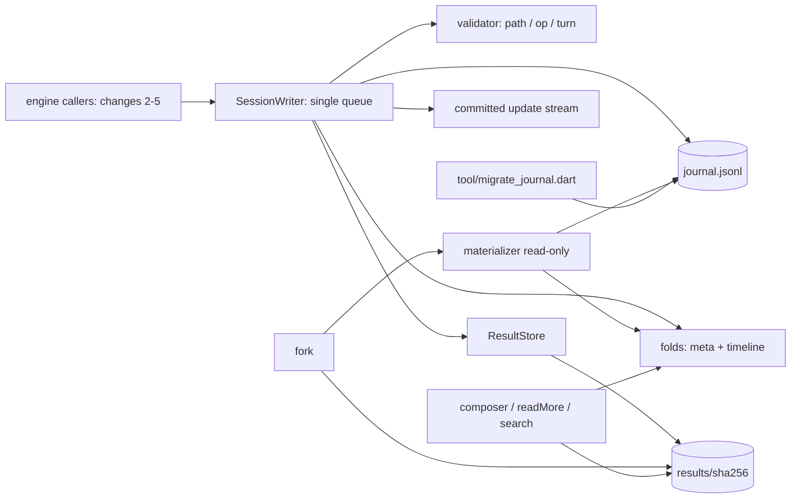
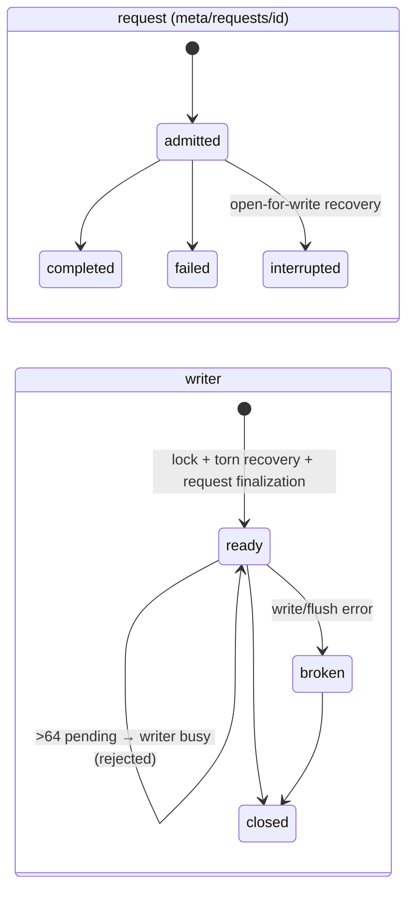
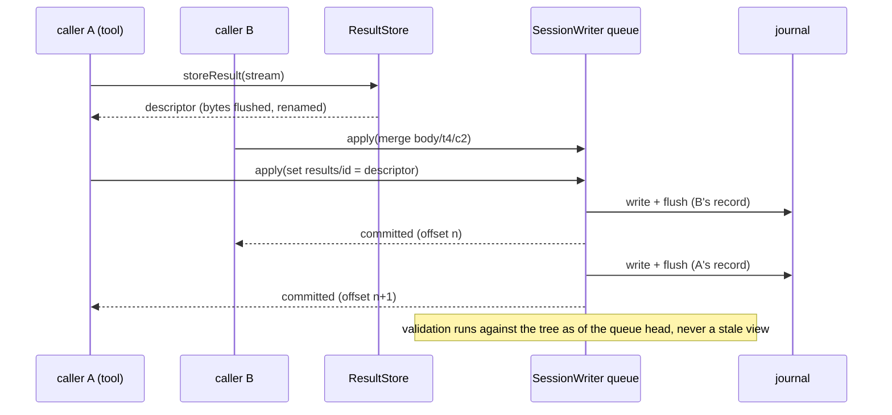
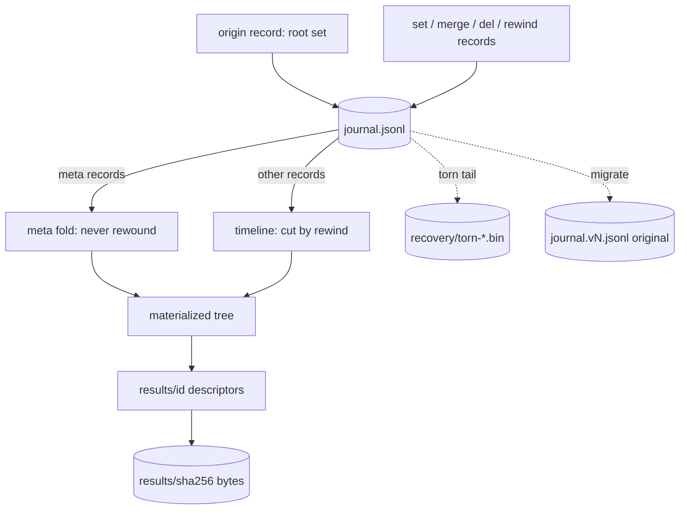

# Design

## Triage

| Trigger | Applies? | Evidence |
|---|---|---|
| T1 Components (new component, or 3+ with directed relationships) | Yes | New package; session writer, journal file, materializer, result store, composer and migration tool, with directed dependencies (diagram below). |
| T2 State (persistent state, caches, 3+ state machine) | Yes | Introduces the durable session journal and result files; request state machine `admitted → completed / failed / interrupted`; writer state `ready → broken → closed`. |
| T3 Concurrency (background work, workers/isolates, async, retries) | Yes | Concurrent async callers (parallel result writes, appends) must be serialized through one writer; streaming result ingestion with backpressure. |
| T4 Boundaries (data format, migration, shared interface, IPC, external) | Yes | Journal format v1, on-disk session layout, migration script, and the library interface changes 2–5 build on. |
| T5 Volume (grows without a fixed bound) | Yes | Journal, result bytes, request correlation and the in-memory timeline grow with session length. |
| T6 Risk (security, money, data loss, unrecoverable user data) | Yes | Session history and full results are user data that cannot be recreated (effects are never rerun). |

TIER: FULL

## Context

Greenfield: the repository has no Dart code yet (no `pubspec.yaml`, `lib/` or `test/`; only planning docs, `mise.toml`, `.mcp.json` and vendored skills). The toolchain pins Dart 3.13.7 (`mise.toml:5`), and `mise run check` runs format, analyze (`--fatal-infos`) and test (`mise.toml:34-48`). Scope and motivation are in [proposal.md](proposal.md); behavior contracts are in `specs/session-journal`, `specs/session-tree` and `specs/result-store`.

Binding constraints, restated as the per-M1 contract requires:
- **Platform:** Dart 3.x native AOT. No Rust core, no embedded script runtime, no FFI or native assets in this change. No durable session state outside the tree: result bytes are immutable payloads the tree references, and torn-tail recovery files are forensic copies, not session state. Secure credentials (change 2) are the only external exception.
- **M1 scope:** sensorium stays turn/budget plus central truncation. This change ships only central truncation; turn/budget rendering arrives with the loop. Deferred to M2+: nocterm, compaction, LSP, jj checkpoints, the full plugin protocol, MCP, Anthropic OAuth, the pricing registry and themes. The job supervisor, rewind reconciler and resume finalization of jobs are change 3. RPC framing and expected-offset checks are change 4.
- **Windows:** the test suite must pass on native Windows (the primary dev machine here) and Linux. Login and line-client qualification is not touched by this change.
- **Dogfood rule:** Kehai cannot run yet, so no Kehai apply attempt applies until change 4.

Durability is verified against the Dart SDK source at tag `3.13.7`. `RandomAccessFile.flush()` calls `fsync(fd)` on Linux ([runtime/bin/file_linux.cc:177-180](https://github.com/dart-lang/sdk/blob/3.13.7/runtime/bin/file_linux.cc#L177-L180)) and macOS ([file_macos.cc:217-220](https://github.com/dart-lang/sdk/blob/3.13.7/runtime/bin/file_macos.cc#L217-L220)), and `FlushFileBuffers` on Windows ([file_win.cc:244-248](https://github.com/dart-lang/sdk/blob/3.13.7/runtime/bin/file_win.cc#L244-L248)). [`RandomAccessFile.lock`](https://api.dart.dev/dart-io/RandomAccessFile/lock.html) is a POSIX advisory, per-process lock, released when *any* descriptor of the file closes. On Windows it is tied to the locking handle.

Reference learned from: the pi session format at `ad702637fdf6fbd3f965c5dba0b14bae100b74eb` ([session-format.md](https://github.com/badlogic/pi-mono/blob/ad702637fdf6fbd3f965c5dba0b14bae100b74eb/packages/coding-agent/docs/session-format.md)). Pi stores a message-entry tree (`id`/`parentId`) in one JSONL file. It branches inside the file, forks into a new file whose header holds `parentSession` (a path to the parent file), persists extension state as `custom` entries, and auto-migrates v1→v3 on load. Kehai adopts only "one JSONL file per session, fork as a new file". It rejects the rest:
- parent references by path, which are unsafe when the parent is deleted (D8);
- typed message entries and `custom` side entries, since everything is a property record on one tree;
- automatic migration on load (D10).

## Decisions

### D1: One package, small dependency set

- **Choice:** A single Dart package `kehai` at the repo root. `lib/src/session/` holds the journal, tree, writer, store, fork and recovery; `lib/src/results/` holds the result store, reader and composer; `lib/kehai.dart` exports the public API. Dependencies: `crypto` (SHA-256) and `path`. Dev dependencies: `test` and `lints`, resolved with `dart pub add`. Randomized testing uses a hand-rolled seeded generator (D11).
- **Rejected:** separate packages per layer (`kehai_session`, `kehai_results`) under a workspace. That adds cross-package versioning before any second consumer exists; Kumiko consumes RPC, not the library.
- **Reversal cost:** low. Moving files into packages later is mechanical.

### D2: Record and operation vocabulary

- **Choice:** Records are exactly `{turn,path,op,value}` (spec *Four-field journal records*), encoded with key order `turn, path, op, value` and one `\n`; the newline is the commit marker. The ops are `set`, `merge`, `del` and `rewind` (spec *Operation vocabulary*). Atomic multi-field updates are expressed as one `set` or `merge` at the common ancestor. For example, settling a tool call merges `status`, `result` and `usage` under its node in one record. The journal starts with a root `set` origin record holding the whole initial tree (spec *Session origin record*). Paths are validated `/`-joined segments (spec *Path identity*). There is no escaping, because the segment alphabet excludes `/`.
- **Rejected:** JSON Patch (RFC 6902), with `add/remove/replace/move/copy/test` and pointer escaping. It is rejected by ADR 0005, and `move`/`copy` add semantics nothing here needs.
- **Rejected:** begin/commit marker records with rollback of open groups on recovery. That is a transaction envelope spread across records (ADR 0005 rejects envelopes), and rollback would contradict "never edit history" for records already published.
- **Reversal cost:** high. This is the on-disk format. Evidence settling it: the randomized replay suite (D11) plus changes 2–4 expressing their writes without a new op. A needed op is a format bump with a migration (D10).

### D3: Rewind by timeline replay, `meta` exempt

- **Choice:** The tree is split into two folds:
  - **`meta` fold:** every record touching `meta`, in journal order. It is never rewound.
  - **Timeline:** the in-memory list of live records for every other root subtree. Turns are non-decreasing within it (spec *Turn anchoring*).

  A `rewind K` record cuts the timeline after the last record with `turn ≤ K`, and the non-`meta` subtrees are rebuilt by replaying the remaining timeline from the origin. Both live operation and materialization use this algorithm, so they cannot diverge. Validation of a non-`meta` record depends only on non-`meta` state, so the two folds never read each other.
- **Rejected:** per-node anchor turns, where rewind deletes nodes created after K. It cannot restore an earlier node's value that was *modified* after K: `scratch/goal` set in turn 2 and changed in turn 3 would vanish instead of reverting.
- **Rejected:** persistent per-turn snapshots with structural sharing. They need a persistent map; plain path-copying of wide maps such as `body` (one child per turn) is O(turns) per record and O(n²) overall.
- **Rejected:** rewind written as many compensating `set`/`del` records. That is non-atomic, and a crash mid-rewind would leave half-restored state.
- **Reversal cost:** high (rewind semantics are a shared contract). Evidence: the reference model (D11) implements rewind independently with deep-copied per-turn snapshots, and the suite must agree with it.

### D4: Request correlation in `meta/requests`

- **Choice:** `meta/requests/<id>` holds `{fingerprint, state, turn, outcome?, reason?}`.
  - `admit(id, fingerprint)` is **one writer-queue operation**: lookup, fingerprint comparison and the conditional append all run at the queue head with no await between them. It returns `Admission.newlyAdmitted`, `Admission.existing(node)` (no permission to execute) or throws `RequestCollision`. Two concurrent admits therefore serialize: the first appends, the second sees the node.
  - `complete` / `fail` merges the outcome.
  - A duplicate with the same fingerprint returns the recorded node and appends nothing.
  - A duplicate with a different fingerprint is rejected (spec *Request admission and outcome correlation*, including its simultaneous scenarios).

  The fingerprint is caller-supplied, for example a SHA-256 of the canonical command; change 4 defines it for RPC commands. Because `meta` is exempt from rewind (D3), correlation survives rewind, as ADR 0005 requires. Fork starts the child with empty `meta/requests`, since ids are session-scoped.
- **Rejected:** anchoring requests in `body` beside their turn. Rewind would delete them, and a duplicate arriving after rewind would execute again, which ADR 0005 explicitly forbids.
- **Reversal cost:** medium. It moves only a subtree, but changes 3–4 build on it.

### D5: Durable append and single writer

- **Choice — append:** The writer owns one `RandomAccessFile` in append mode. Each record is written with `writeFrom(utf8(line + "\n"))`, then `flush()` (fsync or FlushFileBuffers, see Context). Only after flush does it update the in-memory folds, emit the committed update and complete the caller's future (spec *Validate, persist, append, then publish*). On any write or flush error the writer enters `broken` and refuses further appends until reopened, because a partial line may now sit at the tail.

- **Choice — queue and subscribers (spec *Bounded writer admission and subscribers*):** Calls go through one internal queue processed by a single loop, so bytes never interleave and validation always sees the queue-head tree. The queue admits at most **64 pending operations**; operation 65 fails synchronously with `writer busy` and is never enqueued. That is twice M1's expected peak of parallel tool calls; change 3's supervisor applies its own admission in front of it. Each subscriber gets a buffer of **1,024 updates**. On overflow the writer closes that subscriber's stream with `ResyncRequired(lastDeliveredOffset)`, and the subscriber rematerializes. The writer never awaits a subscriber.

- **Choice — single writer (spec *Single writer per session*):** Three files in the session directory:
  - **`session.owner`:** `{pid, nonce, startedUtc}`, always written as a temp file, flushed, then renamed into place, so it is never partially written. It names the one writer.
  - **`session.lock`:** an OS lock used **only as a liveness probe** for a foreign owner.
  - **`session.gate`:** created with exclusive create (`O_CREAT|O_EXCL` / `CREATE_NEW`), holding `{pid, nonce, utc}`. It serializes **every** ownership change.

  Nothing is shared in memory, because Dart statics are isolate-local. POSIX `fcntl` locks are per process (other isolates can acquire them) and are released by any descriptor close, so the protocol never relies on the OS lock to exclude isolates of one process.

  **Invariant, maintained under the gate:** whenever `session.owner` is absent or does not name this process, no isolate of this process holds a lock on `session.lock`.

  **Gate acquisition.** Retry the exclusive create for up to 2 s, since live holders keep it for milliseconds. Then fail with `session gate held by pid 
 since <t>; remove session.gate if no kehai is running`. An empty or partly written gate (the holder died between create and write) gets the same message with `pid unknown`. All gate paths delete the gate in a `finally`.

  **Claim** (open for write, migration). Holding the gate, read `session.owner`:
  1. **Absent:** write the owner record (temp, then rename), open `session.lock` and `lock(FileLock.exclusive)`, keeping that handle for the writer's lifetime. If the lock fails (a foreign process holds it with no owner record, for example a hand-deleted owner file), delete the record just written and refuse with `session locked`.
  2. **Names this process:** refuse with `session locked` (another isolate or opener here owns it). `session.lock` is not opened.
  3. **Names a foreign process, or is unreadable** (only possible through outside interference, because records are renamed into place): open `session.lock` and try `lock`.
     - Failure means a live process holds it: close this probe descriptor and refuse. Closing is harmless, because by the invariant this process holds no lock there.
     - Success means the recorded owner is dead (the OS releases its lock on exit): replace the owner record (temp, then rename), keep the handle and report the takeover.

  Because each claim reads and replaces the owner while holding the gate, no claim can act on a stale read. That is the round-2 takeover race.

  **Release** (close):
  1. **First close the `session.lock` handle**, while `session.owner` still names this process. Same-process isolates still see "names this process" and refuse; none of them holds a lock, so the close releases nothing of theirs.
  2. Then acquire the gate, delete `session.owner` only if its `{pid, nonce}` is this writer's own, and release the gate.

  Between steps 1 and 2 a foreign process may legitimately take over, which is fine because this writer has stopped. The nonce check then leaves the new record alone. This ordering removes the round-3 close/reopen race: no new claimant can lock while an old descriptor in the same process is still open. If the gate cannot be acquired on close, the owner record stays and close reports it. The next same-process opener then gets `session locked`, and a foreign one takes over through step 3.

  Fail-safe edge cases, all visible: a stale gate (above), and a dead owner whose pid was reused by this very process (refused under step 2, with a hint to remove `session.owner` if no kehai is running). Tests drive every interleaving deterministically with injected pause hooks: a two-isolate takeover race, close/reopen with two isolates plus a foreign process, and a kill after the gate is created but before its content is written (spec *Single writer per session*). On Windows the lock is per handle, which already excludes isolates; the gate protocol gives one mechanism on every platform.
- **Rejected:** a process-wide static registry. Statics are per isolate, so it cannot exclude other isolates (review round 1, C1).
- **Rejected:** Linux OFD locks (`F_OFD_SETLK`). They exclude per open file description, but need FFI, which this change does not introduce.
- **Rejected:** an `IOSink` opened with `FileMode.append`. Its `flush` drains to the OS but does not guarantee fsync, so acknowledgement would not mean durable.
- **Rejected:** taking the lock on the journal itself. Any reader closing its descriptor would release the writer's POSIX lock.
- **Reversal cost:** low. These files are internal to the session directory; the journal format is unaffected.

### D6: Torn tail and corruption handling

- **Choice:** Read-only materialization stops at the last `\n` and reports any trailing byte count. When `session.owner` names a live writer, its result is flagged `observed`: a newline-terminated line can be on disk before its `flush()` returns, or even when that flush fails (spec *Read-only materialization is observational*). Anything that needs acknowledged state (fork, change 4's RPC materialization) obtains it from the writer's in-memory folds, which only ever contain flushed records. Open-for-write copies the torn bytes to `recovery/torn-<offset>-<utc>.bin`, flushes it, then truncates the journal to the last newline. It reports the path and size in the open result (spec *Torn trailing record recovery*). A newline-terminated line that fails parsing or schema validation, or fails to apply, aborts both modes with `{line, offset, reason}` and leaves the file unmodified (spec *Interior corruption stops writes*). There are no per-record checksums: ADR 0005 forbids mandatory digests, and JSON parse plus schema plus apply validation catches torn or garbled lines.
- **Rejected:** "repair" by appending a newline after the torn bytes. That turns an uncommitted fragment into permanent interior corruption.
- **Rejected:** silently truncating without a copy. That violates "never silently skip history" in spirit, even though the bytes were never acknowledged.
- **Reversal cost:** low.

### D7: Content-addressed result store, descriptors in the tree

- **Choice:** `storeResult(Stream<List<int>>)` returns a `ResultWrite`:
  1. Write chunks to `results/.tmp-<random>` with `await writeFrom` per chunk. `await for` pauses the source, so the store holds exactly one producer chunk. Chunk size is the producer's contract: change 3's process pipes deliver the OS pipe reads (≤ 64 KiB). The store does not split chunks, because the chunk is already in memory when it arrives.
  2. Hash (SHA-256) and count bytes and lines incrementally.
  3. Flush, close and rename to `results/<sha256>`. When that name already exists with equal size, delete the temp file (dedupe).
  4. The caller appends the descriptor via one record at `results/<id>`, where `<id>` is the first 12 hex digits of the hash. The descriptor is `{handle:"r/<id>", sha256, bytes, lines}` and holds facts about the bytes only, so the same bytes always yield the same descriptor, and writing it again is idempotent.

  **Completion belongs to the occurrence, not the bytes.** Each tool or result node cites a result reference `{handle, complete}`. Two calls producing identical bytes share the descriptor and the file, but each records its own `complete` (spec *Identical bytes from a complete and a failed producer*).

  The outcomes (spec *Immutable full-result bytes*) are:
  - **`ResultWrite.complete(descriptor)`:** the stream ended normally.
  - **`ResultWrite.producerFailed(descriptor, error)`:** the stream emitted an error. Every chunk received so far was already written, so steps 2–4 run on that prefix. The caller records `partial`/`error` with `complete: false` on its result reference, and the prefix stays pageable (ADR 0002 "preserve available results").
  - **`ResultWrite.storageFailed(bytesAccepted, tempPath, error)`:** a write, flush or rename failed. The store cancels the producer subscription and returns no descriptor, because the prefix's durability is unknown. The temp file is kept, not referenced, and named in the error so the failure is reported out of band (architecture *Resource bounds*). The caller records `error` with that message.

  Tool nodes carry the handle string. A descriptor already at `results/<id>` with a different `sha256` fails loudly with `handle collision`. Handles resolve only through the current tree (spec *Tree-held result descriptors and handles*). A line is a `\n`-terminated segment, plus a final unterminated segment if non-empty. `\r` before `\n` is stripped for display only, never from bytes.
- **Rejected:** result bytes inline in journal records. Replay would grow with output size, paging would need the journal, and 50 MiB results would dominate materialization.
- **Rejected:** sequential handles (`r/1`, `r/2`). They need a counter in the tree and collide when fork copies bytes between sessions; content addressing makes fork copies and dedupe trivially safe.
- **Reversal cost:** high for the handle format and descriptor shape (a shared contract with the composer, tools and RPC); low for the file layout.

### D8: Fork copies, never references

- **Choice:** `writer.fork(atTurn)` is a writer operation. It runs at the queue head from acknowledged in-memory folds, never from a disk read (spec *Read-only materialization is observational*). To fork a closed session, open its writer first.
  1. Validate K (spec *Journal-only fork*).
  2. Compute the non-`meta` tree at the end of turn K by replaying the timeline prefix. Take the **current** `meta`, which is consistent with rewind keeping current `meta` (D3). Only three keys are replaced: `meta/session` = new id, `meta/lineage = {parent, parentTurn: K}` and `meta/requests = {}`. `meta/format` is already current, because an open writer implies it.
  3. Create `<root>/.fork-<childId>.tmp/`. Copy every result file referenced under the forked tree's `results/`, verifying each copy's SHA-256 against its descriptor. Write and flush the child journal with its single origin record at turn K.
  4. Rename the temp directory to `<root>/<childId>`.

  Any failure deletes the temp directory and reports the failing handle. The parent is never written.
- **Rejected:** a child origin that references the parent journal by id and offset, as pi's `parentSession` does by path. Parent deletion or migration would break the child (ADR 0001 parent-deletion safety), and offsets are not stable identity (architecture *RPC and loop*).
- **Rejected:** hardlinking result files. It is not portable to every Windows filesystem, and it adds a failure mode for a byte copy that is bounded by referenced results only.
- **Reversal cost:** medium.

### D9: One composer function owns truncation

- **Choice:** `composeResult(tool, status, summary, descriptor, policy, {notrunc, capacityTokens})` is the only code that cuts result text (spec *Central truncation envelope*). Default policies:
  - `read`: 400 lines.
  - `bash`: 8,000 estimated tokens, cut head 60% / tail 40% by whole lines (spec *Head and tail cut for logs*).
  - Any other tool: 8,000 estimated tokens, head only.
  - Per-line cap: 2,000 characters.

  The token estimate is `ceil(utf8Bytes / 3)`. It is a **heuristic**, not an upper bound: dense punctuation can tokenize below 3 bytes per token. It only sizes presentation cuts and the `notrunc` pre-check. Change 2's provider adapter owns the authoritative context-capacity check before submitting a request, with a visible stop on overflow (architecture *RPC and loop*), and may substitute provider counts. `notrunc` bypasses **both** the line cap and the per-line cap. It compares the estimate with the caller-supplied `capacityTokens` and fails explicitly when over (spec *Explicit opt-out bounded by capacity*).

  **Bounded line scanning:** `readMore`, `searchResult` and the composer use one byte-level scanner over the stored file (64 KiB reads), not `LineSplitter`. For each line it keeps at most the retained prefix: the 2,000-character display cap for composing and paging, or the **64 KiB search prefix** for search. It counts the rest without storing it, so memory per line is bounded by the prefix plus one read buffer, even for a newline-free multi-GiB result (spec *Head and tail cut for logs*, over-long line scenario). Under `notrunc` the composer streams whole lines to its output sink instead of retaining them; the capacity pre-check has already bounded the total.

  **Search (spec *Paging and search over stored results*):** Dart `RegExp` has no timeout, so search runs in a spawned worker isolate that receives the file path and pattern and streams matches back. At most **4 search workers** run per engine. A fifth concurrent search fails synchronously with `search busy` before spawning anything (no queue). The slot is released in a `finally` block on completion, error or kill. A worker sends at most 201 match messages, then only a final count, so the caller's buffer is bounded. The caller kills the worker at a **5 s** deadline and returns `search timed out after 5s; narrow the pattern`, never a partial list presented as complete. Search caps at 200 matches, followed by `… +N more`. Lines longer than the search prefix are matched within the prefix only, and the output says so. Text is decoded as UTF-8 with malformed sequences replaced.
- **Rejected:** truncation helpers each tool calls before storing, which is what ADR 0002 forbids. A cap mistake would destroy evidence irreversibly.
- **Reversal cost:** low for the defaults; medium for the envelope text the model learns.

### D10: Explicit migration script

- **Choice:** `dart run tool/migrate_journal.dart --session <dir> [--to <n>] [--check]`.
  - It claims the session through the D5 owner protocol, reads the journal and checks `meta/format`. Interior corruption is refused. A **torn tail** is recovered by the migration itself: the torn bytes are saved to `recovery/torn-<offset>-<utc>.bin` as in D6, and only complete records are migrated. The original file, torn bytes included, becomes the byte-identical `journal.v<n>.jsonl` backup (spec *Outdated format with a torn tail*). A normal open of an outdated format still changes nothing and names the command.
  - It chains registered `n → n+1` record transformations (pure `Record → List<Record>`).
  - It writes `journal.jsonl.migrating` and flushes. It renames the original to `journal.v<n>.jsonl`, then renames the new file to `journal.jsonl`.
  - It prints old and new record counts. `--check` runs everything except the renames.

  Opening a session that has `journal.v<n>.jsonl` plus `.migrating` but no `journal.jsonl` fails with `incomplete migration; rerun migrate_journal`, and rerunning completes it. Format 1 is current and the production registry is empty. Tests register a fixture `0 → 1` migration that proves preservation and atomicity (spec *Explicit journal migration*). Opening a format older than current fails naming the command; a newer format fails with `format <n> is newer than this kehai`.
- **Rejected:** automatic migration on open, as pi does. It silently rewrites user data and invalidates RPC offsets without the user deciding (architecture *RPC and loop*).
- **Reversal cost:** low.

### D11: Seeded randomized model-based tests

- **Choice:** A hand-rolled generator (`Random(seed)`) produces histories: `set`, `merge` and `del` over a bounded path space, new turns, rewinds, request admit/complete/duplicate, result stores and forks. Each history runs through the real writer on a temp directory. Assertions:
  - The live tree equals the materialization from disk, done twice.
  - The canonical serializations are byte-identical.
  - The tree equals a **reference model**, a deliberately naive implementation that keeps a deep-copied snapshot per turn and rewinds by picking a snapshot. Its algorithm differs from D3, so agreement is meaningful.

  The suite runs 500 histories by default, overridable with `KEHAI_PROPERTY_RUNS`. Failure messages name the seed and index, and `KEHAI_PROPERTY_SEED` reproduces one. Torn-tail tests truncate a valid journal at random byte offsets; corruption tests flip bytes in interior lines.
- **Rejected:** `package:glados`. It gives shrinking, but stateful operation sequences with a disk side-effect fit poorly with its generator model, and it is an extra dependency for one suite.
- **Reversal cost:** low.

### D12: Session layout and identity

- **Choice:** `<root>/<sessionId>/` holds `journal.jsonl`, `session.owner`, `session.lock`, `results/` and `recovery/` (created on demand), plus the transient `session.gate`. The session id is `<yyyyMMddTHHmmssZ>-<8 random hex>`: sortable and collision-safe for one user. The root is a constructor argument; change 4 picks the user default (for example `~/.kehai/sessions`). Listing ignores dot-entries such as fork temp directories.
- **Rejected:** a single global journal or a database index of sessions. ADR 0001 and ADR 0005 reject side stores, and a directory listing is enough.
- **Reversal cost:** low.

## Diagrams (FULL)

T1 — components:

T2 — request and writer state:

T3 — append ordering with a concurrent result write:

T4 — data on disk and derived state:

## State & Ownership (FULL)

| State | Owner (sole writer) | Lifetime | Invalidation / rebuild | Authoritative copy |
|---|---|---|---|---|
| `journal.jsonl` | `SessionWriter` holding `session.lock` | session (user deletes the directory) | append-only; torn tail truncated only at open-for-write (D6); rewritten only by the migration tool under the same lock | itself |
| In-memory folds (meta, timeline, tree) | `SessionWriter` queue | writer open | rebuilt from the journal at open; updated only after flush | journal |
| `results/<sha256>` files | `ResultStore` (create-once, then immutable) | session | never modified; orphans after rewind stay until the session is deleted (no automatic deletion) | file bytes; the descriptor's `sha256` identifies them |
| Result descriptors `results/<id>` | `SessionWriter` (as records) | turn-anchored, removed by rewind | replay | journal |
| `meta/requests/*` | `SessionWriter` | session, survives rewind; empty in fork child | replay | journal |
| `recovery/torn-*.bin` | open-for-write recovery | until the user deletes it | never read by Kehai | forensic copy only, not session state |
| `session.owner` / `session.gate` | whoever holds `session.gate` (D5) | owner: writer open; gate: milliseconds per claim, takeover or release | owner deleted on release under the gate, after the lock handle closes; a dead owner's record is replaced only after the OS lock proves no live holder | `session.owner` names the holder; the `session.lock` OS lock proves a foreign holder's liveness |
| Subscriber buffers | `SessionWriter` | per subscriber | overflow closes the stream with `ResyncRequired` | journal (resync rematerializes) |
| Fork temp directory | `fork` | the fork operation | deleted on failure; a crash leftover is ignored by listing | none until renamed |

## Failure & Visibility (FULL)

| Component | Fails / dies mid-operation → | Recovery | Retry safe? | Who finds out |
|---|---|---|---|---|
| Append (write) | partial line at tail; writer `broken` | reopen: torn tail preserved and truncated (D6) | the caller must treat it as unacknowledged and uncertain; the record may be absent | the caller gets a storage error; the open result reports the torn tail |
| Append (flush fails after a full write) | the line may persist although unacknowledged | none needed; reopen shows it if it survived | not blindly: "no ack" means unknown, not "not written" (ADR 0005); the duplicate/fingerprint check applies | the caller gets a storage error |
| Process crash between records of one logical action | earlier records committed, later absent | admitted requests become `interrupted`/`effect-uncertain` at open (spec *Resume finalizes interrupted requests*); other multi-step work uses the admission pattern | effects are never replayed | the open result reports the count; the tree shows the state |
| Result write, producer error | prefix already written | the prefix is finalized as `complete: false` and stays pageable (D7) | the producer is not rerun by the store | the caller records `partial`/`error` with the handle |
| Result write, storage error | temp file left; nothing referenced | the temp file is kept, unreferenced and named in the error; listing ignores `.tmp-*` | yes (content-addressed) | the caller gets a storage error with the temp path and records `error` |
| Search worker | runaway regex | the isolate is killed at 5 s | yes, with a narrower pattern | the caller gets `search timed out` |
| Power loss after a result rename (Linux; no directory fsync, see Risks) | the descriptor record is durable but the file entry may be lost | none automatic | — | `result bytes missing for r/<id>` on resolve (visible) |
| Interior corruption | — | the user inspects the reported line and restores from backup | — | open fails naming line, offset and reason |
| Fork | temp directory partially written | deleted on failure; a crash leftover is ignored | yes | fork error names the handle or I/O failure |
| Migration | crash between renames | the next open names `rerun migrate_journal`; rerunning completes it | yes (idempotent from `.migrating` plus original) | the user, via the open error |
| Writer process dies holding the session | `session.owner` remains; the OS releases the `session.lock` lock | the next opener takes over under the gate after acquiring the OS lock (D5) | yes | the open result reports the takeover |
| Process dies holding `session.gate` (a claim, takeover or release of a few ms) | the gate remains, possibly empty | manual removal; the refusal names pid and time, or `pid unknown` | yes after removal | the user, via `session gate held …; remove session.gate…` |

## Resource Bounds (FULL)

| Queue / buffer / cache / transfer | Bound | At the bound | Timeout | At 10x / 100x |
|---|---|---|---|---|
| Writer queue | 64 pending operations (D5) | `writer busy`, rejected synchronously, not queued | none here; turn/foreground deadlines are change 3 | fsync latency caps throughput near 100–1,000 records/s. That is ample for one interactive agent; group commit is not built (ledger). |
| Subscriber buffer | 1,024 updates per subscriber | stream closed with `ResyncRequired(lastOffset)` | — | unchanged; a slow client resyncs |
| Result ingestion buffer | one producer chunk (`await for` backpressure); chunk size is the producer's contract (≤ 64 KiB pipe reads in change 3) | the source is paused | none here (change 3 owns deadlines) | unchanged |
| In-memory timeline and meta | O(records) of small JSON (result bytes excluded) | none | — | 10k records ≈ 2 MB; 1M records ≈ 200 MB, the point where a timeline index would be needed (ledger) |
| Rewind cost | O(live timeline) replay | — | — | 1M records ≈ seconds per rewind; acceptable because rewinds are user-initiated and rare |
| `meta/requests` | one node per admitted request; no eviction (needed for duplicate safety) | none | — | 100k requests ≈ 10 MB |
| Paging/compose scan | 64 KiB read buffer plus a retained line prefix of at most 2,000 characters; the rest of the line is counted, not stored | — | none | a newline-free 2 GiB line still uses bounded memory; a sparse line index is not built (ledger) |
| Search | 4 concurrent workers; 64 KiB prefix per line; at most 201 match messages per worker | `search busy`, rejected without spawning; prefix-only matching, stated in the output | 5 s, then the isolate is killed and its slot freed | at 100× callers, still 4 workers; the excess is rejected |
| Search output | 200 matches | `… +N more` line | — | unchanged |
| Composed output | per-tool policy (D9) | explicit truncation line | — | unchanged |
| Fork copy | referenced result bytes only | — | none | 10 GB of referenced results makes fork slow but correct; dedupe is per session |
| Result and recovery files on disk | none (no automatic deletion, per architecture) | disk-full surfaces as a storage error | — | the user deletes sessions |

## Flow & State Gaps (FULL)

- **Partial completion:** multi-record logical actions are never atomic. Each record is the atomic unit (D2). Work spanning effects records `admitted` first, and open-time recovery finalizes it (D4). Change 3 adds the same finalization for tool and job nodes on top of this pass.
- **Concurrent callers:** serialized by the writer queue (D5). Each record is validated against the tree at the queue head, so a `del` racing a `set` fails visibly instead of applying to a stale view.
- **Stale views / out-of-order publication:** updates are published in commit order with their byte offset and line number, after flush. A subscriber can never observe an uncommitted record. Offsets change after torn-tail truncation or migration; consumers resync from a fresh materialization (change 4).
- **Restart mid-operation:** covered by torn tail (D6), request finalization (D4), the fork temp directory (D8) and the migration marker (D10).
- **Rewind racing a result write:** a descriptor appended after a rewind into an earlier turn is valid in the new timeline only if its turn obeys the turn rule. A stale caller holding a pre-rewind turn number gets `invalid turn`. Rejecting stale callbacks for live jobs is change 3.
- **Read-only materialization during writes:** reads complete lines up to the last newline and flags the result `observed`, because a line may be on disk before its flush is acknowledged or after its flush failed (D6). Fork and RPC take acknowledged state from the writer.
- **Concurrent admissions:** the lookup and conditional append run as one queue operation (D4); exactly one caller is told `newlyAdmitted`.

## Mechanism Ledger (FULL)

| Mechanism | Built? | Why (harm nobody catches / expensive later) | Evidence that would change the call |
|---|---|---|---|
| Gate file serializing every ownership change, owner record, OS liveness lock | Yes | Two writers interleave and corrupt the journal silently; POSIX locks do not exclude same-process isolates and are released by any close | OFD locks via FFI (then simplify) |
| Bounded writer queue and subscriber buffers | Yes | Unbounded futures or update buffers exhaust memory under a burst or a paused client (architecture *Resource bounds*) | — |
| Prefix finalization on producer error | Yes | Without it, accepted output is lost or unaddressable, violating ADR 0002 | — |
| Search worker isolate with deadline | Yes | One bad regex hangs the engine event loop with no recovery | Dart adding RegExp timeouts |
| Torn-tail preservation file | Yes | Truncating without a copy loses evidence nobody can recover | — |
| Request admission/outcome in `meta` | Yes | Required by ADR 0005; without it a duplicate after rewind re-executes effects | — |
| Seeded reference-model tests | Yes | Rewind/replay divergence would surface only as rare, unreproducible session bugs | — |
| SHA-256 check on fork copy | Yes | A silently wrong copy makes a fork lie about evidence after the parent is deleted | — |
| Per-record checksum or digest | No | ADR 0005 forbids mandatory digests; parse, schema and apply validation catch torn and garbled lines | Bit-rot reports with a valid-but-wrong record |
| Begin/commit compound markers with rollback | No | Envelope semantics are rejected; atomic updates use one record | A change that needs atomic writes across two unrelated subtrees |
| Per-turn snapshot cache | No | Rewind is rare; replay is O(records) | Rewind latency above 1 s in real sessions |
| Group commit / batched fsync | No | One agent does not saturate fsync | Profiled append latency limiting parallel tools (change 3) |
| Sparse line index for paging | No | A streaming scan is fast enough at observed sizes | Paging latency above 200 ms on real results |
| Hash verification on every page read | No | A size check catches truncation; full rehash per page is O(file) | Corruption reports not caught by size |
| Directory fsync after create/rename | No | Dart has no directory fsync; it would need FFI (out of scope). Process crashes are covered; only power loss is exposed, and the failure is visible | Power-loss loss observed, or FFI arriving in change 2 (then add it) |
| Automatic garbage collection of orphan result bytes | No | The architecture forbids automatic deletion; orphans cost disk only | Disk-usage complaints, with an explicit user command |
| Group or periodic snapshots | No | Snapshots-primary persistence is rejected (ADR 0005) | — |

## Risks / Trade-offs

- [The on-disk format is hard to reverse] → The format version lives in `meta/format` from day one, D10 provides an explicit migration path, and ADR 0008 records the v1 vocabulary and rewind semantics.
- [`meta` is never rewound, so a careless future writer could put turn-anchored facts in `meta`] → ADR 0008 states that `meta` holds only session-lifetime facts (format, session, lineage, requests, settings); review checks every later change's paths.
- [Power loss on Linux can lose a renamed result file or a new session's directory entry (no directory fsync)] → The failure is visible (`result bytes missing`); process crashes are fully covered; revisit when FFI exists.
- [macOS `fsync` does not force a drive-cache flush (no `F_FULLFSYNC`)] → macOS is not an M1 platform. Record it in ADR 0008 for the macOS target.
- [The `ceil(bytes/3)` token estimate is a heuristic and can underestimate dense text] → It only sizes presentation and the `notrunc` pre-check; change 2's adapter makes the authoritative capacity check before submit and stops visibly on overflow.
- [The gate scheme refuses, rather than recovers, when a crash leaves `session.gate` or a pid is reused by the same process] → It fails safe, with an explicit manual-removal message naming the file; both need a crash inside a millisecond window or pid reuse.
- [In-memory timeline growth at 1M+ records] → This is beyond M1 session sizes; the ledger names the trigger.

## ADRs

- **In force, constraining this change:** [0001](../../../docs/adr/0001-one-session-tree.md) (one tree; rewind as restoration; fork result access), [0002](../../../docs/adr/0002-central-result-truncation.md) (full bytes, central composer), [0003](../../../docs/adr/0003-unified-job-lifecycle.md) (jobs are change 3; this change ships only the request finalization seam), [0004](../../../docs/adr/0004-dart-native-engine-and-clients.md) (Dart native, no FFI needed here), [0005](../../../docs/adr/0005-four-field-journal-and-rpc.md) (four fields, no envelope or digest, explicit migration, request anchoring that survives rewind).
- **To record during apply:** ADR 0008, *Journal format v1: operations, paths, rewind and result handles*. It binds:
  - the op vocabulary (D2), path grammar and root set;
  - the origin record;
  - the turn rule and `meta`-exempt timeline rewind (D3);
  - `meta/requests` anchoring (D4);
  - the newline commit marker and torn-tail policy (D6);
  - the content-addressed `r/<12hex>` handles and descriptor shape (D7);
  - copy-on-fork with current `meta` (D8) and the migration contract (D10);
  - the single-writer owner-file protocol (D5) and the `observed` status of disk reads (D6).

  It adds the ADR to the index in `openspec/architecture.md`.

## Open Questions

- The default sessions root (`~/.kehai/sessions` vs. an XDG/AppData path) is decided in change 4 when the CLI exists; this change takes the root as a parameter.
- Whether change 2 replaces the token estimate with provider counts for composition, or keeps it for request-independent caps. It does not affect this change's interfaces.
