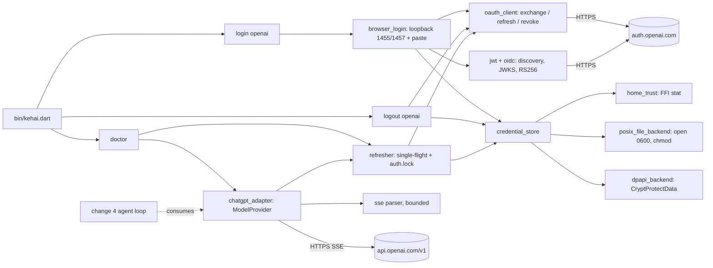
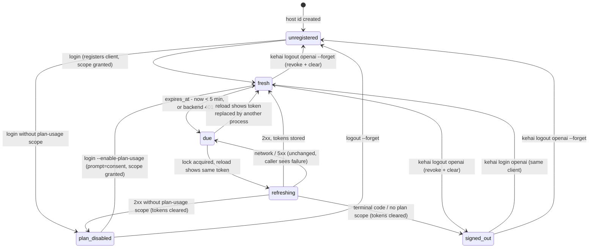
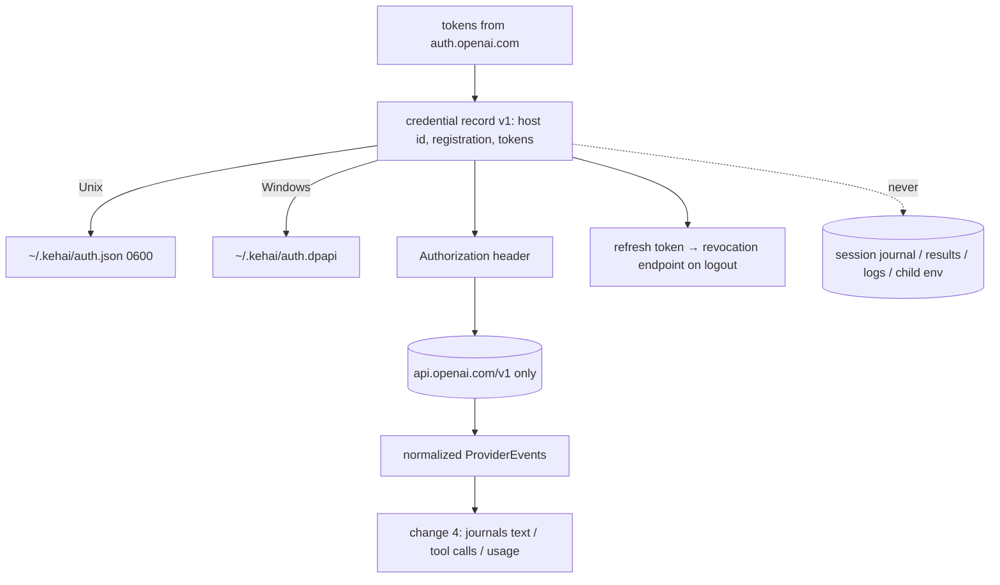

# Design

## Triage

| Trigger | Applies? | Evidence |
|---|---|---|
| T1 Components (new component, or 3+ with directed relationships) | Yes | New CLI entrypoint, sign-in flow, ID-token verifier, credential backends, refresh coordinator, SSE parser and ChatGPT plan adapter, with directed dependencies (diagram below). |
| T2 State (persistent state, caches, 3+ state machine) | Yes | New persistent credential record outside the tree (host id, client registration, token set); refresh state machine `fresh → due → refreshing → fresh / reauth_required`; login flow `binding → waiting → exchanging → verifying → stored / failed`. |
| T3 Concurrency (background work, workers/isolates, async, retries) | Yes | Concurrent requests share one refresh; cross-process refresh races on a rotating token; callback and pasted URL race; a streamed response with cancellation and a response-silence deadline; a login pending across another process's logout or login; one 401 repeat. |
| T4 Boundaries (data format, migration, shared interface, IPC, external) | Yes | Credential file format v1; two external services in an OpenAI preview program (`auth.openai.com`, `api.openai.com/v1`); the provider interface change 4 consumes; the CLI surface. |
| T5 Volume (grows without a fixed bound) | Yes | A streamed response, an SSE event, tool-call arguments, request bodies and error bodies can be arbitrarily large. |
| T6 Risk (security, money, data loss, unrecoverable user data) | Yes | Credentials (account takeover); paid plan usage spent by duplicated requests. |

TIER: FULL

## Context

The package so far holds only the session tree, journal and result store (`lib/kehai.dart:1-25`). There is no executable and no network code. `pubspec.yaml` depends only on `crypto` and `path`. Scope is in [proposal.md](proposal.md); behavior contracts are in `specs/credential-store`, `specs/provider-auth` and `specs/model-provider`.

Binding constraints, restated as the per-M1 design contract requires:

- **Platform:**
  - Dart 3.x native AOT, with no Rust core and no embedded script runtime.
  - No durable session state outside the tree. The credential record is the one explicit exception: secure, external and user-deletable.
  - FFI reaches only system libraries, with no bundled native assets: `crypt32` through `package:win32` on Windows, and libc `open`/`chmod`/`stat`/`geteuid` on Unix. This is the essential M1 FFI use that ADR 0004 and ADR 0006 name.
  - RS256 verification uses `pointycastle`, which is pure Dart.
- **M1 scope:**
  - Sensorium stays `turn`/`budget` plus central truncation. This change adds no sensorium; it adds the usage and estimate values that `budget` will read in change 4.
  - Deferred to M2+: nocterm, compaction, LSP, jj checkpoints, the full plugin protocol, MCP, Anthropic OAuth, the pricing/model registry, themes, and API-key adapters (D9).
- **Windows:** `kehai login openai` and `kehai doctor` must work on native Windows without WSL. The suite runs on native Windows (the dev machine) and on Linux (via the approved WSL runner).
- **Dogfood rule:** Kehai cannot run a loop yet, so no Kehai apply attempt applies until change 4.

Existing patterns reused:
- **Error type:** a stable `reason` plus `detail`, with a `message` getter (`lib/src/session/errors.dart:10-37`). `ProviderFailure` and `AuthError` follow it.
- **Atomic replace:** temp file, flush, then rename (`lib/src/session/ownership.dart:229-239`, `lib/src/results/result_store.dart:151-182`).
- **OS lock:** an exclusive `RandomAccessFile` lock (`lib/src/session/ownership.dart:248-258`).

The session layer is not touched.

### Upstream sources compared

**Short forms:**
- **`docs`:** OpenAI's *Sign in with ChatGPT: token sharing for open-source apps* developer pages, read on 2026-10-29. They are not revision-pinned, so ADR 0009 records the read date, and each constant in `openai_constants.dart` names its page. The pages:
  - overview: <https://developers.openai.com/siwc/token-sharing-open-source>;
  - `sign-in`: `…/sign-in`;
  - `sessions`: `…/profiles-and-sessions`;
  - `inference`: `…/models-and-inference`;
  - `limits`: `…/preview-limitations`;
  - `tokens`: `…/token-reference`;
  - `errors`: `…/errors-and-recovery`.
- **`pi@c466a35`:** `earendil-works/pi@c466a35957e73876651d014d6c36d5ea47148344`, `packages/ai/src/auth/oauth/openai-chatgpt.ts` unless another file is named.
- **`oc@77a0fd6`:** `anomalyco/opencode@77a0fd6f3b247235b09941d55ff0faf72be1dae4`, `packages/core/src/plugin/provider/chatgpt.ts`.

Both implementations are official-flow clients. OpenCode is a named launch partner of the program. Line citations were read by the author.

| Fact | docs | pi@c466a35 | oc@77a0fd6 | **Kehai** |
|---|---|---|---|---|
| Client id | `dynamic_agent_client` on first sign-in; save the issued id (`oaiapp_…`) and reuse it (`sign-in`, `sessions`) | `dynamic_agent_client` on **every** login `:16` | registration once, saved id reused `:21`, `:532` | docs |
| Agent name hint | app name, registration only | `"Pi"` every login `:17` | `"OpenCode"`, registration only `:22`, `:532` | `Kehai`, registration only |
| Host id (`ext_agent_host_id`) | required; stable per host; `urn:ietf:params:oauth:jwk-thumbprint:…` recommended, `urn:uuid:` supported, `did:key:` (overview) | `urn:uuid:<device id>` `:225-230` | random `urn:uuid:`, persisted `:106` | random UUIDv4 `urn:uuid:`, persisted in the record |
| Endpoints | authorize `https://auth.openai.com/api/accounts/authorize`, token `…/api/accounts/oauth/token` (`sign-in`) | same `:19-20` | same `:23-24` | docs |
| Scope / resource | `openid profile email offline_access resource.invoke chatgpt.tokens.use.direct`; `resource=https://api.openai.com/v1` | same `:21`, `:27` | same `:25-26` | docs |
| PKCE / state / nonce | S256; fresh `state` and `nonce` per attempt | 32-byte state and nonce `:50` | 43-char verifier, 32-byte state and nonce | 64-byte verifier (86 chars), 32-byte state and nonce |
| Redirect | `127.0.0.1` loopback, exact path `/auth/callback`; only the port may vary, and only on later sign-ins; never `localhost` (`sign-in`) | fixed `1455`, busy port is an error `:23`, `:246` | ephemeral port even on first sign-in `:202` | `1455`; `1457` only with a stored registration (D3) |
| Callback checks | validate `state` first; `access_denied` stops; a new registration without an issued id is incomplete; reauth may omit the id; reject a different id | requires the issued id `:60` | rejects a different id `:172`, a missing one `:176` | docs |
| Paste fallback | not mentioned | pastes the final redirect URL `:274` | none | pi (D3) |
| Code exchange | form `grant_type=authorization_code, client_id, code, code_verifier, redirect_uri, resource`; no secret; `invalid_grant` → restart | `:191` | `:382` | docs |
| ID token | verify signature with OpenAI's JWKS, issuer, audience = issued id, expiry, nonce; `sub` is the identity (`sign-in`) | presence only `:200` | RS256 via `{issuer}/.well-known/jwks.json`, requires `exp nonce sub` `:467-476` | docs, keys via discovery (D3b) |
| Plan-usage grant | granted scopes must include `chatgpt.tokens.use.direct` | `:170` | `:178` | docs |
| Lifetimes | access 1 h (`expires_in: 3600`); refresh 30 days, a fresh replacement on every refresh (`tokens`) | refresh 3 min early `:29` | default 3600 | refresh 5 min early |
| Refresh | form `grant_type=refresh_token, refresh_token, client_id, resource`, no scope; serialize across processes (`sessions`) | `:215` | `:401` | docs + D5 lock |
| Terminal refresh errors | `invalid_grant`, `invalid_refresh_token`, `token_expired`, `refresh_token_expired`, `refresh_token_invalidated`, `refresh_token_reused` → clear tokens, redo OAuth with the saved client; `invalid_client` → fix configuration (`errors`) | not classified | not classified | docs |
| Revocation | discovered `revocation_endpoint`, form `token, token_type_hint=refresh_token, client_id`; empty `200` = success; keep the client and host id (`sessions`) | none | none | docs |
| Inference | `POST https://api.openai.com/v1/responses`; "do not point it at ChatGPT's `backend-api`"; `store:false`, `stream:true`; success only on `response.completed` (`inference`) | `store:false` `api/openai-responses.ts:370`, encrypted reasoning `:407` | base URL = resource; "rejects uncompressed bodies over ~1 MiB" `:297` | docs; 1 MiB local cap (D7) |
| Request rules | omit 15 listed fields; no `previous_response_id`; no system message items; function/custom tools only, grouped in namespaces or supplied through `additional_tools` input items (`limits`) | all tools in an `additional_tools` input item at the head of `input` `api/openai-responses-shared.ts:157-245` | — | docs, with pi's item shape (D7) |
| Models | `GET /v1/models`; keep `visibility == "list"`, show `display_name`, send `slug` (`inference`) | — | also requires `supported_in_api` `:421`; live listing currently disabled in favor of a fixed list | docs + `supported_in_api` |
| Error codes | `subscription_sharing_*` and `chatpass_v2_*` codes, `{"detail"}` bodies (`errors`) | adds `subscription_sharing_workplace_individual_usage_limit_exceeded` `api/openai-responses.ts:259-261` | non-retryable set `:51-59` | docs + pi's code (D10) |
| Device code | not documented | none | none | not built |

**The Codex-client route.** ADR 0006 and `openspec/config.yaml` require comparing the Codex-era login references at their pinned revisions. That comparison was made in this change's first draft, and its key facts remain:
- **Pinned revisions:** `openai/codex@7c11b80`, `can1357/oh-my-pi@76772d0`, `anomalyco/opencode@ec3ae17` (historical) and `numman-ali/opencode-openai-codex-auth@bec2ad6`.
- **What all four do:** reuse the Codex CLI's client `app_EMoamEEZ73f0CkXaXp7hrann` (codex `login/src/auth/manager.rs:1794`), with `/oauth/authorize` and `/oauth/token` on `auth.openai.com`. They call `https://chatgpt.com/backend-api/codex` (codex `model-provider-info/src/lib.rs:85`) with `chatgpt-account-id` and `originator` headers, and a pinned `client_version` that gates models (omp `catalog/src/wire/codex.ts:24-35`).
- **Current upstream:**
  - oh-my-pi's current `main` (`e78a34c881c34528c09348420ab2eb0ea879e2d9`) still ships only this route (`packages/ai/src/registry/oauth/openai-codex.ts`).
  - Current pi and OpenCode keep it as a separate provider beside their official one (`pi …/oauth/openai-codex.ts`, `oc packages/core/src/plugin/provider/openai.ts`).

The historical login facts, kept so the ADR 0006 comparison stays auditable (from the first draft's reading at those revisions; short forms codex, omp, oc@ec3ae17, nm):

| Fact | codex@7c11b80 | omp@76772d0 | oc@ec3ae17 | nm@bec2ad6 | **Kehai (official flow)** |
|---|---|---|---|---|---|
| PKCE | 64-byte verifier, S256 | 96-byte verifier | 43-char verifier, biased alphabet | 64-byte verifier | 64-byte verifier, S256 |
| State | 32 bytes | 16 bytes hex | — | 16 bytes hex | 32 bytes, plus a 32-byte nonce |
| Redirect | `http://127.0.0.1:1455/auth/callback`, fallback `1457` | `localhost:1455`, no fallback | `localhost:1455` | `localhost:1455`, paste fallback | `127.0.0.1:1455`, `1457` only when registered, paste fallback |
| Scopes | `openid profile email offline_access api.connectors.read api.connectors.invoke` | codex's full set | `openid profile email offline_access` | `openid profile email offline_access` | `openid profile email offline_access resource.invoke chatgpt.tokens.use.direct` |
| Token-valid endpoint | `chatgpt.com/backend-api/codex` | same | same | same | `api.openai.com/v1/responses` (`inference`) |
| Refresh / expiry | JSON body; at `exp − 5 min` or 8 days after the last refresh | form; 60 s skew | form; at expiry | form | form with `resource`; at `expires_at − 5 min`, and once after a `401` |
| Service-change failure | client id or backend cut off for third parties, with no published contract | same | same | same | preview program changes, surfaced as named errors (Risks) |
| Reversal cost | — | — | — | — | medium (Risks) |
| API-key fallback | separate API-key login | separate provider | separate provider | none | none in M1 (D9) |

It is the Codex CLI's own client used by others. OpenAI does not sanction it for third parties, and its docs tell apps not to call `backend-api`. Rejected (D2).

**Rule:** `docs` is authoritative for auth and for the request rules. Where `docs` is silent (paste fallback, request body cap, `supported_in_api`, an extra usage-limit code), Kehai follows an official-flow implementation and cites it. No constant is taken from a snippet: every row cites the page or file read.

## Decisions

### D1: Module layout and CLI

- **Choice:**
  - **CLI:** `bin/kehai.dart` dispatches through `package:args` `CommandRunner` to `login openai [--no-browser] [--enable-plan-usage]`, `logout openai [--forget]` and `doctor`.
  - **Exit codes:** `0` success, `1` failure, `64` usage error. Failures print one sanitized line to stderr.
  - **`lib/src/auth/`:**
    - `openai_constants`, `pkce`, `failure_text`;
    - `jwt` (decode and RS256 verify), `oidc` (discovery and key set);
    - `oauth_client` (exchange, refresh, revoke);
    - `login_controller`, `browser_login`, `refresher`;
    - `credential_store`, with `home_trust`, `posix_file_backend` and `dpapi_backend`.
  - **`lib/src/provider/`:** `provider` (interface and event types), `sse` (parser), `chatgpt_adapter`, `estimate`.
  - **`lib/src/cli/`:** commands, and doctor rendering.
  - **Exports and HTTP:** the library exports the provider interface and auth entry points. HTTP uses `dart:io` `HttpClient`/`HttpServer`.
- **Rejected:**
  - **A separate `kehai_cli` package or auth helper binary:** there is no second consumer (as session-tree-journal D1 found), and a helper process would need its own IPC contract for secrets.
  - **`package:http`:** it adds a dependency, and its streaming abort is no better than `HttpClientRequest.abort()`.
- **Reversal cost:** low.

### D2: Auth authority and parameters

- **Choice:** OpenAI's documented Sign in with ChatGPT flow, with every parameter as in the table:
  - issuer `https://auth.openai.com`; authorize and token at `/api/accounts/…`;
  - registration through `dynamic_agent_client`, `agent_name_hint=Kehai`, `ext_agent_host_id`;
  - the full scope set and `resource=https://api.openai.com/v1`.

  **Plan-usage state** (`errors`, "ChatGPT plan use isn't enabled"). A verified sign-in whose granted scopes lack `chatgpt.tokens.use.direct` is kept: the registration is stored with `plan_usage: "disabled"` and no token set, and no inference runs. The obtained refresh token is revoked best-effort, since Kehai has no other use for it.
  - **Recovery:** `kehai login openai --enable-plan-usage` is the docs' explicit user choice to enable plan usage. It needs a stored registration (otherwise exit 1 naming `kehai login openai`, before binding). It sends the saved client id, the full scope set and `prompt=consent`. The docs name `force_reconsent=true` for this only once OpenAI confirms its deployment for the integration; until then they direct `prompt=consent`. Switching is one constant.
  - **Ordinary sign-ins** send neither `prompt` nor `force_reconsent` (the docs: don't force consent on ordinary sign-ins). Afterwards the granted scopes are checked again in either case.
  - An ordinary login on a disabled registration also succeeds if the user allows plan usage on the consent screen they happen to see; otherwise its message names `--enable-plan-usage`.

  **Randomness:**
  - The PKCE verifier is 64 random bytes, base64url without padding (86 characters, within RFC 7636's 43–128). The challenge is S256.
  - `state` and `nonce` are 32 random bytes each, from `Random.secure()`.

  **Token response:**
  - It must hold `access_token`, `refresh_token`, `id_token`, a positive `expires_in` and `scope`. Any missing field fails the login, naming the field.
  - Expiry is `now + expires_in`. The access token is treated as opaque; it is not decoded.
- **Rejected:**
  - **Reusing the Codex CLI client and `chatgpt.com/backend-api/codex`** (the first draft's choice, and that of codex, omp and nm). OpenAI does not sanction it for third parties, its docs forbid `backend-api`, and the user chose the official flow.
  - **pi's new registration on every login.** The docs say to reuse the issued client, and a new client per login multiplies registrations in the user's ChatGPT settings.
  - **oc's ephemeral port on the first sign-in.** The docs allow the port to vary only on later sign-ins; D3 follows the conservative reading.
  - **A `jwk-thumbprint` host id.** It would need a persisted key pair for no gain; `urn:uuid:` is supported and used by both implementations.
- **Reversal cost:** low (constants). Evidence that would change it: a login error naming `invalid_scope`, `redirect_uri` or `invalid_client` during the user-verified check.

### D3: Browser login lifecycle

- **Choice:**
  1. **Load.** Read the record under the trusted home (D6). Create and store the host id (with `generation: 0`) if absent, under `auth.lock`, before any network step. Snapshot the record's `generation` and registration (`client_id`, `subject`, or none). With `--enable-plan-usage` and no registration, stop here.
  2. **Bind.** Bind `HttpServer` on `InternetAddress.loopbackIPv4`, port 1455. If 1455 is busy:
     - with a registration, try 1457;
     - without one, fail naming 1455 and the Codex CLI as a likely holder.
  3. **Show the URL.** Print it once on stdout; this and the launcher argument are the only places `state` and `nonce` leave memory (the boundary exception, credential-store *Credentials never leave the boundary*). No error, log line or later output echoes it, and a rejected pasted line is never echoed. Open a browser unless `--no-browser`:
     - Windows: `rundll32 url.dll,FileProtocolHandler <url>` (no shell, so `&` in the query is not reinterpreted);
     - macOS: `open`; Linux: `xdg-open`.

     The launcher gets an environment stripped of secrets. A launcher failure only prints a hint.
  4. **Wait.** Serve exactly `GET /auth/callback`; anything else is `404`. If stdin is a terminal, read lines concurrently. A line that parses as a URL with exactly the `redirect_uri`'s scheme, host, port and path is handled as that callback; any other line prints the expected prefix and keeps waiting. The first accepted result wins.
  5. **Validate**, in this order:
     - `state` must match;
     - an `error` stops the login;
     - client id: with no registration it must be present; with one it must be absent or equal;
     - `code` must be present.
  6. **Exchange** the code (form, issued client id, the same `redirect_uri` and `resource`).
  7. **Verify** the ID token (D3b). With a registration, the verified `sub` must equal its subject. Then read the plan-usage scope (D2).
  8. **Commit.** Under `auth.lock`, reload the record and compare it with the step-1 snapshot.
     - **Unchanged** (same `generation`, same registration or still none): write host id, `generation + 1`, registration (`issuer, client_id, subject, email, plan?, plan_usage`) and, only with the scope, the token set. Respond with a static success page.
     - **Changed:** another login, logout or `--forget` committed meanwhile. Store nothing, best-effort revoke the refresh token just obtained (5 s, reusing the discovery document from step 7), and fail with `login failed: another login or logout happened meanwhile; run kehai login openai again`.

     A refresh does not advance `generation`, so a background refresh during a 10-minute login does not reject it (spec *Refresh during a pending login*). Concurrent first sign-ins are arbitrated by the lock: the first commit stores its registration, and the second sees a registration where its snapshot had none. The losing client stays an unused registration in the user's ChatGPT settings, with its token revoked.
  9. **Close.** `HttpServer.close(force: true)` also drops idle connections the browser opened ahead of time (pi `:288-296` documents the failure this prevents).

  The wait is bounded by a 10-minute deadline and Ctrl-C (`ProcessSignal.sigint`). Every exit path closes the server and stops the stdin reader in a `finally`.

  **Commit point and cancellation owner.** A single `LoginController` owns cancellation. The deadline, Ctrl-C and callback failure all trip its `CancelToken`, and every pending step listens to it:
  - the discovery, key-set and exchange requests are aborted, and results arriving afterwards are discarded;
  - the `auth.lock` poll loop checks the token between attempts.

  The commit begins when the controller, holding the lock with the token not tripped, calls the store's atomic replace. From then it ignores the token until the replace returns, so a trip during the replace is reported after success (spec *Interrupt during commit*). A trip before the commit means the replace is never called.
- **Rejected:**
  - **Device-code login** (the first draft, from codex). OpenAI documents no device flow for token sharing, so it would be undocumented use. The paste fallback covers headless and SSH use with the documented redirect.
  - **codex's `GET /cancel` to the port holder.** It would kill another tool's login.
  - **No deadline.** A forgotten login would hold the port forever.
  - **Last commit wins** (the earlier draft). Atomic replacement keeps the record whole, but a login that started before a logout or account switch would silently undo it.
  - **Holding `auth.lock` for the whole login.** It would block every refresh in other processes for up to 10 minutes.
- **Reversal cost:** low.

### D3b: ID-token verification

- **Choice:**
  1. **Discover.** `GET {issuer}/.well-known/openid-configuration` (30 s, 64 KiB). Its `issuer` must equal the configured issuer. Read `jwks_uri` and `revocation_endpoint`; both must be `https` URLs on the issuer's host, or on loopback in tests (D11).
  2. **Fetch keys.** `GET jwks_uri` (30 s, 64 KiB).
  3. **Select a key.** The JWT header's `alg` must be `RS256`; anything else, including `none`, fails. The key with the header's `kid` must have `kty: RSA`, and an `alg` that is absent or `RS256`.
  4. **Verify.** Check RSASSA-PKCS1-v1_5 with SHA-256 over `header.payload`, through `pointycastle` `RSASigner(SHA256Digest(), '0609608648016503040201')`.
  5. **Check claims:**
     - `iss` equals the issuer;
     - `aud` equals or contains the issued client id;
     - `exp` is later than now − 60 s;
     - `nonce` equals the sent nonce;
     - `sub` is a non-empty string.
  6. **Read identity.** `email` is display-only. The plan is read from `https://api.openai.com/auth`.`chatgpt_plan_type` when present, and is otherwise reported unknown; the docs do not document it.

  Keys are fetched per login, not cached: login is rare and a cache adds state. Discovery is also used by logout for the revocation endpoint (D6a).
- **Rejected:**
  - **pi's presence-only check.** The docs require verification, and the nonce check is what ties the token to this attempt.
  - **oc's hardcoded `/.well-known/jwks.json`.** Discovery is the standard source, and it also yields the revocation endpoint the docs point to.
  - **FFI to platform crypto** (BCrypt on Windows, libcrypto on Unix). It needs two code paths, and on Unix a library that is not guaranteed present; `pointycastle` is pure Dart.
- **Reversal cost:** low.

### D4: Refresh protocol

- **Choice:**
  - **Request:** `POST {issuer}/api/accounts/oauth/token`, form `{grant_type:"refresh_token", refresh_token, client_id:<registration>, resource}`, with no `scope` (`sessions`).
  - **Due:** a refresh is due when `expires_at − now < 5 min`. It also runs once after a `401` from the backend (spec *Refresh after unauthorized*). The first draft's codex "8 days since last refresh" rule is dropped: the docs give a 30-day rotating refresh token and say to refresh near access-token expiry.
  - **Response:**
    - `access_token` and `expires_in` are required;
    - `refresh_token` and `scope` replace the stored ones when present;
    - a returned scope set without `chatgpt.tokens.use.direct` means plan usage was withdrawn. Under the lock, the token set is cleared (if unchanged, as below) and the registration is marked `plan_usage: "disabled"`. The outcome is `not_permitted`, naming `kehai login openai --enable-plan-usage` (spec *Plan usage dropped on refresh*).
  - **Classification:**
    - **Terminal:** `401`, or `400` with one of the six terminal codes in the table. The outcome is `reauth_required`, with one message per cause, and the token set is cleared (below).
    - **`invalid_client`:** `invalid_request`, naming `kehai logout openai --forget`.
    - **Other `4xx`:** `invalid_request`. **`5xx`:** `server`. **I/O:** `network`.

    Only `reauth_required` tells the user to log in again.
  - **Clearing on a terminal outcome.** Still holding `auth.lock`, the refresher reloads the record. It clears the token set only if the stored refresh token is the one that was rejected, keeping the registration and host id. A token set another process stored meanwhile is kept (spec *Token replaced meanwhile*). This follows the docs' "clear the tokens and repeat OAuth with the saved client ID".
  - **Lost responses:** the I/O failure is split by whether the request body was sent.
    - **Not sent** (connection refused, DNS, TLS before the body went out): `network`, `sent:false`. The refresh token was certainly not consumed.
    - **Sent, no response:** `network`, `sent:true`, `rotationUncertain`. The server may have rotated the token and the replacement is lost. Credentials are untouched, and no second refresh is sent within that call.
    - **The next attempt** either succeeds or gets `refresh_token_reused`, whose message says "already used, possibly by an earlier refresh whose response was lost".
  - **Error codes:** read from `error` (string) or `error.code`, from at most 64 KiB of body, and validated per D12.
  - **Backoff:** the docs advise backoff for network and `5xx` failures. That policy belongs to change 4's loop; the refresher itself never retries.
- **Reversal cost:** low.

### D5: Single-flight refresh across callers and processes

- **Choice:** one `Refresher` per process, owning `Future<Credentials>? _inFlight`.

  **Per-request observation** (spec *Credentials observed per request*). `credentials()` is called before every new model or models request. It first loads the authoritative record: one small file read, plus DPAPI decrypt on Windows, a few ms against a request taking seconds.
  - **No token set:** the cached copy is discarded. With the registration marked `plan_usage: "disabled"`, `not_permitted` naming `--enable-plan-usage` is returned; otherwise `reauth_required`. No backend request is sent.
  - **Different record** (different subject or tokens): it replaces the cache.

  Only after the load does the refresher decide whether a refresh is due. A stream already started keeps the token it was sent with until its terminal event. This load needs no lock, because reads see either the old or the new complete record (atomic replace).

  The first caller that finds a refresh due:
  1. creates the future;
  2. acquires `auth.lock` (exclusive `RandomAccessFile` lock: non-blocking attempts every 100 ms, 30 s deadline → `network`-class failure "credential lock busy");
  3. reloads the record. If its access token differs from the one that was due, it returns it without refreshing;
  4. otherwise it refreshes, writes the record (D6) and releases the lock.

  Later callers await `_inFlight`. On success or failure, every waiter receives the same result. `_inFlight` is cleared in a `whenComplete` before the result is delivered, so a caller arriving afterwards starts a fresh attempt: a failure is never cached (spec *Shared refresh fails*). Login and logout take the same lock. The OS releases the lock when a holder dies.
- **Rejected:**
  - **A lock-free compare-and-swap on file contents.** Two processes would both send a refresh; the second trips `refresh_token_reused` and forces a re-login. The docs name this race: "serialize refreshes … so two processes do not race a rotating token".
  - **In-process single-flight only.** Kehai will run `rpc` and `doctor` in separate processes.
- **Reversal cost:** low.

### D6: Credential storage backends and format

- **Choice:**
  - **Record (format v1):** UTF-8 JSON:
    ```
    {version:1, provider:"openai", host_id, generation,
     registration?:{issuer, client_id, subject, email, plan?, plan_usage:"enabled"|"disabled"},
     tokens?:{id_token, access_token, refresh_token, expires_at (ISO-8601 UTC), scopes, saved_at, last_refresh}}
    ```
    - The user is logged in iff `tokens` is present. `tokens` is present only with `plan_usage: "enabled"`; a load that finds both `tokens` and `"disabled"` treats it as `credentials unreadable`.
    - `generation` is an integer advanced by every login, logout and `--forget` commit, never by a refresh. It is the stale-login check (D3 step 8).
    - One record per Kehai home: one registration at a time (M1).
  - **Home:** `KEHAI_HOME`, else `~/.kehai` (`%USERPROFILE%\.kehai` on Windows).
  - **Unix:** `auth.json`. The directory is created and then `chmod 0700`'d through libc FFI. The temp file is created through libc `open(path, O_WRONLY|O_CREAT|O_EXCL, 0600)`, so it is never readable by others, not even briefly. It is written, `fsync`ed and renamed over `auth.json`.
  - **Trusted home path** (spec *Trusted credential home path*). This runs first: before any load, store, or lock creation/acquisition.
    - The home's own final component must not be a symlink (checked first, spec *Unsafe Unix home or link*); symlinked ancestors are allowed.
    - `Directory(home).resolveSymbolicLinksSync()` gives the canonical path.
    - **The ownership rule**, the OpenSSH `safe_path` rule (`auth.c`). Each component is `stat`ed through libc FFI for `st_uid` and `st_mode`, and the process's uid comes from `geteuid()`.
      - The home must be owned by the current user.
      - Every ancestor up to `/` must be owned by root or the current user.
      - Every ancestor must have no `0022` bit, unless it is **root-owned** with the sticky bit (`01000`), as `/tmp` is.

      A failure names the component, its owner uid and its mode.
    - **Reading `struct stat`:** the layout differs per ABI. Kehai reads only `st_mode` and `st_uid`, at fixed offsets for its three Unix targets:
      - Linux x86_64 (`stat`): `st_mode` at 24, `st_uid` at 28;
      - Linux aarch64 (generic `stat`): `st_mode` at 16, `st_uid` at 24;
      - macOS arm64/x86_64 (`stat$INODE64`): `st_mode` (16-bit) at 4, `st_uid` at 16.

      The symbol is `stat` (exported by glibc ≥ 2.33, and by macOS as `stat$INODE64` on x86_64). On older glibc, where only `__xstat` exists, Kehai falls back to `__xstat(_STAT_VER, …)`, with `_STAT_VER` 1 on x86_64 and 0 on aarch64.

      Any other ABI fails closed with `secure credential storage unavailable`.

      **Self-validation:** at first use, Kehai `stat`s the home through FFI and compares `st_mode & 07777` with Dart's `FileStat.statSync(home).mode & 07777`. A mismatch means the offsets are wrong for this platform, and Kehai fails closed rather than trust a misread uid. Tests assert the agreement on Linux (WSL runner) and the native Windows skip.
    - The canonical path is then used for `auth.json`, temp files and `auth.lock`, so every process that resolves the same home serializes on the same lock file.
    - **Why this suffices:** replacing the home, or any ancestor, needs write permission on its parent, or ownership of the parent (which allows a `chmod` first). With every ancestor owned by root or the user, and none writable by others except root-owned sticky directories, no other non-root user holds either. A root-owned sticky directory lets only an entry's owner rename or remove that entry, so a user-owned home beneath `/tmp` cannot be replaced by others.
  - **Unix path validation**, before every load and store (spec *Unsafe Unix home or link*):
    - the home must not be a symlink (`FileSystemEntity.typeSync(followLinks: false)`), must be a directory, and must have no `0077` bit;
    - `auth.json` must not be a symlink, must be a regular file, and must have no `0077` bit.

    Only then is it opened and read. This check-then-open cannot be raced by another user:
    - only the owner can create, rename or replace entries in a directory with no group/other bits;
    - a directory with those modes but owned by someone else is unreadable to Kehai, so the load fails;
    - with the ownership rule above, the home cannot be substituted either, so pathname operations on the canonical path stay anchored.

    Root and the user's own processes are inside the trust boundary (architecture: local processes run with user privileges).

    Rejected: `openat`/`fstatat` directory-handle operations for every file access. They would route all reads, writes, renames and locks through FFI instead of `dart:io`, for no gain once every ancestor is trusted.
  - **Windows home:** the default `%USERPROFILE%\.kehai` sits under the profile ACL, which only the user and administrators can modify. A substituted `auth.dpapi` fails to decrypt. A `KEHAI_HOME` the user deliberately points at a shared, writable location on Windows is outside the supported trust model in M1; ACL validation (`GetNamedSecurityInfoW`) is recorded as not built.
  - **Windows:** `auth.dpapi`, holding `CryptProtectData` output (current-user scope, `CRYPTPROTECT_UI_FORBIDDEN`, a fixed 16-byte entropy constant `kehai-openai-v1`). It is written by temp, flush and rename.
  - **Windows substitution:** DPAPI output is integrity-protected. A blob substituted by anyone other than the same user fails to decrypt, giving `credentials unreadable`.
  - **Fail closed:** a failure of `CryptProtectData`/`CryptUnprotectData`, `open` or `chmod` stops with `secure credential storage unavailable` / `credentials unreadable`. There is never a plaintext fallback.
  - **Rename-over:** the Windows path relies on Dart's `File.rename` replacing an existing file. The *atomic replacement* test proves it on Windows; if it does not hold, the backend switches to `MoveFileExW(MOVEFILE_REPLACE_EXISTING)` through `win32`.
- **Rejected:**
  - **Windows Credential Manager split across several ≤2.5 KB entries.** Multi-entry writes are not atomic, so a crash mid-write leaves a mismatched token set. DPAPI files give one atomic blob with the same protection scope (the current user's logon secret).
  - **The host id in a separate plain file.** It is not a secret, but one record keeps one atomic write and one lock. Logout and `--forget` keep the record's `host_id` instead.
  - **macOS Keychain or Linux Secret Service now.** They need more FFI or a D-Bus dependency, and the strategy permits the `0600` file on Unix.
  - **`dart:io` file creation followed by `chmod` via `Process.run`.** It leaves a window where the file has umask permissions, and depends on an external binary.
- **Reversal cost:** medium. It is an on-disk format the user's login depends on, but it is regenerable by logging in again, so a format change can require re-login. Recorded as ADR 0009.

### D6a: Logout and revocation

- **Choice:**
  1. Acquire `auth.lock` and load the record.
  2. **No token set.** Send nothing to the network. If a record exists (host id only, or a registration without tokens, such as one marked plan usage disabled), write it back with `generation + 1`, so any login pending in another process is rejected at its commit (D3 step 8).
     - With `--forget`: drop `registration` too, keeping `host_id`. Print `registration forgotten` when one was removed (spec *Forget after logout*), else `not logged in`.
     - Without it: keep the registration and print `not logged in`.

     Exit zero. With no record at all, nothing is written: no login can be pending, because a login stores the host id before it binds (D3 step 1).
  3. **Token set.** Fetch discovery (D3b) for `revocation_endpoint`, then `POST` the form `{token:<refresh_token>, token_type_hint:"refresh_token", client_id}`, with 30 s for discovery and revocation together.
  4. In a `finally`, so Ctrl-C and failures still clear, write the record without `tokens` and with `generation + 1`. With `--forget`, also drop `registration`, keeping `host_id`.
  5. Print `logged out` on an empty `200`. Otherwise print `logged out locally; remote revocation was not confirmed (<status or network>). You can disconnect Kehai in ChatGPT settings.` Exit zero either way.
- **Rejected:**
  - **Local removal only** (the first draft). The docs specify revocation; without it, a copied refresh token stays valid for up to 30 days.
  - **Deleting the registration on every logout.** The docs say signing out does not create a new client and to reuse the registration. `--forget` is the explicit switch-account path.
- **Reversal cost:** low.

### D7: Model wire request

- **Choice:** `POST {apiBase}/responses`, with `apiBase = https://api.openai.com/v1`.
  - **Headers:** `Authorization: Bearer <access>`, `Content-Type: application/json`, `Accept: text/event-stream`, `User-Agent: kehai/<package version>`.
  - **Body:** `{model, instructions, input, tool_choice:"auto", parallel_tool_calls:true, reasoning:{effort?, summary:"auto"}, include:["reasoning.encrypted_content"], store:false, stream:true, prompt_cache_key:<session id>}`. There is no top-level `tools` key.
  - **Input items:**
    - tools, when the request has any: one item first in `input`, `{type:"additional_tools", role:"developer", tools:[{type:"function", name, description, parameters, strict:false}, …]}`. It is rebuilt from `ModelRequest.tools` on every request and is never part of the conversation items;
    - user message: `{type:"message", role:"user", content:[{type:"input_text"}]}`;
    - assistant message: `{type:"message", role:"assistant", content:[{type:"output_text"}]}`;
    - tool call: `{type:"function_call", call_id, name, arguments}`;
    - tool output: `{type:"function_call_output", call_id, output}`;
    - opaque reasoning: forwarded verbatim.

    `ModelRequest` has no system-item type, so a system message cannot be built. The whole conversation is sent on every turn, and `previous_response_id` is never set.
  - **Tool shape, and its evidence.** `limits` says to "group function/custom tools in namespaces or supply them through `additional_tools` input items", with no JSON example. The item shape is pi's (`api/openai-responses-shared.ts:157-245`): every tool in an `additional_tools` input item at the head of `input`, which pi's comment says it verified in October 2026 against the OpenAI, Codex and Copilot backends. Calls and results keep the standard `function_call` / `function_call_output` items, keyed by `call_id`. Later `additional_tools` items replace same-name definitions but cannot remove tools, so Kehai sends exactly one, rebuilt each turn. The fake server asserts the shape; only the user-verified turn with a completed tool round trip (task 8.2) settles that the real route accepts it.
  - **Forbidden fields:** the body is built from an explicit allowlist of keys; the 15 fields in the `limits` list are never constructed. A test asserts the body's top-level keys are a subset of the allowlist.
  - **Body cap:** a serialized body over 1 MiB fails locally with `context_overflow` before any request (spec *Request too large*). The limit comes from oc `:297` ("rejects uncompressed bodies over ~1 MiB"), the only source; at about 3 bytes per token that leaves roughly 300 k tokens, beyond M1's needs.
- **Rejected:**
  - **`chatgpt.com/backend-api/codex`** (the first draft). The docs forbid it.
  - **oc's `session-id`/`thread-id` headers,** which mirror the Codex client and are undocumented. `prompt_cache_key` (pi `api/openai-responses.ts:367`) covers cache affinity.
  - **Request compression.** zstd needs a native library, and gzip support on this route is undocumented (Open Questions).
  - **The WebSocket transport.** Its continuation needs the same connection and adds a state machine; SSE suffices.
  - **Bare top-level `tools`** (the earlier draft). `limits` names namespaces or `additional_tools` instead, and no evidence shows the route accepts bare definitions.
  - **A namespace grouping.** It is documented in name only, and no official-flow implementation uses it, so it has no verified shape.
- **Reversal cost:** medium. Change 4 consumes the normalized interface, not this wire shape, so only the adapter changes. Evidence that would change it: a `400` `subscription_sharing_unsupported_capability` naming a field (for example `input[0]`) during the user-verified turn.

### D8: Model listing

- **Choice:** `GET {apiBase}/models` with the bearer token (`inference`), reading at most 4 MiB.
  - Decode `{models:[{slug, display_name, visibility, supported_in_api?, …}]}` (field names as in oc `:73-81`).
  - Keep models with `visibility == "list"` that are not `supported_in_api: false`. Map `slug` → id and `display_name` → name.
  - Doctor reports `no models available` when the list is empty (spec *Doctor report*).
- **Rejected:**
  - **A hardcoded model list.** oc currently falls back to one, but a fixed list cannot tell the user what their plan allows, and doctor's acceptance needs the real list.
  - **The first draft's pinned Codex `client_version`.** The docs do not gate `/v1/models` on a client version.
- **Reversal cost:** low.

### D9: API-key fallback deferred to M2

- **Choice:** no API-key adapter in this change.
  - The plan token and an API key now reach the same `/v1/responses` endpoint. An API-key path still needs its own key entry and storage, its own error mapping (no `subscription_sharing_*` codes, standard rate limits), and request rules without the token-sharing restrictions. That is a second configuration with its own tests, not a free variant.
  - Anthropic needs a different event model entirely.
  - The interface (D10) is shaped so either fits later.
- **Rejected:** shipping OpenAI API-key Responses support now. ADR 0006's "only if genuinely free" does not hold, and it cannot count toward acceptance anyway.
- **Reversal cost:** low.

### D10: Normalized provider interface

- **Choice:**
  ```dart
  abstract interface class ModelProvider {
    String get id;
    Stream<ProviderEvent> stream(ModelRequest request, {CancelToken? cancel});
    Future<List<ModelInfo>> listModels();
    TokenEstimate estimate(ModelRequest request);
  }
  ```
  - **Request:** `ModelRequest{model, instructions, items, tools, reasoningEffort?, sessionId}`.
  - **Events (sealed `ProviderEvent`):**
    - `TextDelta`, `ReasoningSummaryDelta`;
    - `ToolCall{callId, name, argumentsJson}`, `OpaqueItem{json}`;
    - `Usage{input?, cachedInput?, output?, reasoning?}` (null = unknown);
    - `Completed{stop: end_turn | tool_use}` and `Failed{ProviderFailure}`. `Completed` is the only success; an incomplete response is a `Failed` of kind `incomplete`.
  - **Failure:** `ProviderFailure{kind, status?, code?, param?, retryAfter?, sent: bool, rotationUncertain: bool, message}`. The message is at most 500 characters and composed by D12; `kind` comes from the spec's set.
  - **Estimate:** `TokenEstimate{tokens, exact:false}` = `ceil(utf8Bytes(serialized request) / 3)`. That is conservative against the usual ~4 bytes/token; exact counts arrive in `Usage`.
  - **Mapping from SSE:**
    - **Deltas:** `response.output_text.delta` → `TextDelta`; `response.reasoning_summary_text.delta` → `ReasoningSummaryDelta`.
    - **Finished items:** `response.output_item.done` → `OpaqueItem` (type `reasoning`, emitted at once), a held tool call (type `function_call`), or the final assistant message (ignored, already streamed).
    - **Held tool calls.** Finished `function_call` items are kept in a per-turn list (bounded: 128 calls, 8 MiB of arguments each) and emitted as `ToolCall` events only on `response.completed`. A `ToolCall` event therefore always belongs to a successfully completed turn, and a turn that ends any other way authorizes no tool run, whatever change 4 does with partial output. Change 4 executes tools after the turn anyway, so holding them costs nothing.
    - **Terminal:**
      - `response.completed` → the held `ToolCall`s, then `Usage` + `Completed`, with `tool_use` iff any call was held;
      - `response.incomplete` → `Usage` + `Failed(incomplete)`, with `code` = `response.incomplete_details.reason` validated per D12 (`max_output_tokens`, `content_filter`, or `unrecognized`). Held calls are dropped; streamed text stays emitted;
      - `response.failed` and `error` → `Failed`, mapped by code as for HTTP errors below. Held calls are dropped.
    - Unknown event types are ignored. Success is only `response.completed` (`inference`).
  - **Error mapping, by code first, then by status:**
    - `subscription_sharing_usage_limit_exceeded` and `subscription_sharing_workplace_individual_usage_limit_exceeded` → `usage_limit`, with no retry-after (the docs: "don't infer a reset time");
    - `subscription_sharing_user_not_eligible`, `subscription_sharing_route_not_supported`, `chatpass_v2_scope_not_authorized`, `chatpass_v2_invalid_authorization_context`, and any other `403` → `not_permitted` (the docs: don't retry, don't loop through OAuth);
    - `subscription_sharing_usage_unavailable`, `subscription_sharing_user_unavailable`, and any `503` or other `5xx` → `server`, credentials preserved;
    - `subscription_sharing_unsupported_capability` and other `400` → `invalid_request`, carrying `error.param`;
    - `context_length_exceeded` → `context_overflow`;
    - other `429` → `rate_limited`, with `Retry-After`;
    - `401` (including `subscription_sharing_invalid_user`) → refresh and repeat once (D4), then `reauth_required`. Tokens are not cleared, because the docs say to ask for sign-in only after a confirmed revocation or a terminal refresh error.

    `{"detail": "…"}` bodies yield no code, only the status.
- **Cancellation, two paths:**
  - **`CancelToken.cancel()`** is the interrupt path change 4 uses for Ctrl-C. The adapter aborts the request, emits `Failed(cancelled, sent:true)` as the terminal event, and closes the stream, so the caller's terminal bookkeeping always sees one terminal event.
  - **`StreamSubscription.cancel()`** means the subscriber has gone away. The adapter aborts the request and frees its buffers, and emits nothing, since nobody is listening.

  Change 4 must use the token for interruption and treat subscription cancel as abandonment (spec *Cancellation and idle deadline*).
- **Response-silence deadline** (default 300 s, per provider). One timer per turn:
  - **Start:** when the request body has been written and flushed (`HttpClientRequest.close()` called). The 30 s connect timeout covers everything before that, failing `network`, `sent:false` when the connection never opened. A stall during the body upload of at most 1 MiB is under the same timer from the first body byte.
  - **Restart:** on the response headers, and on every SSE event (any complete event, including comments and unknown types).
  - **Backpressure:** while the subscriber has paused the stream, the adapter pauses the socket subscription and stops the timer. On resume, the timer restarts at its full length. Caller slowness is never reported as backend silence.
  - **Expiry:** abort the request, emit `Failed(idle_timeout, sent:true)` and close. The request is never resent; the body may have been admitted.
  - **Cancellation:** a `CancelToken` trip or a subscription cancel stops the timer before aborting, so only one terminal outcome is produced. Whichever fires first wins.

  This covers a backend that accepts the body but never answers, one that sends SSE headers but no event, and one that stalls between events (spec *Headers withheld*, *Headers without events*, *Backend stalls*).
- **Rejected:**
  - **A callback/listener interface the provider pushes into.** A `Stream` gives backpressure, and the loop in change 4 is stream-based.
  - **Emitting tool-argument fragments.** The engine cannot act on a partial call, and buffering in one place, the adapter with a bound (Resource Bounds), is simpler than buffering in every consumer.
  - **`response.incomplete` as `Completed(incomplete)`** (the earlier draft). A `Completed` terminal invites the caller to treat truncated output as success and run its tool calls.
  - **Emitting each tool call as soon as its item finishes**, with a "do not execute unless completed" rule for change 4. A rule the type does not enforce is one every future consumer must remember.
  - **Separate header and event timeouts.** Two timers produce the same failure for the same cause; one restartable timer is simpler.
- **Reversal cost:** high. This is the shared interface changes 4–6 build on. Evidence that settles it: the fake-backend contract tests, plus one real streamed turn with a tool call in the user-verified check (task 8.2).

### D11: Testing against fakes, overridable only on loopback

- **Choice:** the issuer and API base URLs are constructor parameters. For CLI-level tests, `KEHAI_OPENAI_ISSUER` and `KEHAI_OPENAI_API_BASE` override them **only if** the URL's host is `127.0.0.1` or `localhost`; any other value is rejected with a usage error. The `resource` value stays the constant `https://api.openai.com/v1`.
  - Tests run `test/support/fake_openai.dart`, an `HttpServer` that plays:
    - the auth server: discovery, key set, authorize redirect with an issued client id, token (code and refresh grants), revocation;
    - the API: Responses SSE scripts, `/models`, error bodies.
  - It signs ID tokens with an RSA key generated per test run through `pointycastle`.
  - The real services are touched only by the user-verified acceptance check.
- **Rejected:**
  - **Unrestricted environment overrides.** A stray variable could send the refresh token to any host.
  - **Only unit tests with a mocked `HttpClient`.** That skips the real socket, port-binding and SSE-framing boundaries the specs describe.
- **Reversal cost:** low.

### D12: Failure text composed locally

- **Choice:** one `FailureText` builder is the only way an auth or provider failure gets a message.
  - **Inputs:** a Kehai template keyed by `(kind, code?)`, the HTTP status, a server code and a server parameter.
  - **Code check:** accepted only if it matches `^[a-z0-9_.]{1,64}$`. **Parameter check:** accepted only if it matches `^[A-Za-z0-9_.\[\]]{1,64}$`.
  - **Secret check:** a value containing any current secret (access, refresh or id token, authorization code, PKCE verifier, `state`, `nonce`) fails its check. A failed code becomes `unrecognized`; a failed parameter is dropped.
  - **Server text:** `message`, `error_description` and `detail` fields, bodies and headers are parsed for the code and parameter, then dropped. They are never stored in the failure, logged or printed.
  - **Templates** are fixed strings. Examples: `"refresh rejected (refresh_token_reused): the refresh token was already used, possibly by an earlier refresh whose response was lost. Run kehai login openai."`, `"ChatGPT plan usage limit reached (subscription_sharing_usage_limit_exceeded). See ChatGPT settings → Usage."`, `"model request failed: HTTP 500 (unrecognized)"`.
  - **Secret set:** held by the refresher and the login controller for the duration of the call.
- **Rejected:** relaying a bounded and scrubbed server `message`. Scrubbing only catches secrets Kehai knows about, verbatim. A server echoing a transformed or partial token, or another account's data, would leak. The code and parameter are enough to act on.
- **Reversal cost:** low. Adding a relayed field later is additive.

## Diagrams (FULL)

### T1 — components



### T2 — credential state



Every login, logout and `--forget` commit advances `generation`; refresh transitions do not. A login commits only if `generation` and the registration still match its start (D3 step 8).

### T3 — sign-in and a streamed turn

```mermaid
sequenceDiagram
  participant U as User / browser
  participant K as kehai login
  participant A as auth.openai.com
  K->>K: load record, host id; bind 127.0.0.1:1455 (1457 if registered); PKCE, state, nonce
  K-->>U: print URL, open browser (or user pastes redirect URL)
  U->>A: sign in, allow plan usage
  A-->>U: 302 → 127.0.0.1:port/auth/callback?code&state&client_id
  U->>K: GET /auth/callback (or paste)
  K->>K: check state, error, client id, code
  K->>A: POST /api/accounts/oauth/token (code, verifier, resource)
  A-->>K: id / access / refresh tokens, scope
  K->>A: discovery + JWKS
  K->>K: verify RS256, iss, aud, exp, nonce, sub; scope has chatgpt.tokens.use.direct
  K->>K: under auth.lock: reload, generation + registration unchanged? store (commit point) : revoke new token, fail; close server
  Note over K: before commit, deadline / Ctrl-C abort requests and lock wait, store nothing; after commit starts, cancel is deferred and success reported
```

```mermaid
sequenceDiagram
  participant L as Caller (doctor / change 4 loop)
  participant P as ChatGPT plan adapter
  participant R as Refresher
  participant B as api.openai.com/v1
  L->>P: stream(request, cancel)
  P->>P: body ≤ 1 MiB, allowlisted keys
  P->>R: credentials()
  R-->>P: fresh token (single-flight refresh if due)
  P->>B: POST /responses (SSE, store:false)
  alt 401 before stream
    P->>R: refresh (forced, once)
    P->>B: POST /responses again (once)
  end
  loop events (silence deadline 300 s from body sent; restarts on headers and each event; paused with the subscriber)
    B-->>P: data: {...}
    P-->>L: TextDelta / OpaqueItem (function calls held)
  end
  alt response.completed
    B-->>P: response.completed (usage)
    P-->>L: held ToolCalls, Usage, Completed
  else response.incomplete
    B-->>P: response.incomplete (reason, usage)
    P-->>L: Usage, Failed(incomplete) — held calls dropped
  end
  Note over L,P: CancelToken → abort, Failed(cancelled), close. Subscription cancel → abort, no event
```

### T4 — data across the boundary



## State & Ownership (FULL)

| State | Owner (sole writer) | Lifetime | Invalidation / rebuild | Authoritative copy |
|---|---|---|---|---|
| Credential record (`auth.json` / `auth.dpapi`) | `credential_store`, called only by login, refresher and logout, always under `auth.lock` | Until user deletion or a format change | Refresh replaces the token set; a terminal refresh or logout clears it; `--forget` clears the registration; the host id is never rewritten | The file |
| Host id | `credential_store` (created once by login) | The life of the record | Only by deleting the file | The file |
| `generation` | `credential_store`, advanced only by login, logout and `--forget` commits, including tokenless logouts (D6a step 2) | The life of the record | Never reset; a refresh leaves it | The file |
| Login snapshot (start `generation` and registration) | The login command | One login | Compared under the lock at commit, then discarded | The file at commit time |
| `plan_usage` flag | Login (sets it from the granted scopes), refresher (sets `disabled` when the scope disappears) | With the registration | `--enable-plan-usage` or an ordinary login granting the scope sets `enabled`; `--forget` removes it | The file |
| In-memory credentials in a process | `Refresher` | Until the next request | Reloaded from the file before every new model or models request (D5), and again under the lock before a refresh. No token set discards it; a replaced record supersedes it. It is never written back. An in-flight stream keeps the token it started with | The file |
| `_inFlight` refresh future | `Refresher` | One refresh | Cleared on completion or failure | n/a |
| `auth.lock` OS lock | The holding process | One store operation | The OS releases it on close or death | n/a |
| Login PKCE verifier, state, nonce, callback server, stdin reader | The login command | One login | Discarded on every exit path | Memory only |
| Discovery document and key set | One login or logout | One command | Not cached | The issuer |
| SSE parse buffer, per-turn tool-call accumulators | One `stream` call | One turn | Dropped on terminal event or cancel | n/a |
| Endpoints, scope, resource, registration client id | Source constants | Release | Code change | Source, citing `docs` |

No state has two writers. Session-tree state is untouched: the adapter writes nothing to a session.

## Failure & Visibility (FULL)

| Component | Fails / dies mid-operation → | Recovery | Retry safe? | Who finds out |
|---|---|---|---|---|
| Browser login | Port busy, timeout, Ctrl-C, state mismatch, denial, missing or different client id | Server and stdin reader closed in `finally`; nothing stored except a newly created host id; prior credentials untouched | Yes, the user reruns it | User: stderr line naming the cause; browser page for callback-side errors |
| Pasted URL | Wrong prefix, wrong state | Wrong prefix: message and keep waiting. Wrong state: same as a callback | Yes | User |
| Token exchange | Network / `invalid_grant` / other 4xx / 5xx | Nothing stored | Yes, by rerunning login (a code is single-use) | User: status and code only |
| ID-token verification | Discovery or key set unavailable, bad signature, claim mismatch, different subject | Nothing stored | Yes, by rerunning login; a different subject needs `--forget` first | User: the failed check, never the token |
| Plan-usage grant | Verified, but the scope is missing | Registration stored with `plan_usage: disabled`, no tokens; obtained refresh token revoked best-effort | Yes, with `--enable-plan-usage` | User: message naming `--enable-plan-usage`; doctor; `not_permitted` on any model request |
| Login commit | Another login, logout or `--forget` committed meanwhile | Nothing stored; newer record kept; obtained refresh token revoked best-effort | Yes, by rerunning login | User: "another login or logout happened meanwhile" |
| Credential write | Encrypt or `open` fails, disk full, crash before rename | Temp file removed or ignored; previous record intact (atomic rename) | Yes | User: `secure credential storage unavailable` |
| Credential load | Bad mode, untrusted path, decrypt failure, JSON or version mismatch | Refuse; tell the user to fix the mode or path, or log in again | n/a | User: doctor, or the caller's `reauth_required` failure |
| Refresher | Not sent / 5xx | Record unchanged; `network` (`sent:false`) or `server` | Yes: a request that never went out consumed nothing, and a `5xx` rejection rotated nothing | Caller, then user |
| Refresher | Sent, no response | Record unchanged; `network`, `sent:true`, `rotationUncertain` (D4) | Once, by the caller. That attempt either succeeds or gets `refresh_token_reused` → `reauth_required`, whose message names the possible lost rotation | Caller, then user |
| Refresher | Terminal code | Token set cleared if unchanged; registration kept | No; re-login with the same client | User: reauth message naming the cause |
| Shared refresh | Fails | Every waiter gets the same failure; `_inFlight` cleared | The next caller starts a new attempt | Each caller |
| Refresher | Crash after the 2xx response but before the store | Rotated refresh token lost; the next refresh gets `refresh_token_reused` → `reauth_required` | No; re-login | User: reauth message. Accepted risk: a narrow window, a recoverable outcome |
| Refresher | Lock holder dies | OS releases the lock | Yes | Nobody needs to |
| Logout | Revocation fails or Ctrl-C | Local tokens cleared in `finally` | Yes | User: "remote revocation was not confirmed", pointing to ChatGPT settings |
| Plan adapter | Body over 1 MiB | `Failed(context_overflow)`, nothing sent | n/a | Caller (change 4 can shrink context) |
| Plan adapter | Connection refused / DNS before send | `Failed(network, sent:false)` | Yes, for the caller | Caller, then user |
| Plan adapter | Drop or stall mid-stream; `response.failed` with a usage limit | `Failed(network \| idle_timeout \| usage_limit, sent:true)` | No automatic retry: plan usage may have been spent and output partly consumed | Caller, then user |
| Plan adapter | `403` / not eligible / route not supported | `Failed(not_permitted)` | No (the docs: don't retry) | User: named code |
| Plan adapter | Unknown event shape / oversized event | Unknown types ignored; oversized → `Failed(protocol)` | No | Caller, then user |
| Plan adapter | `response.incomplete` | Text already emitted; held tool calls dropped; `Usage` + `Failed(incomplete)` with the validated reason | No automatic retry | Caller; no tool runs |
| Plan adapter | Body sent, no headers or no first event | `Failed(idle_timeout, sent:true)` at the silence deadline | No (may have been admitted) | Caller, then user |
| Doctor | Any of the above | Report each section's status | Yes | User: exit code and sections |

## Resource Bounds (FULL)

| Queue / buffer / cache / transfer | Bound | At the bound | Timeout | At 10x / 100x |
|---|---|---|---|---|
| Request body | 1 MiB serialized | `Failed(context_overflow)` before sending | — | M1 turns are far below; change 4 owns shrinking context |
| SSE event buffer (one `data:` event) | 8 MiB | `Failed(protocol, "SSE event exceeds 8 MiB")`; buffer released | — | 10x normal events (~KBs) is far below; one 100x huge reasoning item would trip the bound visibly |
| Tool-call argument accumulator | 8 MiB per call | `Failed(protocol)` | — | Same |
| Held tool calls per turn | 128, each within the 8 MiB argument bound; held until `response.completed` | `Failed(protocol, "too many tool calls")` | — | M1 expects <16 |
| Error response body read | 64 KiB | The rest is discarded; the code is parsed from what was read | — | Constant |
| Token, discovery, key-set and revocation bodies | 64 KiB each, read before decoding | `invalid_request` "response exceeds 64 KiB"; connection closed; nothing stored | 30 s each | A few KB |
| Models response body | 4 MiB, read before decoding (spec *Oversized models response*) | `protocol` "models response exceeds 4 MiB"; connection closed | 30 s | ~10 models today, so 100x is ~1 MiB |
| Event stream to the caller | Backpressured by `Stream` pause (the socket stops being read) | Producer waits | The silence deadline is stopped while paused, so caller slowness is not backend silence | Constant memory |
| Response-silence deadline | 300 s default, per-provider config; from body flushed, restarted on headers and each event | `Failed(idle_timeout, sent:true)`, not resent | — | — |
| Connect timeout | 30 s | `Failed(network, sent:false)` | — | — |
| Browser login wait | 10 min | `login timed out` | — | — |
| Losing-login revocation | One request | Failure ignored; the login fails as stale anyway | 5 s | — |
| Pasted line | 16 KiB per line | Line rejected, keep waiting | — | Constant |
| `auth.lock` acquisition | 30 s, polled every 100 ms | "credential lock busy" (`network` kind, not reauth) | — | — |
| Model list (decoded) | Bounded by the 4 MiB body; doctor prints at most 200 entries, then a count of the rest | Count line | — | Constant |

No unbounded buffer remains: total streamed text is unbounded by design, but it is forwarded incrementally and never accumulated by the adapter.

## Flow & State Gaps (FULL)

- **Concurrent logins:** two `kehai login` runs bind different ports or one fails. The first commit advances `generation`; the second login's commit check sees it changed and stores nothing (D3 step 8). That holds for concurrent first sign-ins too: the second registration is never stored, its refresh token is revoked best-effort, and the user reruns login, which reuses the stored client. No account is assumed: a second login as a different account is rejected just the same.
- **Login pending across a logout or account switch:** logout and `--forget` advance `generation`, so a login that started before them is rejected at commit and cannot restore tokens or replace account B's registration (spec *Logout during a pending login*, *Account replaced during a pending login*).
- **Login while a refresh runs:** the login's store waits on `auth.lock`. A refresh does not advance `generation`, so the login still commits; the refresher's reload check afterwards sees a different token and does not overwrite it.
- **Refresh loses the plan scope while another process logs in:** both run under the lock; whichever writes second sees the other's record on reload. The refresher clears tokens only if its refresh token is still stored.
- **`--forget` after an ordinary logout:** removes the registration with no network request (D6a step 2).
- **Tokenless logout during a pending login:** a logout or `--forget` with no token set still advances `generation`, whether the record holds only the host id (a pending first login) or a registration without tokens (a pending `--enable-plan-usage`). The pending login is rejected at commit (spec *Tokenless logout during a pending login*).
- **Logout during a stream:** the stream keeps its in-memory token until it ends. Revocation may cut it short on the server side; it then ends with a typed failure. The next request finds no token set → `reauth_required`, with no backend request.
- **Switching accounts:** `--forget`, then login, registers a new client for account B. A process that used account A loads the new record on its next request.
- **Stale in-memory token after another process refreshed:** a `401` from the backend triggers a refresh. Its reload finds the new token and uses it without a second refresh.
- **Clock skew:** the 5-minute window absorbs moderate skew, and the ID-token `exp` check allows 60 s. Severe skew causes a backend `401` → refresh-and-repeat, which is correct either way.
- **Callback and paste both arrive:** the first accepted result wins; the server answers the later one `409`, and a later pasted line is ignored.
- **Out-of-order SSE (`output_item.done` for a call after `response.completed`):** events after a terminal event are dropped; the terminal event is final.
- **Duplicate held call for one call id:** the second is dropped. The stream still completes.
- **Tool call, then a drop or `response.incomplete`:** the held call is never emitted, so no caller can run it.
- **Restart mid-refresh:** see the Failure table (rotated token lost → reauth). There is no partial file.
- **Restart mid-login:** nothing but the host id is stored before the commit; the port is freed when the process dies.

## Mechanism Ledger (FULL)

| Mechanism | Built? | Why (harm nobody catches / expensive later) | Evidence that would change the call |
|---|---|---|---|
| Official Sign in with ChatGPT registration flow | Yes | The sanctioned route; the Codex-client route is unsanctioned and can be cut off for third parties | — |
| ID-token RS256 verification via discovery and JWKS | Yes | The docs require it; the nonce binds the token to this attempt | — |
| Plan-usage scope check (login and refresh) | Yes | Without it, a grant the user narrowed fails only later, at the first turn, with a confusing `403` | — |
| Cross-process refresh lock + reload check | Yes | Rotating refresh tokens: parallel processes trip `refresh_token_reused` and force a re-login. The docs require serialization | — |
| In-process single-flight | Yes | Change 4 runs parallel requests; N refreshes would each rotate the token | — |
| `401` refresh-and-repeat once | Yes | Token revoked early or clock skew; a `401` means not admitted, so repeating is safe | — |
| Token clearing on terminal refresh failure | Yes | The docs say to stop using an unusable token set; keeping it would retry a dead token on every request | — |
| Revocation on logout | Yes | The docs specify it; a leftover refresh token stays valid for 30 days | — |
| Stale-login check (`generation` + registration compared at commit) | Yes | Without it, a login started before a logout or account switch silently undoes it | — |
| Plan-usage disabled state + `--enable-plan-usage` | Yes | The docs' recovery path; without it a declined scope loses the registration and reruns repeat a flow that never asks for consent | OpenAI confirming `force_reconsent` (one constant) |
| Holding tool calls until `response.completed` | Yes | A truncated or failed turn must never authorize a tool run; the type, not a convention, enforces it | — |
| One response-silence deadline from body sent | Yes | Without it, a backend that never sends headers holds the turn forever | — |
| Paste fallback for the redirect URL | Yes | Headless and SSH logins have no other documented path once device code is dropped | — |
| Device-code login | No | Not documented for token sharing | OpenAI documents a device flow |
| Automatic retry/backoff for network or 5xx | No | Uncertain paid requests must not be duplicated (architecture RPC/loop rule); change 4 owns the policy | — |
| Local 1 MiB request cap | Yes | An oversized body is rejected after upload, wasting time and possibly plan usage; a local check names the limit | Compression verified as accepted (Open Questions) |
| Request compression | No | zstd needs a native library; gzip on this route is undocumented | A documented encoding, or real turns hitting the 1 MiB cap |
| `0600` via `open(2)` + mode check on load | Yes | A world-readable token is silent account exposure | — |
| Ownership + mode check of home and every canonical ancestor (D6, OpenSSH `safe_path` rule) | Yes | Without it, the owner of a writable or another-user-owned ancestor can swap the home after validation, redirecting credentials and splitting `auth.lock` | — |
| FFI `stat` with per-ABI offsets, self-validated against `FileStat.mode` | Yes | `dart:io` exposes no owner uid; a misread layout must fail closed, not misjudge ownership | A `dart:io` API exposing `st_uid` |
| `openat`/`fstatat` directory-handle operations for all file access | No | Once every ancestor is owned by root or the user and not writable by others, the canonical path cannot be substituted (D6) | A supported deployment where the Kehai home lives under another user's directory |
| DPAPI entropy constant | Yes | Cheap, and stops other DPAPI consumers running as the user from blindly decrypting a stray blob | — |
| Windows ACL validation of `KEHAI_HOME` | No | The default home is under the profile ACL; a substituted DPAPI blob fails to decrypt | Users placing `KEHAI_HOME` in shared locations on Windows |
| Per-request credential load | Yes | Without it, a running process keeps using credentials after logout or account replacement | Measured load cost becoming significant (it is ~ms) |
| Several saved accounts (one registration each) | No | M1 has one user; `--forget` switches accounts | A user who switches accounts often |
| Key-set cache | No | Login and logout are rare; a cache adds state and rotation handling | — |
| Model-list cache | No | Doctor runs rarely; change 4 can list on demand | Startup latency in change 4 |
| Responses WebSocket transport | No | SSE suffices | Measured SSE latency issues |
| Locally composed failure text (D12) | Yes | Server-controlled text is the leak path: a message echoing a token would reach output and change 4's journal. Templates and validated codes close it. Test: a server echoing each secret in its message, code and parameter never surfaces it | — |
| Loopback-only URL overrides | Yes | Needed for process-level tests; an unrestricted override is a token-exfiltration path | — |

## Risks / Trade-offs

- **[The token-sharing program is a preview and can change: parameters, request rules, error codes]** → Every change maps to a visible, named error, not silence. The user-verified acceptance run (task 8.2) exercises the real path. Constants live in one file (`lib/src/auth/openai_constants.dart`), each citing its `docs` page.

  Reversal cost of the subscription dependency itself is **medium**: if the program closes or changes terms, M1's subscription exit criterion is blocked. The roadmap already states an API-key fallback is not a passing substitute, so that would be escalated to the user, not worked around.
- **[Eligibility]** → The program covers open-source and locally hosted apps; paid or remotely hosted use needs OpenAI's interest form. Kehai qualifies as long as it stays open-source and local. ADR 0009 records this condition.
- **[The models endpoint may be unreliable]** → oc currently ships a fixed model list with live listing disabled, for reasons it does not record. Kehai's doctor depends on the live list for acceptance. A failure is visible (`server`, `protocol` or `no models available`), and the evidence decides.
- **[The 1 MiB body limit comes from one secondary source]** → A local, named failure. If the real limit differs, it is one constant.
- **[The first sign-in needs port 1455]** → Following the docs' port rule; the error names the port and the likely holder (the Codex CLI).
- **[The plan claim is undocumented]** → Shown only when present; it is not needed for acceptance.
- **[Crash between refresh 2xx and store loses the rotated token]** → Narrow window, recoverable by re-login; accepted (Failure table).
- **[Unix home on a filesystem without POSIX modes (e.g. some network mounts)]** → The mode check fails closed with an explicit message; `KEHAI_HOME` can point elsewhere.
- **[`File.rename` over an existing file on Windows]** → Proven by test; `MoveFileExW` is the fallback (D6).
- **[Cross-user DPAPI protection is not tested]** → The *Wrong DPAPI entropy cannot decrypt* test proves only the entropy binding under one user. Isolation between Windows users rests on DPAPI's documented current-user scope; it is a platform property, recorded as such in ADR 0009, not as test evidence.
- **[`additional_tools` shape comes from one implementation]** → The docs name the mechanism but show no example. A rejection surfaces as `invalid_request` with its parameter, and task 8.2 requires a real completed tool round trip before acceptance.

## ADRs

- **In force, constraining this change:**
  - **0004:** Dart-native, FFI only to system libraries.
  - **0006:** subscription auth, secure storage, no API-key acceptance, and the secrets boundary. It requires this design to study the Codex-era references (done: *Upstream sources compared*) and to verify, not assume, which endpoint the subscription token is valid for. OpenAI's docs establish that the token-sharing token is valid for `https://api.openai.com/v1/responses`, so ADR 0006 holds and nothing supersedes it.
  - **0002, 0001, 0005:** no state outside the tree; the provider writes nothing to the journal; credentials never enter it.
  - **0007:** count may be a conservative estimate; no pricing registry.
  - The sensorium spec's locked foundations are unchanged.
- **To record during apply:** ADR 0009 *OpenAI subscription credentials and protocol authority*. It records:
  - credential record format v1 and its location;
  - the DPAPI-file Windows backend, chosen over a Credential Manager split, and the `0600` file on Unix with the trusted-path rule;
  - fail-closed selection and the cross-process lock;
  - that OpenAI's Sign in with ChatGPT token-sharing docs (read 2026-10-29) are authoritative for auth and request rules, with the pi and OpenCode official implementations as corroboration at the cited revisions;
  - that reusing the Codex CLI client and `chatgpt.com/backend-api` is rejected;
  - the eligibility condition (open-source, locally hosted).

  The architecture index gets its row. Its *Subscription auth and trust* paragraph's "entry 2 splits the secret or uses a DPAPI-protected file" becomes the recorded choice. The source map gains rows for the `docs` pages and the two official implementations.

## Open Questions

- **Windows DPAPI details:** the exact `CRYPTPROTECT_*` flag set beyond `UI_FORBIDDEN`, and whether `package:win32` 6.x exposes `LocalFree` for the output blob. These are confirmed while writing the backend, and change neither the spec nor the approach.
- **Request compression:** whether the token-sharing route accepts `Content-Encoding: gzip`, which `dart:io` supports natively. Not needed for M1 (D7). If OpenAI documents it or real turns approach 1 MiB, it is an additive change.
