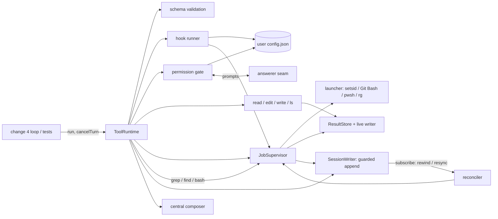
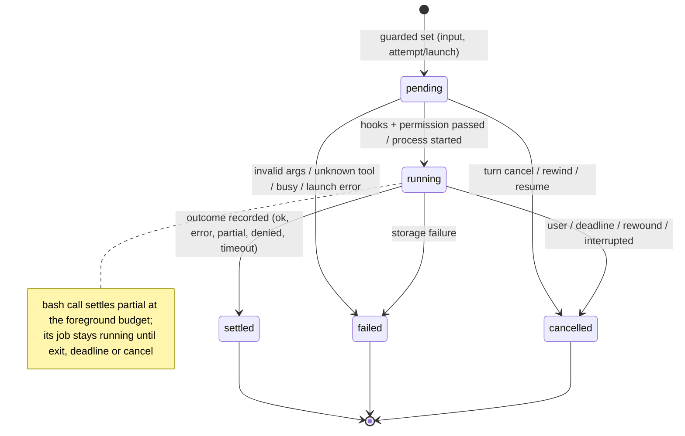
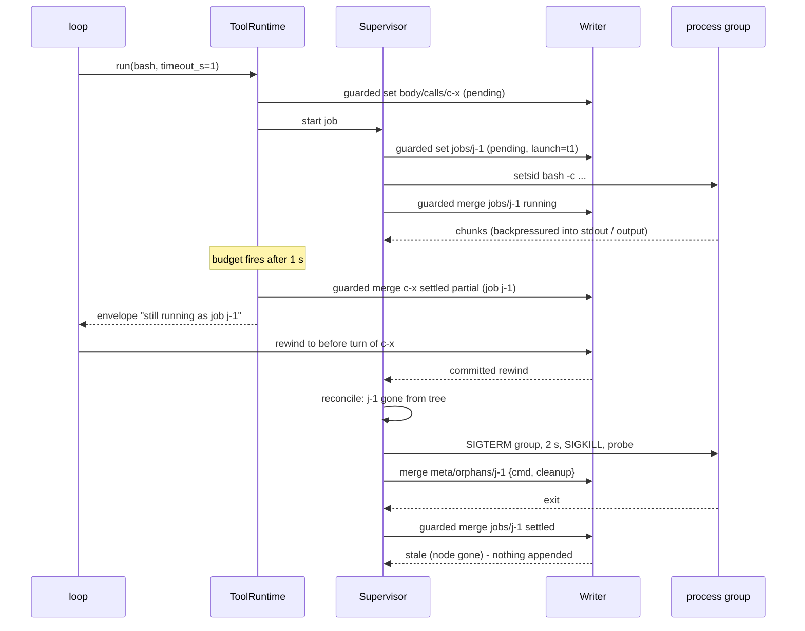
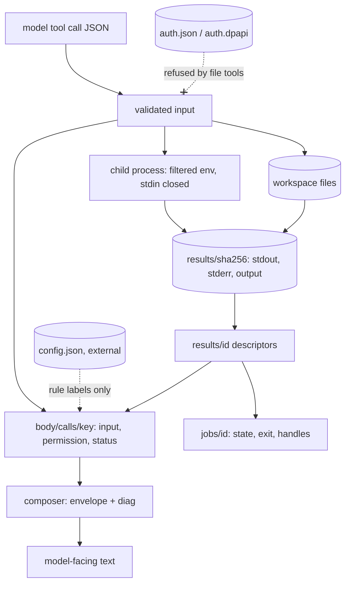

# Design

## Triage

| Trigger | Applies? | Evidence |
|---|---|---|
| T1 Components (new component, or 3+ with directed relationships) | Yes | New tool runtime, permission gate, hook runner, job supervisor, reconciler, shell launcher and config reader, with directed edges into the existing writer (`lib/src/session/writer.dart:130`) and result store (`lib/src/results/result_store.dart:90`). |
| T2 State (persistent state, caches, 3+ state machine) | Yes | New tree nodes `body/calls/*`, `jobs/*`, `meta/orphans/*`; five-state call and job lifecycles; an in-memory runtime job map that must reconcile with the tree. |
| T3 Concurrency (background work, workers/isolates, async, retries) | Yes | Parallel calls, background jobs, deadlines, cancellation racing exit, rewinds racing callbacks. |
| T4 Boundaries (data format, migration, shared interface, IPC, external) | Yes | Tool schemas and envelope seen by the model; tree layout read by changes 4 and 5; child processes (`bash`, `rg`, hooks); the user configuration file. |
| T5 Volume (grows without a fixed bound) | Yes | Command output, read results, the number of jobs and calls over a session. |
| T6 Risk (security, money, data loss, unrecoverable user data) | Yes | `edit`/`write` mutate user files; `bash` runs arbitrary commands; permission bypass; credential exposure through tools. |

TIER: FULL

## Context

The proposal gives the why and the scope. This section covers what the approach builds on.

- **M1 contract.**
  - **Stack:** Dart 3.x AOT, no Rust core and no embedded script runtime. All durable session state is in the tree. The only exceptions are the external secure credentials (change 2) and the user configuration file, which is an explicit external input ([architecture state ownership](../../architecture.md#state-ownership)).
  - **Sensorium:** stays at turn, budget and central truncation. This change ships no turn or budget rendering; that is change 4.
  - **Deferred to M2+:** nocterm, compaction, LSP, jj checkpoints, the full plugin protocol, MCP, Anthropic OAuth, the pricing registry and themes. Delta footers, `summarize_result` and PTY/ConPTY are deferred too.
  - **Windows:** native Windows without WSL must run login and the line client in M1. This change keeps the tools runnable on Windows (Git Bash or PowerShell, tree kill) but does not claim full Windows tool parity, which is an M2 exit.
  - **Process:** change 3 of the roadmap chain, one PR. It is authored with Claude Code. The Kehai apply attempt rule starts at change 4, after its earliest runnable loop.
- **Writer.** The writer runs every operation through one queue (`writer.dart:586`). A `decide` closure evaluated at the queue head returns the record, or `null` for nothing (`writer.dart:650-677`). The queue admits 64 pending operations (`writer.dart:25`). `recordResult` already uses this pattern for its conditional collision check (`writer.dart:417`). Request finalization on open is `_finalizeRequests` (`writer.dart:554`); this change adds the same idea for call and job nodes, above the writer.
- **Result store.** It stores one stream whole with chunk backpressure (`result_store.dart:110`). It exposes no handle on an in-progress write.
- **Composer.** It owns every cut. Its per-tool policies are `read` (400 lines), `bash` (8k tokens, head and tail) and the rest (8k tokens) (`composer.dart:70-83`). Paging and search exist (`lib/src/results/reader.dart`, `lib/src/results/search.dart`).
- **Provider.** It exposes tools as `ToolSpec` (`provider.dart:63`) and delivers complete `ToolCall` events only on a completed response. It also has a `CancelToken` (`provider.dart:327`) that this change reuses for call cancellation.
- **Platform glue.**
  - **POSIX FFI** already binds libc symbols through `DynamicLibrary.process()` (`lib/src/auth/posix_ffi.dart:150`); this change adds `kill`.
  - **Settings** resolve the Kehai home (`lib/src/cli/settings.dart:58`).
- **Hashline reference:** oh-my-pi at `d94bdfa1bb25e50cf90fb57fefb1863e5aef86fc`, `packages/hashline/src/`.
  - **What it does:** one 4-hex xxHash32 per file, over LF-normalized, BOM-stripped text with trailing `[ \t\r]` trimmed per line (`format.ts:173-186`). Lines render as `N:TEXT` (`format.ts:109,202-205`).
  - **Edits:** they use original line numbers, apply bottom-up and reject overlaps (`prompt.md:25`, `apply.ts:1106-1158`, `parser.ts:445-448`).
  - **Not adopted** (the "fail loudly" rule): drift remapping (`recovery.ts:64-88,341-355`), snapshot side stores (`snapshots.ts:114-117`), path recovery (`patcher.ts:360-371`), head/tail inserts despite drift (`patcher.ts:742-745`) and silent indentation or boundary repairs (`apply.ts:1203-1240`).
  - **Anchor granularity:** per 16-line block instead of per file. The user chose this on 2026-10-29 to match the roadmap's "hash every N lines".
- **Development hosts:** `rg` 15.x, Git Bash, `pwsh` and `jj` are present on the Windows development host. `setsid` is not, but it is not needed on Windows. Linux qualification runs in WSL (approved, light, cleaned up).

## Decisions

### D1: Module layout and engine seam

- **Choice:** New libraries:
  - `lib/src/tools/` holds the runtime, roster, schemas, file tools, search, `ask` and `job`.
  - `lib/src/jobs/` holds the supervisor, reconciler, finalization and process launcher.
  - `lib/src/shell/` holds shell detection and the read-only command proof.
  - `lib/src/permissions/`, `lib/src/hooks/` and `lib/src/config/` (the user configuration) each get their own library.

  The one entry point for change 4 is `ToolRuntime.attach(writer, store, {workspace, config, answerer, yolo})`. It runs finalization (D12) and returns a runtime offering:
  - `specs` (the `ToolSpec` list);
  - `run(turnCall)`, which returns the composed model text;
  - `cancelTurn()`, `cancelJob(id)`, `close()`;
  - a prompt stream for the answerer.
- **Rejected:** a tools package or isolate per tool family behind its own message protocol, because cross-isolate contracts add a boundary with no isolation gain (processes already isolate the risky work), and D1 of change 1 rejected splitting the package.
- **Reversal cost:** low. These are internal modules behind one runtime API.

### D2: Tree layout for calls and jobs (recorded as ADR 0010)

- **Choice:** Call nodes live at `body/calls/<key>`.
  - **Key:** `c-` plus the first 12 hex of SHA-256(provider call id), so any provider id becomes a valid path segment (ADR 0008 alphabet).
  - **Fields:** `{tool, version, callId, attempt, input, status, permission?, hooks?, diag?, envelope?, summary?, result?, reason?}`.
  - **Job nodes:** `jobs/<id>`, `<id>` = `j-` plus 8 random hex, with the spec's shape.
  - **Orphan records** from rewinds go in `meta/orphans/<id>`.
  - **Launch records** go in `meta/handoffs/<launch>`. They live from a job's admission until its settle, or until its output mapping has moved to `meta/orphans` (D8). Because `meta` is rewind-exempt, a job's spool names are durable for its whole life, whatever rewind removes.

  Both `body` and `jobs` are turn-anchored v1 roots, so rewind and fork cover them with no new code. `meta/orphans` is session-lifetime, so a kill that rewind caused stays visible after the rewind.
- **Rejected:**
  - Calls nested under each turn's assistant message (`body/t<n>/msg/calls`), because change 4 owns the message chain and has not designed it. A flat registry lets resume and reconcile find every call without walking message structure.
  - A separate `calls/` root, because it would be a format bump (new root) for no behavioral gain.
- **Reversal cost:** medium. Moving the paths later needs a journal migration (ADR 0008 rule). M1 sessions are development data, so the migration is small. ADR 0010 makes it explicit.

### D3: Call lifecycle and envelope mapping

- **Choice:** One state machine (diagram T2). The mapping:

  | Lifecycle | Envelope status |
  |---|---|
  | `settled` | `ok`, `error`, `partial`, `denied` or `timeout`, from the tool's outcome |
  | `failed` (validation, launch, `tool busy`, storage) | `error` |
  | `cancelled` | `error` with summary `cancelled: <reason>` |

  - **Records:** each transition is one guarded `merge` on the call node (D9). The terminal merge installs the result reference, so it is subject to D9's descriptor check and retry: a rewind between storing the result and settling cannot leave the call pointing at an unknown handle. `input` is recorded with `pending`, so a crash after admission still shows what was asked.
  - **Composition:** the model-facing text is always `composeResult(...)` (`composer.dart:94`), with tool-specific policy from `ResultPolicy.forTool`, plus `[diag ...]` lines.
  - **Short results:** messages such as `unknown tool` are stored through the result store too, so every terminal node has a handle.
  - **Storage failure is the one exception** (architecture resource bounds: "reporting partial/error out-of-band if persistence itself fails"). `ResultStorageFailed` returns no descriptor (`result_store.dart:65`), and disk exhaustion may also block storing an error text.
    - **Writer usable:** the node gets a guarded merge `failed` with `reason: "storage: <error>"`, `accepted: <bytes>` and no `result`. The model text is built by a small `composeStorageFailure` beside the composer, the only handle-less envelope.
    - **Writer broken:** nothing more is appended. `run` throws the writer's `StorageError`, and the runtime refuses further calls, because the session must be reopened (change 1 contract).
- **Rejected:** returning short errors inline without a stored result, because it creates a second rendering path, and a result without a handle could not be paged or searched. That breaks the "one envelope" invariant.
- **Reversal cost:** low.

### D4: Block anchors for `read` and `edit`

- **Choice:** 16-line blocks aligned at line 1, with the hash per the spec.
  - **xxHash32:** implemented in-repo, about 60 lines, tested against the published reference vectors. There is no package dependency.
  - **`read` makes two passes per block,** so memory is constant whatever the line lengths, line count or `limit`. For each block it records the block's start byte offset, then:
    - **Hash pass:** it reads the block's 16 lines in 64 KiB chunks into a streaming xxHash32 and stops at the 16th line end. Only the current block's hash is held; there is no hash list.
    - **Render pass:** it seeks back to the block's start offset and streams the same bytes again, writing `N#HASH:` or `N:` prefixes and the line bytes chunk by chunk into the result store.
    - **Change check:** `read` takes size and mtime before the first block and compares them after each render pass and at the end. A difference fails with `file changed during read`.
    - **Working set:** one 64 KiB read buffer, two xxHash32 states (each 4 accumulators, a 16-byte tail and a length) and the result store's write buffer. That is under 1 MiB for a 2 GiB single line and for a 64 MiB file of empty lines alike.
  - **Trailing-whitespace trimming in a stream** uses two hash states:
    - **`committed`** holds the block's bytes up to the last non-whitespace byte seen.
    - **`speculative`** starts as a copy of `committed` when a space or tab follows content, and takes the whitespace run byte by byte.
    - **Next byte non-whitespace:** `speculative` becomes `committed`, so the exact interior sequence of spaces and tabs is hashed in order, and the byte is added.
    - **Line end:** `speculative` is discarded, which trims the run.
    - **Separators:** `\n` goes into `committed` between lines of a block, never after its last line.
    - **State copying** is a value copy of the state fields, so a run of any length costs constant memory. Chunk boundaries do not matter, because the states carry over between chunks.
    - **The BOM** is skipped only at byte 0 of the file. CR and CRLF are line ends, so a CR never reaches a whitespace run.
  - **`edit` arguments:** `{path, anchors:[...], ops:[{op:"replace",start,end,text} | {op:"insert",after,text} | {op:"delete",start,end}]}`. `text` is split on `\n`.
  - **`edit` validation** happens before any write: bounds, overlaps (two ops touching a common line, or two inserts at the same `after`), anchor syntax, coverage of every touched block, then a fresh hash of each named block. Then it applies bottom-up and writes atomically (D5).
  - **`edit` result:** it re-renders the touched blocks of the new file. When the line count changed it adds `later anchors: <anchor> …` for the blocks after the edit, so the model can keep editing below without a full re-read. This is a few characters per 16 lines, stored whole and cut only by the composer.
- **Rejected:**
  - The upstream whole-file hash: any change anywhere forces a re-read, and the roadmap asks for anchors every N lines.
  - A per-line hash, which costs about 4–5 tokens per line on every read.
  - Any position remapping, which the architecture forbids.
- **Reversal cost:** medium. The format is a contract with the model's habits and with change 5's prompts, not stored data, so changing N or the hash is a tool version bump.

### D5: Atomic file writes that preserve untouched bytes

- **Choice:** `edit` keeps every line's own terminator, as an `(text, eol)` list.
  - **Endings:** a replaced line keeps the terminator of the line it replaces; inserted lines take the preceding line's, else the file's first, else LF.
  - **BOM and last line:** the BOM is kept. The last line's missing newline is kept unless the edit replaces that line.
  - **Write sequence:** write to `<dir>/.<name>.kehai-<rand>`, flush, copy the POSIX mode, rename. On failure the temporary file is deleted. Just before the rename it checks that the target's size and mtime equal what it hashed at validation. A mismatch rejects with `file changed during edit; read the file again`. This narrows, but does not close, the window against concurrent writers.
  - **`write`** creates parent directories and writes exactly the given text.
- **Rejected:** upstream's normalize-then-restore of one ending for the whole file (`normalize.ts:10-21`, `patcher.ts:510`), because it silently rewrites unrelated lines of mixed-ending files.
- **Reversal cost:** low.

### D6: Search through `rg`, listing in-process

- **Choice:** `grep` runs `rg --line-number --no-heading --color never --with-filename --null` with the arguments mapped from the schema. A streaming transformer rewrites `path\0line:text` into `path:line: text`. `find` runs `rg --files`.
  - **The tool's `glob` never reaches `rg`.** A positive `rg --glob` overrides ignore files and hidden-file rules (rg's documented `-g` behavior, reproduced on 15.2.0: a `.ignore`d file and a hidden file are listed once the glob matches them), which breaks the spec's "respecting ignore files". The streaming transformer instead filters each path, relative to the search root, through a small in-repo glob matcher (`*`, `**`, `?`, `[...]`, `{a,b}`, in rg's glob syntax), dropping non-matching paths (`find`) or lines (`grep`). Ignore and hidden rules therefore stay exactly as rg applies them, and `hidden` and `no_ignore` keep their rg meaning. The cost: rg walks, and for `grep` searches, files the glob would have skipped. Negative globs, such as the credential exclusion below, are still passed to rg, because an exclusion cannot widen the set.
  - **Counts come from accepted output.** The match, file and path counters advance only for paths or lines the filter accepts. On a successful rg exit (0 or 1), zero accepted `grep` lines give an empty body and the summary `no matches`, and zero accepted `find` paths give `0 files`; the credential-exclusion note is kept in either case. rg exit 2 stays `error` with stderr, whatever the filter accepted.
  - **Exit codes:** rg exit 1 means no matches (`ok`); exit 2 means `error` with stderr.
  - **Jobs:** both run as `shell`-less jobs (kind `shell`, `shell: null`, argv direct) under the supervisor, so they share budget, deadline and cancellation.
  - **Credential exclusion:** whenever the search root contains the Kehai home, `--glob '!<home relative to root>/auth.*'` excludes the whole credential name family (`auth.json`, `auth.dpapi`, `auth.lock` and the backends' `auth.<x>.<pid>_<n>.tmp` files, from `posix_file_backend.dart:108` and `dpapi_backend.dart:176`). The glob matches names, not a listing taken earlier, so a temporary file created mid-search is excluded too. The file tools apply the same rule to resolved paths.
  - **No configuration:** `rg` always runs with `--no-config` and without `RIPGREP_CONFIG_PATH`, so a config file cannot inject `--pre`.
  - **`ls`** is in-process (`Directory.list`, not recursive).
  - **`rg` resolution** happens once at attach: `rgPath`, else `PATH`. `rg --version` must succeed.
- **Rejected:**
  - Passing the tool's `glob` to rg as `--glob`, because it overrides ignore and hidden rules (above).
  - A temporary ignore file built from the glob, because translating a positive glob into negated ignore patterns is error-prone and leaves a file to clean up per call.
  - A `package:glob` dependency, because the matcher is small and this change adds no dependencies.
  - An in-process Dart search fallback, because it is slow on large trees and duplicates ignore-file semantics. The architecture says bundled or detected `rg`; bundling is a native asset and not needed for M1.
- **Reversal cost:** low.

### D7: Shell detection and launch

- **Choice:** Detection happens once at attach.
  - **Linux and macOS:** `bash` on `PATH`.
  - **Windows:** Git Bash, found as the `bin\bash.exe` beside `git.exe` from `PATH`, then `%ProgramFiles%\Git\bin\bash.exe`. `C:\Windows\System32\bash.exe` is never used, because it is the WSL launcher. Then `pwsh`, then `powershell`.
  - **Invocation:** `bash -c <cmd>`, or `pwsh -NoProfile -NonInteractive -Command <cmd>`.
  - **Process groups (POSIX):** commands are launched through `setsid` (util-linux), so the child is a new session and process-group leader with pid = pgid. Kehai's child is not a group leader, so `setsid` execs in place. When `setsid` is missing (macOS), launch is direct and group termination is reported `uncertain`.
  - **stdin and environment:** stdin is closed at once. The environment is filtered as the spec says, with configured passthrough.
  - **Autoapproved commands get no shell** (closes the `BASH_ENV` hole). A command approved by the builtin proof or a user rule is executed directly as its tokenized argv. The program resolves only through absolute `PATH` entries outside the workspace, else the call falls back to the prompt. The environment additionally drops `BASH_ENV`, `ENV`, `BASH_FUNC_*`, `SHELLOPTS`, `BASHOPTS` and `RIPGREP_CONFIG_PATH`. The proof forbids glob characters, so no shell expansion is needed. Commands the user approved at the prompt, or under `--yolo`, run through the shell as typed: the user authorized that command in their own environment.
- **Rejected:**
  - Dart's `ProcessStartMode.detachedWithStdio`, because detached processes have no exit code in Dart, so status would need a wrapper writing `$?` to a file.
  - A PTY/ConPTY, which is deferred.
- **Reversal cost:** low.

### D8: Unified supervisor, foreground budget and streaming

- **Choice:** One `JobSupervisor` per runtime.
  - **Admission and launch ownership:** synchronously, before any `await`, it checks the live bound (16) and inserts a runtime **reservation** `{launch, state: launching, cancelRequested: false}`. It then appends, in order:
    1. **The launch record** `meta/handoffs/<launch>` = `{job, session, spools: {<stream>: <name>}}` (guarded: absent). No spool file exists yet.
    2. **The node `pending`** (guarded: absent), with the fresh `launch` token and the same `spool` names.
    3. **Spool creation,** after the `pending` record commits.

    A crash or a rewind at any later point therefore finds the spool names in `meta`. The reservation is what the reconciler and `cancelJob` see during launch. Finalizing a launching job sets `cancelRequested`.
    - **After `Process.start` returns:** the launcher checks `cancelRequested`. If set, it terminates the new process tree at once (D10) and appends nothing for `running`.
    - **Otherwise:** it merges `running` (guarded).
    - **Stale is never ignored:** whenever any guarded update for a live process returns `stale`, the supervisor terminates that process tree and records `meta/orphans/<id>` when the node is gone.
    - **Test seam:** launch hooks pause at each boundary (after reservation, after the `pending` commit, after start, before `running`), like `OwnershipHooks` (`lib/src/session/ownership.dart`), so the spec's launch-race scenarios are deterministic.
  - **Streaming results:** three result writes (`stdout`, `stderr`, combined `output`) go through a new `ResultStore.begin(spoolName)` live writer. It writes the pre-named spool file `results/.spool-<launch>-<stream>` and hashes as it goes.
    - **`snapshot()`** stores the accepted prefix of the spool as its own result through `storeResult`, for `job output`. The spool is untouched.
    - **`seal()`** flushes and closes the spool and returns its descriptor (SHA-256, bytes, lines) without renaming.
    - **`publish(spoolName, descriptor)`** renames the spool to `results/<sha256>`, using the existing rule when that name already exists with the same size. It writes no record.
    - **`adopt(spoolName)`** hashes an existing spool, used by resume (D12).
  - **Intent, publish, register, settle (crash-safe handoff):** the existing result contract holds throughout: a descriptor under `results/` and a reference to it are recorded only once its file exists (result-store spec; `handles.dart:27-48`, `fork.dart:76-94`). The launch record lives in `meta`, which rewind never touches (ADR 0008; `writer.dart:287`). It names the spools from admission on, so the mapping survives any rewind until the job is settled.
    1. **Intent:** seal each stream, then `merge` into the launch record `{streams: {<stream>: {spool, sha256, bytes, lines, complete}}, outcome}`. A launch record with `streams` is the intent.
       - **`outcome`** is the terminal state the job will take, with `exit` and `reason`. **`session`** is `meta/session` at the time of writing.
       - **`complete`** is stored per stream and never derived later. It is `true` only when the job exited on its own and that stream reached end of file. Cancellation, deadline, interruption and adoption on resume always store `false`, whether or not the process left an exit code.
       - **Intent guard:** the launch record exists without `streams`, and the job node exists with this `launch` and is non-terminal.
       - **Refused because the job is gone or superseded** (a rewind before or during sealing): the supervisor still holds the sealed descriptors. It runs the orphan transfer below with them, as dispositions `spooled`. Nothing is published, and no job node is recreated.
       - **Visibility:** nothing under `results/` or in the job node changes, so no handle exists yet, and handle resolution and fork ignore the intent.
    2. **Publish:** publish each spool to its content-addressed name.
    3. **Register:** append each descriptor under `results/<id>` (`recordResult`, `writer.dart:417`, idempotent).
    4. **Settle:** one guarded merge on `jobs/<id>` records the terminal state and the `stdout`, `stderr` and `output` references, each with the intent's `complete` for that stream. It is subject to D9's descriptor check like every reference-installing record.
    5. **Clear:** `del meta/handoffs/<launch>`, under the cleanup guard, not the ownership guard. The launch record must exist, and the job node must be terminal with this `launch`, or else absent or carrying another `launch`. In the absent or superseded case, `meta/orphans/<id>/outputs/<launch>` must also already hold the record's stream mapping (below).
       - **Launch failure:** a job that goes `pending` → `failed` without a process has empty spools. It is settled with no stream references, its spools are deleted, and then its record is cleared.
       - **Intent already absent:** the clear completes as done and appends nothing, so a repeated clear is harmless.
       - **Job node non-terminal with this `launch`:** a rewind committed between steps 4 and 5 and undid the settle. The clear is refused `unsettled` and the supervisor repeats steps 3 and 4 from the intent, because the process really exited. The intent is never removed while its job could still read `running`.

    - **Consumers:** any consumer sees either a non-terminal job without references, or a terminal job whose every reference resolves. That covers subscribers, a concurrent `job` call and a fork.
    - **Rewind during the handoff:** a rewind that keeps the job's start may remove descriptors registered in step 3. Step 4 then returns `descriptors missing`, and the supervisor registers them again from the intent and retries (D9).
    - **Rewind, then crash:** if the engine crashes before step 4, attach still finds the intent in `meta` and completes it (D12).
    - **Rewind past the start:** a rewind that removes the job node or changes its `launch` makes step 1 or step 4 return `stale`. The supervisor then runs the **orphan transfer**, in this order:
      1. **Record:** `set meta/orphans/<id>/outputs/<launch>` = one entry per stream: its spool name, its hash when known, and its disposition (`published`, `spooled` or `absent`) as found on disk.
         - **Hash source:** taken from the intent, or from the supervisor's sealed descriptors, or from `adopt` on the spool during attach.
         - **Idempotent:** the `set` writes the same value for the same launch, so repeating it is harmless.
      2. **Clear:** clear the intent. The cleanup guard refuses this until step 1 has committed, so the mapping is always durable in `meta` first.

      A crash before step 1 leaves the intent, and a crash between the steps leaves both. Either way the next attach repeats the transfer and ends with the mapping in `meta/orphans` and no intent.
  - **Exit:** it waits for the process exit and both pipes' end, then runs the handoff above.
    - **Bounded drain:** the supervisor never waits on a pipe without a bound. Once the direct process has exited, it waits up to 2 s for both pipes' end. If a pipe is still open, it starts D10's termination of the process group (SIGTERM, then SIGKILL after the 2 s grace). The second 2 s drain runs concurrently with that grace, not after it. At the end of that interval the remaining readers are force-closed (below), and only D10's probe of up to 1 s may follow. That covers a pipe held by a background child. A cancellation or deadline reuses its own running termination sequence: the drain's second interval is that termination's grace, and no further grace is started.
    - **Forced close:** if a pipe is still open after that, a descendant escaped the group, for example through `setsid`. The supervisor cancels the pipe subscription and closes its end of the pipe. Every byte already written to the spool is kept. The stream is sealed with `complete: false`, and `cleanup` records `uncertain: output pipe held by a surviving process`.
    - **Bound:** from exit, or from cancellation's kill grace, the job reaches `handoff` within 4 s plus the D10 probe. Its admission slot is then released by the normal settle.
    - **Natural exit with a forced close:** the job keeps its exit code, but the affected streams are `complete: false`. Cancellation and deadline use the same handoff, with every stream's `complete` stored as `false` in the intent. The supervisor keeps the job's runtime entry until step 5 succeeds. The runtime entry has a phase: `launching`, `running`, then `handoff`. It enters `handoff` once process exit is observed and each pipe has either reached EOF or completed forced reader closure, and before sealing. Incomplete flags and the cleanup uncertainty from a forced closure are kept through the handoff. A launch record, which exists from admission, proves nothing about exit.
    - **`cancel` or a reconciler pass while `launching` or `running`:** it terminates the process tree as D10 and D11 say, whether or not a launch record exists. Sealing then follows the termination and stores every stream `complete: false`. If the node is gone, the intent guard refuses and the orphan transfer runs.
    - **While `handoff`:** the process has already exited. A `cancel` answers `job <id> already exited`, and a reconciler pass leaves the handoff to its owner, which handles any ownership loss through the stale paths above.
    - **No runtime entry** (D11): the pass finishes the handoff itself when the record holds an intent.
  - **Foreground budget:** a timer owned by the calling tool, not the job. When it fires, the call settles `partial` with the job id while the job runs on.
  - **Deadline:** a supervisor timer per job.
- **Rejected:**
  - Per-tool timers and background registries, which ADR 0003 explicitly rejects.
  - Storing only the combined stream, which loses the authority shape's `stdout`/`stderr` handles (sensorium session model).
- **Reversal cost:** high (ADR 0003 shared contract). The evidence that settles it is the spec's cancellation, crash, stale-callback and rewind tests, which this change must pass.

### D9: Guarded append in the single writer

- **Choice:** Add `SessionWriter.applyGuarded(build)`. `build` runs inside `decide` (`writer.dart:650`) against the queue-head tree. It returns the record to append, or a refusal that completes the call and appends nothing. All runtime and supervisor updates to `body/calls/*`, `jobs/*` and `meta/handoffs/*` use it. Each kind of record states its guard:
  - **Ownership guard,** for every call and job transition: the node exists ∧ its `attempt`/`launch` equals mine ∧ its status is not terminal. Failing it is refused `stale`.
  - **Launch record, intent and cleanup** for `meta/handoffs/*` have their own guards (D8 admission, steps 1 and 5). Cleanup is legal exactly when its job is settled, gone or superseded, and the ownership guard would forbid all three.
  - **Descriptor check, for every reference-installing record:** this covers call results, job stream references, `job output` snapshots and resume's synthetic results. Such a record is refused `descriptors missing` (listing the handles) unless every handle it references has its descriptor under `results/` at the queue head. The rule lives in `applyGuarded`, which scans the record's value for result references, so no caller can skip it.
  - **Retry:** the caller still holds each descriptor it stored. On `descriptors missing` it calls `recordResult` for the listed ones and retries the same record under the same ownership guard. `stale` ends the retries. A rewind that keeps the owner but drops a descriptor therefore delays the reference; it never installs an unknown handle. The journal format is unchanged. A `stale` answer for a live process obliges the caller to terminate it (D8).
- **Rejected:**
  - Checking the tree before calling `apply`, a check-then-act race with other queued operations: a rewind queued between the check and the append would let a stale record land.
  - A second writer or lock for jobs, which would be two writers.
- **Reversal cost:** low. It is an internal API.

### D10: Cancellation and process-tree termination

- **Choice:** `cancelJob` first merges `signal: "term"`, guarded.
  - **POSIX:** `kill(-pgid, SIGTERM)` through FFI. After a 2 s grace it sends `kill(-pgid, SIGKILL)`, then probes `kill(-pgid, 0)` for up to 1 s. ESRCH means `cleanup: confirmed`; otherwise `uncertain: group still present`.
  - **Windows:** `taskkill /PID <pid> /T /F`, then `cleanup: uncertain: descendants not verifiable`.
  - **Record:** the terminal merge records `cancelled`, `reason`, `cleanup` and output so far, with `complete: false`.
  - **Turn cancellation:** `cancelTurn` cancels the turn's pending calls, then running calls, through their `CancelToken`s. A running call cancels its foreground job. Background jobs handed off earlier are left alone.
- **Rejected:**
  - Windows Job Objects through FFI, which are stronger but more native surface than M1 needs; deferred with Windows tool parity to M2.
  - Killing only the direct child, which leaves dev servers running.
- **Reversal cost:** low.

### D11: Generic reconciler

- **Choice:** The supervisor subscribes to the writer (`writer.dart:491`).
  - **Trigger:** on every committed `rewind`, and on `ResyncRequired` (it resubscribes), it runs one level-triggered pass over the whole tree and its runtime map.
  - **Node gone or `launch` differs:** terminate as in D10, then `merge` `{cmd, rewoundTo, cleanup}` into `meta/orphans/<id>`. Every writer of an orphan record uses `merge` (`tree.dart:128`, creating the node when absent), or a `set` below its own subkey such as `outputs/<launch>`, so the kill record and the output mapping never overwrite each other, in either order.
  - **Node live with no runtime entry:** if `meta/handoffs` holds an intent for its `launch`, the job exited and the pass settles it from the intent (D12's intent path). If the record has no intent, the pass adopts its spools as D12 does, with outcome `cancelled`/`rewound` and `complete: false`. With no record, it gets a guarded merge `cancelled`, reason `rewound`.
  - **Call nodes** get the same rule against the runtime's live calls.
  - The pass is idempotent and has no per-tool code. Passes are serialized, so a second rewind during a pass reruns it afterwards.
- **Rejected:** a callback per tool on rewind, which ADR 0003 and the sensorium session model forbid.
- **Reversal cost:** medium. The `meta/orphans` shape is stored data; ADR 0010 covers it.

### D12: Resume finalization at attach

- **Choice:** `ToolRuntime.attach` walks `jobs/*` first, then `body/calls/*`.
  - **Launch records first:** attach walks `meta/handoffs/*` before `jobs/*`. Each record, with or without an intent, is decided from the tree and the disk alone, so a crash during attach leaves a state the next attach handles the same way.
    - **Job node gone or `launch` differs** (rewound past its start, at any point of the job's life): run D8's orphan transfer. Spools without an intent's hashes are `adopt`ed first. The mapping is recorded under `meta/orphans/<id>/outputs/<launch>`, then the record is cleared. A spool still on disk is left under its name and listed as `spooled`, so the bytes stay findable. A record whose spools never existed (a crash between the launch record and the `pending` record) lists every stream `absent`.
    - **Job node terminal with this `launch`** (crash between steps 4 and 5): clear the intent. Nothing is recorded for the job.
    - **Intent written by another session** (`session` differs from `meta/session`: a fork child inherited it, since fork copies `meta`, `writer.dart:304`): the job is settled as below, but with outcome `cancelled`/`interrupted` and every stream `complete: false`. The parent's process never belonged to the child, and only files the fork copied exist in the child's directory.
    - **Job node non-terminal with this `launch`:** finish steps 2 to 5 of the D8 handoff, stream by stream:

      | `results/<sha256>` with the intent's size | Spool on disk | Action |
      |---|---|---|
      | present | either | already published: register |
      | absent | present with the intent's size | `publish`, then register |
      | absent | absent or another size | record the stream absent, never as empty success |

      The settle applies the intent's `outcome`, and each reference takes the `complete` the intent stored for its stream. Recovery never upgrades `complete`: cancelled, timed-out and interrupted output stays `false`.
    - **Record without an intent, job node non-terminal with this `launch`** (crash while running): each spool that exists is `adopt`ed. The intent is merged into the record as in D8 step 1, with outcome `cancelled`/`interrupted` and every stream `complete: false`. The job then takes the path above. A missing spool is recorded absent.
  - **Fork children:** a child resolves spool names in its own session directory and never renames a file of its parent. A spool missing there takes the `absent` rows.
  - **Live calls:** each `pending` or `running` call gets a stored text result `interrupted: the engine stopped while this call was <status>; effects uncertain`, referenced with `complete: false`, and its merge to `cancelled`/`interrupted`, or `failed` when it carried an error `reason`. It points at its job's output handle when it has one.
  - **Leftovers:** content-addressed files that no reference or orphan record names (the existing store's own crash window) are left in place and counted in the report. Every spool is named by a launch record or an orphan record, because the launch record precedes spool creation.
  - **Storage failure** during any of this fails the attach (spec). Only after every record commits does attach return a runtime that admits calls. It reports the count and the warning that processes may still run, because no PID is stored to check. Fork children take the same path when opened, so a parent's running job never appears live in a child.
- **Rejected:** finalizing inside `SessionWriter.open`, because that couples the journal layer to tool semantics. The runtime is the only component that admits calls, so gating there is sufficient.
- **Reversal cost:** low.

### D13: Permissions

- **Choice:** The gate order is validate → hooks → credential-path refusal → builtin allowlist → user rules → yolo → prompt.
  - **Credential refusal** goes first among the allow steps, so neither yolo nor a rule can bypass it.
  - **Workspace check:** `File.resolveSymbolicLinks` (or the nearest existing ancestor for new files), checked against the resolved workspace root. Matching is case-insensitive on Windows.
  - **Shell proof:** a small hand-written tokenizer (single quotes, double quotes without `$`, backquote or backslash, and plain words). Any forbidden character outside single quotes, or a glob character, means not proven.
  - **Option table:** each allowed program has an explicit table of options, each typed `flag`, `value` (non-path) or `path`, accepting both attached (`-fX`, `--file=X`) and separate forms. An unlisted option fails the proof. Every `path` operand and every positional operand is resolved against the call's effective `cwd`, which must itself be inside the workspace. A path that resolves outside, or crosses a symlink outside, fails the proof. Tables (M1):

    | Program | Options |
    |---|---|
    | `pwd` | none |
    | `ls` | `-a -l -1 -h -R -t -r -S`, each a flag |
    | `cat` | `-n -A`, each a flag |
    | `head`, `tail` | `-n` and `-c`, each taking a value |
    | `wc` | `-l -w -c -m`, each a flag |
    | `rg` | flags `-n -i -S -F -w -l -c -v --hidden --no-ignore --files`; values `-e`, `-g/--glob`, `-t/--type`, `-A`, `-B`, `-C`, `-m`; paths `-f/--file`. No `--pre`, `--pre-glob`, `-z`, `--search-zip` |

    `tail -f` is excluded: it is read-only but never ends, so it would hold a call until its budget.
  - **User rules** are matched against the tokenized argv as an exact prefix, after the same proof's shape rules (so `&&` and redirects never match).
  - **Recording:** the decision is merged into the call node as `permission`, before the call runs.
  - **Prompts** go through the answerer as `{key, kind: permission, tool, input}` with `allow` or `deny`.
- **Rejected:**
  - A shell-prefix string match, which the architecture rejects.
  - Parsing full bash grammar, which is large, and anything outside the simple form asks anyway.
  - Session-wide "always allow" grants, which are not needed for M1. Users put durable rules in the configuration.
- **Reversal cost:** medium. Widening autoapproval later is easy; narrowing it after users rely on it is not.

### D14: Hooks as jobs with an independent deadline

- **Choice:** A hook is a `hook` job launched like D7, with the call JSON written to stdin and stdin then closed. The deadline timer belongs to the hook runner, not to the hook. At the deadline it runs D10 termination and does not wait past the 2 s grace. The outcome follows the spec table. The default deadline is 10 s, subject to the measurement task: the default must be ≥ 3× the measured p95 startup on Linux bash, Git Bash and Windows PowerShell, and ≥ 2 s. Measurements go in `docs/measurements/hook-startup.md`.
- **Rejected:** the sensorium's 300 ms collector timeout, which is below Windows shell startup (architecture resource bounds), so every optional hook would be skipped and every deny hook would deny.
- **Reversal cost:** low.

### D15: User configuration

- **Choice:** `<kehai home>/config.json` (JSON, so no YAML dependency), strictly parsed with unknown keys rejected:

  ```json
  {"allow":[{"tool":"bash","argv":["jj","status"]},{"tool":"edit"}],
   "hooks":[{"name":"guard","argv":["/usr/bin/guard"],"tools":["bash"],"policy":"deny","timeout_ms":5000}],
   "rgPath":"/opt/rg","env":{"passthrough":["OPENAI_API_KEY"]}}
  ```

  - It is read once at attach and never re-read mid-session.
  - Its content is not journaled. Decisions record the rule's label (`bash:jj status`), which is enough to audit them.
- **Rejected:** reading project files (`.kehai/`, `.claude/settings.json`), which repository content may not do: it may not change approval policy (ADR 0006).
- **Reversal cost:** low.

## Diagrams (FULL)

### T1 — components



### T2 — call and job lifecycle



### T3 — a command that outlives its budget, then a rewind



### T4 — data across boundaries



## State & Ownership (FULL)

| State | Owner (sole writer) | Lifetime | Invalidation / rebuild | Authoritative copy |
|---|---|---|---|---|
| `body/calls/<key>` | ToolRuntime, through guarded appends | until rewound past | rewind removes it; reconciler/resume finalize stranded ones | the tree |
| `jobs/<id>` | JobSupervisor, through guarded appends | until rewound past | the same | the tree |
| `meta/orphans/<id>` | reconciler | session | never removed (rewind-exempt) | the tree |
| `meta/handoffs/<launch>` | supervisor; attach on resume | from a job's admission to its settle or orphan transfer | `del` under the cleanup guard (rewind-exempt) | the tree |
| `results/<id>` descriptors and bytes | ResultStore and writer (change 1) | session | as in change 1 | the tree plus immutable files |
| Runtime job map (`id → process, launch, timers`) | JobSupervisor | process lifetime | reconciled against the tree after every rewind or resync; empty after restart | the tree; the map is a capability cache |
| Live call map (`key → attempt, CancelToken`) | ToolRuntime | process lifetime | the same | the tree |
| Open prompts (`key → completer`) | ToolRuntime | until answered, cancelled or withdrawn | turn cancel withdraws them | runtime only; the decision lands in the tree |
| Detected shell and `rg` path | ToolRuntime at attach | runtime lifetime | re-detected on the next attach | runtime |
| User configuration | the user (external file) | read once per attach | edit the file, then re-attach | `config.json` |
| Workspace files | the user's workspace; Kehai writes only through edit/write/bash | external | `edit` re-hashes at mutation time | the disk |

## Failure & Visibility (FULL)

| Component | Fails / dies mid-operation → | Recovery | Retry safe? | Who finds out |
|---|---|---|---|---|
| Engine process crash | calls and jobs left `running`; children may still run (no PID stored) | D12 finalizes as `interrupted` at the next attach | no automatic retry; the model decides | the user, through the attach report and warning; the model, through the cancelled envelopes |
| Writer storage failure | the writer is broken (change 1) | reopen the session | n/a | the call fails with the storage error; the runtime stops admitting |
| Result write failure | the producer stops (store contract) | none | the model may rerun | the call is `failed` with bytes accepted so far |
| Shell or `rg` missing | the call fails | install or configure | yes | the model, through the error text naming the fix |
| Process ignores SIGTERM | stays up through the grace | SIGKILL, then probe | n/a | the node's `cleanup` field |
| Process tree survives (Windows or group escape) | possible stray processes | none automatic | n/a | `cleanup: uncertain` on the node and the cancel result |
| Hook hangs or crashes | at most deadline + 2 s delay | D14 kill | n/a | a diag line (optional) or a `denied` reason (deny) |
| Edit races an external writer | caught in the pre-rename check, or lost in a sub-millisecond window | the model re-reads | yes, after a re-read | the error `file changed during edit`; the narrow window is an accepted risk (Risks) |
| Rename fails (Windows file lock) | target unchanged, temporary file deleted | none | yes, later | the call's error |
| Reconciler pass fails on a storage error | the writer is broken | reopen; attach finalizes | n/a | the user, through the writer error surfaced by `run` |
| Answerer disconnects | prompts open | turn cancel or reattach | n/a | the call stays `running` until the turn is cancelled; change 4 handles detach |
| Stale callback | dropped, no record | none needed | n/a | the caller gets `stale`; it is logged at debug level only, because the reconciler already recorded the job's fate |

## Resource Bounds (FULL)

| Queue / buffer / cache / transfer | Bound | At the bound | Timeout | At 10x / 100x |
|---|---|---|---|---|
| Running calls | 8 | queue | per-tool budget | unchanged; bound by design |
| Queued calls | 32 | `tool busy` (failed) | none while queued; turn cancel clears | 40+ calls per turn is already abnormal for one model turn |
| Live jobs | 16 | `too many live jobs` | job deadline (default 3,600 s, max 86,400 s) | unchanged |
| Writer queue (change 1) | 64 | `writer busy` | none | worst case is 8 calls + 16 jobs + reconciler, each with at most 1 queued record ≈ 25, under 64 |
| Pipe buffering | one read per stream (≤ 64 KiB), paused until written | the process blocks on write | job deadline | memory constant; disk grows with output |
| Result bytes per command | 3 copies (stdout, stderr, output) | disk-full gives a storage failure | job deadline | a 1 GiB log uses about 2 GiB. Accepted: full results are the locked foundation, and dropping the per-stream copies is a later option (ledger) |
| `read` render | two passes per block, 64 KiB chunks; one block hash in memory, no hash list; > 64 MiB requires `limit` | refusal with a hint | foreground budget | constant working set under 1 MiB, including a multi-GiB line, a 64 MiB file of empty lines and any `limit` |
| `edit` working set | whole file in memory; files > 16 MiB refused with `file too large to edit` | refusal | foreground budget | bounds memory at 10x/100x file size |
| Open prompts | ≤ the running calls (8) | n/a | none; turn cancel withdraws | unchanged |
| `meta/orphans` | one entry per job killed by rewind | grows with rewinds × live jobs | n/a | at 100x (a few thousand entries) still small beside `body`; compaction is M2 |
| Hook runs | per call, configuration-ordered, sequential | n/a | per-hook deadline (default 10 s, max 600 s) + 2 s grace | a slow hook delays each call by up to its deadline; that is user-configured |
| Reconciler passes | 1 running + 1 pending (coalesced) | coalesce | none | unchanged |

## Flow & State Gaps (FULL)

- **Exit vs cancel race:** both are guarded on a non-terminal status, so the first to commit wins and the other gets `stale` (spec scenario).
- **Budget vs exit race:** the call settle (partial or ok) is guarded on the call's attempt. Whichever of the budget timer and the exit wins is the call's outcome. The job's own settle is independent.
- **Rewind during an open prompt:** the reconciler finds the call node gone, cancels the call's token, and withdraws the prompt. A late reply is refused (`question withdrawn`).
- **Rewind during edit validation:** an edit already past validation completes its file rename, an external effect that rewind does not undo. Its settle record is then guarded and becomes `stale`, so the tree does not claim it. Accepted and documented: rewind never rolls back files (ADR 0003).
- **Two edits to one file in one turn (parallel):** each is validated and renamed independently. The second fails `stale anchor` when the first changed its blocks, or `file changed during edit` in the pre-rename check. A same-file mutex inside the runtime serializes validate-and-rename per resolved path, so two edits in this process never interleave there.
- **Restart mid-rename:** the target is either old or new (rename is atomic on one volume). An orphan temporary file `.<name>.kehai-*` may remain. It is not cleaned up automatically, and the next edit of that file reports it in the summary.
- **Turn advanced while a job runs:** later records carry the then-current turn (turn rule, ADR 0008). Rewinding to a turn between start and settle triggers the D11 `rewound` rule.
- **Fork during live jobs:** the child is finalized at attach (D12). The parent is untouched.
- **Out-of-order pipe end vs exit:** the job settles only after the exit code and both pipes' end, or the D8 forced close. A pipe still open 2 s after exit (a grandchild holding it) is closed by group termination. One still open 2 s after that (an escaped descendant) has its reader closed by force. The node records `cleanup` either way, so no job waits on a pipe without bound.
- **Prompt for a call later denied by a hook:** hooks run before the prompt, so a denied call is never prompted.
- **Rewind or cancel during launch:** handled by the D8 reservation. The process is terminated after start, and no `running` record lands.
- **Crash between the launch record and the `pending` record:** no spool exists yet, and no job node exists. Attach runs the orphan transfer with every stream `absent` and clears the record.
- **Rewind before or during sealing:** the intent guard refuses, and the supervisor transfers its sealed descriptors to `meta/orphans` before clearing the launch record (D8).
- **Crash at any point of the result handoff, or during attach itself:** the `meta/handoffs` intent survives rewind and D12 decides from the tree and the disk alone, so every interruption point resolves to a reachable result or a recorded absence.
- **Consumer or fork during the handoff:** before step 4 the job has no references, so there is nothing to resolve. Step 4 lands only while every referenced descriptor is present, and its file already exists.

## Mechanism Ledger (FULL)

| Mechanism | Built? | Why (harm nobody catches / expensive later) | Evidence that would change the call |
|---|---|---|---|
| Launch reservation (D8) | Yes | A rewind or cancel during `Process.start` would otherwise leave an effectful process running for a finalized node (review C2) | n/a |
| Direct exec for autoapproved commands (D7) | Yes | `BASH_ENV` or imported functions would run repository code under an approval that never saw it (review C1) | n/a |
| Spool finalization on resume (D12) | Yes | Without it the bytes a crashed command produced are lost, which ADR 0002 forbids | n/a |
| Descriptor check on every reference-installing record (D9) | Yes | A rewind between registering a descriptor and the record that references it would install an unknown handle, for jobs (review M10) and calls (review M13) alike | n/a |
| Handoff intent in `meta/handoffs` (D8, D12) | Yes | An intent in the job node can be removed by rewind before the job settles, so a crash would lose the spool-to-hash mapping (review M12). A `merge` also cannot remove a key, so a node-held intent would never clear (review M11) | n/a |
| Handoff intent, publish, register (D8) | Yes | Renaming before the journal records anything loses the bytes on a crash (review M6); recording references before the file exists exposes unresolvable handles to live consumers and fork (review M9) | n/a |
| Committed/speculative hash states (D4) | Yes | A whitespace counter loses the exact space/tab order of interior runs, so streamed hashes would diverge from the definition (review M7) | n/a |
| Guarded append (D9) | Yes | Without it a rewind between check and append lands stale state silently (traced: two writers to the queue) | n/a |
| Generic reconciler (D11) | Yes | ADR 0003 requirement; orphaned processes after rewind are otherwise invisible | n/a |
| `meta/orphans` record | Yes | Rewind removes the job node, so a kill's cleanup would be visible to nobody | n/a |
| Process groups via `setsid` | Yes | Killing only the shell leaves `dart test` workers and servers running | macOS becoming an M1 platform: needs a native spawn |
| Windows Job Objects | No | `taskkill /T` plus an `uncertain` label is honest | Observed stray processes in Windows dogfooding (M2 parity) |
| Session-wide "always allow" | No | The user configuration covers durable trust | Prompt fatigue recorded in change 6 dogfood |
| Full bash parser | No | The proof only needs to reject anything not simple | False "asks" on common read-only forms in dogfood |
| Same-file edit mutex | Yes | Parallel calls are a real path; interleaved validate/rename would lose an edit unnoticed | n/a |
| Pre-rename size/mtime recheck | Yes | Cheap, and narrows the external-writer window | n/a |
| File locking for edits | No | Cross-process advisory locks are not honored by editors | n/a |
| Orphan temp-file sweep | No | Rare, and visible in the next edit's summary | Reports of accumulation |
| Per-stream result copies (3×) | Yes | Authority shape (stdout and stderr handles) plus an ordered model view | Disk pressure from logs: merge into one stream with offsets |
| Retry of failed calls | No | Never automatic (ADR 0003, architecture) | n/a |
| Answerer-side timeout on prompts | No | Turn cancel is the user's control; a timeout would auto-deny surprisingly | Unattended runs needing it (change 4/6) |
| Hook output size bound | No | Stored like any job output; the deadline bounds it | n/a |
| Bundled `rg` | No | Detected `rg` plus a visible error suffices; bundling is a native asset program | Install friction for dogfood users |

## Risks / Trade-offs

- [The read-only proof misclassifies a dangerous command as read-only] → A tiny allowlist of programs with fixed denials (`rg --pre`, `-z`). Any metacharacter means ask. Table tests cover each forbidden character and the spec's mixed-command examples.
- [A model learns to edit large regions across many blocks, so anchor coverage gets tedious] → `later anchors` in edit results. Block size is a tunable constant (tool version bump).
- [The 16-bit block hash collides on a real change (1/65,536 per changed block)] → Accepted as upstream accepts it per file. The edit still applies against the current content the model did not see. Mitigation: the edit re-renders touched blocks so the model sees the result. The evidence that would change it is any observed collision in dogfood → 6 hex digits.
- [`setsid` missing on a minimal Linux image] → Visible `cleanup: uncertain`; util-linux is present on all M1 target distros (Ubuntu/Debian/Fedora).
- [A crash leaves running children with no PID record] → The attach warning says so explicitly. PIDs are not stored because reuse makes them unsafe (ADR 0003).
- [The external-writer race in `edit`] → The pre-rename recheck plus the same-file mutex. The remaining window is documented, not hidden.
- [The Windows Git Bash path detection picks the WSL `bash.exe`] → System32 is excluded explicitly. A test asserts the detection order on a fake filesystem.
- [The hook default is too low on slow Windows hosts] → Set by measurement (D14), ≥ 3× p95.

## ADRs

- **In force, constraining this change:**
  - [0001](../../../docs/adr/0001-one-session-tree.md): call, job and orphan state only in the tree.
  - [0002](../../../docs/adr/0002-central-result-truncation.md): full bytes, composer-only cuts.
  - [0003](../../../docs/adr/0003-unified-job-lifecycle.md): one supervisor, generic reconciler, resume finalization, no relaunch, visible cleanup limits.
  - [0004](../../../docs/adr/0004-dart-native-engine-and-clients.md): Dart native, real shells, detected `rg`, no PTY; FFI only for `kill`.
  - [0005](../../../docs/adr/0005-four-field-journal-and-rpc.md) and [0008](../../../docs/adr/0008-journal-format-v1.md): records stay four-field. No new root, so there is no format bump. The turn rule governs late records.
  - [0006](../../../docs/adr/0006-subscription-auth-workflow-and-process-boundaries.md): read-only allowlist, user-owned rules, `--yolo`, the hook deadline seam, credentials kept out of child environments, repository content not authority.
- **To record during apply:** ADR 0010 *Tool-call and job tree layout*. It records:
  - `body/calls/<key>` with the key derivation and node fields;
  - the `jobs/<id>` shape;
  - the `meta/orphans` record;
  - the guarded-append rule for runtime updates;
  - the block-anchor contract (16-line blocks, xxHash32 low 16 bits).

  It binds changes 4 and 5 (the loop's message chain references call keys; subagents are jobs). The same task adds its row to the architecture index.

## Open Questions

- The exact default hook deadline: 10 s unless the measurement task shows 3× p95 above it. This does not change specs or tasks, since the spec states the rule and the task records the value.
