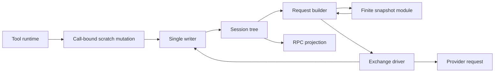
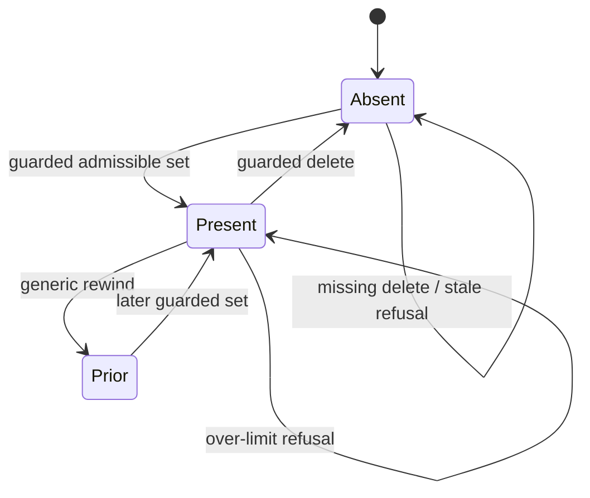
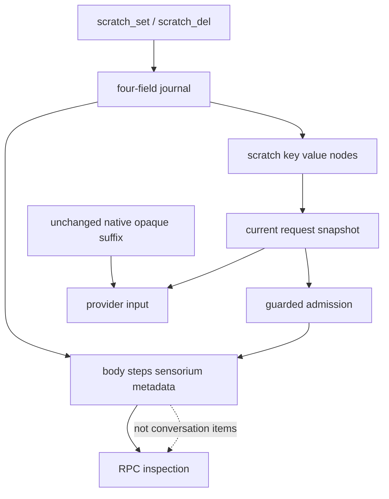

# Design

## Triage

| Trigger | Applies? | Evidence |
|---|---|---|
| T1 Modules | Yes | Runtime → guarded scratch mutation; driver → request builder → snapshot renderer → provider. |
| T2 State | Yes | First real scratch schema and admitted observation metadata. |
| T3 Concurrency | Yes | Parallel tools, queued writer commits, job updates and cancellation during async request construction. |
| T4 Interfaces | Yes | Tool schemas, user configuration, tree fields and RPC-visible observations. |
| T5 Volume | Yes | Jobs/history grow; section previews and observation records require bounds. |
| T6 Risk | Yes | Agent-owned constraints must survive compaction/rewind; prompt data must not become policy. |

TIER: FULL

## Context

Serves M2 change 2 and the exit criteria named in [proposal](proposal.md), after PR #30. Grounded against code main `e483151bc5e5d4ec8d6ec42b1190613f847d0829`; local `88868fb` changes workflow settings only.

- `lib/src/loop/request_builder.dart:243-361` reconstructs conversation, appends the fresh final user item and subtracts the prior block estimate from compatible usage. Its lineage digest (`195-219`) covers instructions and exposed tool definitions; native cuts remain strict.
- `lib/src/loop/sensorium.dart:9-26` owns conservative text/item estimates. Its current renderer (`37-63`) has only turn/budget; `test/loop/sensorium_test.dart:54-167` includes consumer behavior and incidental exact-text assertions.
- `lib/src/loop/driver.dart:675-790` admits a running step before building, enforces native/window/byte guards, then streams. Context metadata is presently assembled before sending but persisted mainly at outcome. Preserve effort/policy admission order; attach the observation before the first stream attempt, not only on completion.
- `lib/src/tools/runtime.dart:65-82` registers tools and `385-417` owns each live call. `lib/src/tools/tool.dart:110-191` exposes no general tree writer. Reuse `SessionWriter.applyGuarded` and call ownership (ADR 0010), not a new memory store or raw writer on every tool.
- `lib/src/session/state.dart:102-108` and `writer.dart:320-331` expose acknowledged tree copies and a committed-length cursor. Scratch is an existing valid root (ADR 0008), but has no production writer/entry schema. No collector producer exists in this slice; unavailable is not a fabricated empty observation.
- `docs/sensorium-spec.md` remains unchanged. ADR 0007's reviewed supplement chooses full self-contained fallback over baseline-losing deltas. ADR 0015's exactly-two-line clause is historical predecessor scope: an additive ADR during apply explicitly replaces that clause only; all native continuity rules remain in force.

Dart 3.x AOT; no Rust, embedded scripting runtime, WSL, dependency or speculative package. Every durable session fact stays in the tree. External validated configuration and secure credentials remain inputs, not scratch recovery.

## Decisions

### D1: Tree-native scratch through a narrow mutation interface

- **Choice:** store `scratch/<key> = {value: <plain text>}`. Record set/delete at the current tool turn; generic timeline replay restores prior values. Sort keys lexically. Store every value character verbatim, including newlines. Render each key on an indented key line and each value line with a separate four-space presentation prefix; stripping only these prefixes recovers the original value. No value line begins at column 0, including literal `</sensorium>` or fake `notices:` text. Count all prefixes, keys, header and newlines in the 400-token section limit. Absent/empty scratch is valid. Reject nonempty malformed or over-limit entries, never skip/change them on load. Changing scratch framing is a compatibility event because it changes admission size.
  Presentation line boundaries are CRLF (one boundary), LF, lone CR, VT (U+000B), FF (U+000C), NEL (U+0085), LS (U+2028) and PS (U+2029). Preserve each original delimiter verbatim and add the four-space prefix after every boundary, including an empty trailing line; never split only on LF. Tests include lone CR and Unicode separators before fake closing tags/notices.
- **Interface:** scratch tools receive a call-bound mutation capability on `ToolContext`, implemented by the runtime. It accepts set/delete, not arbitrary paths. Inside the writer's queue-head guard, check the current call key/attempt, nonterminal ownership and cancellation, then validate the proposed scratch against live state and emit one `set` or `del`. A missing delete returns an explicit no-op. Concurrent writes use commit order; same-key last committed write wins. No await separates validation from the record decision. Unrelated tools receive no general writer capability.
- **Cancellation cutoff:** the successful queue-head decision, not flush acknowledgement, admits the mutation. Cancellation before the decision refuses it; after the decision the writer can finish the record despite a cancelled tool outcome. Never recheck after flush to erase durable data. A held-flush cancellation/reopen test proves committed scratch survives and the call is not replayed (`writer.dart:759-808`).
- **Choice:** schema validation, hooks, existing permission gate, result storage and central envelope composition remain the ordinary tool path. No new autoapproval or deny bypass. Children receive the same available roster subject to role narrowing, but mutate only their own journal. `scratch_pin` is absent, by the owner's session-only decision.
- **Rejected:** scratch JSON/Markdown side files, a mutable singleton, or an independently replayed memory manager; each adds a second authority or bespoke rewind recovery.
- **Reversal cost:** medium for persisted entry shape and tool contract; low for private renderer/mutator implementation. No migration for empty legacy roots; unsupported nonempty development fixtures require an explicit migration or new session, never silent interpretation.

### D2: One finite ordered snapshot module, no collector framework

- **Choice:** `sensorium.dart` becomes a deep module: one typed snapshot input and one compose operation yielding `{text, tokens, mode, folds}` or `SensoriumCompositionError`, a dedicated local error carrying a reason code and safe diagnostic. Handle it explicitly before existing `StateError` handling in both driver consumers; it is not an incompatible-native-lineage error. The module owns finite section order, availability, caps, folding and deterministic framing. Pure typed section values are an internal seam for forthcoming VCS/LSP work, not a plugin registry or writer callback.
- **Choice:** project turn/budget from current request inputs, scratch from D1, processes from real `jobs` nodes and notices as fixed short reason codes from committed compaction facts and validated startup capacity inputs. Keep the existing compaction recovery `UserMessage` separate in its existing placement; do not repeat its prose in notices. Bound reason vocabulary/cardinality to the 80-token notice cap; currently supported codes include `compaction_recovery` and `legacy_window_ignored` (the latter derives from validated startup configuration, not the journal). No new VCS scans, diagnostic queries, test/plan parsing, checkpoint producer or notices queue. Other slots say `unavailable (not collected)`; supported empty jobs/scratch/notices say `none`. Future supplied observations retain available/stale/unavailable state and bounded reason/age.
- **Choice:** processes show tree job id/kind/command/state/relative age; only pending/running jobs are live. Production publishes output references only at settlement, so live jobs say `logs unavailable (published at exit)`. No log-tail I/O, read deadline, spool access, supervisor polling or live-log producer is introduced. The first source fold reduces process details to counts; it never pretends live logs were observed.
- **Choice:** freeze one acknowledged tree/cursor and one clock value before projection. All sections use that observation. Persist source turn and clock; an offset is a same-journal diagnostic only, invalid after fork/migration and never used for identity or lookup. Background updates after capture appear on the next request, not mixed into the current one.
- **Rejected:** independent collector caches/periodic workers now, or a general plugin collector manager. No current producer justifies their ownership and recovery cost.
- **Reversal cost:** low for internal typed section presentation; medium for admitted observation fields. Future collectors commit facts under `collectors` before projection and receive their own designs; this change creates no unused collector store schema.

### D3: Full request-only folding, not historical text surgery

- **Choice:** every request in this change uses `mode: full`. Existing blocks are not conversation items, so there is nothing to regex-remove from canonical history. Keep all user/tool literal tags and opaque JSON unchanged. Current scratch is appended outside the native compactable projection on every request. Retaining current facts is more important than claiming delta savings; delta mode requires a separately proven retained baseline.
- **Choice:** keep system content stable for a run, bump built-in instruction version for the new scratch/perception guidance and use the extended roster normally. Strict lineage intentionally rejects pre-upgrade opaque history when instruction/tool identity changes; recover through new-session or rewind-before-incompatible-output. No digest exemptions, old-boundary fallback or prefix resurrection.
- **Choice:** apply section detail caps with explicit omitted counts before global folding. For variable workspace/model presentation, reserve fixed labels/counts first and truncate only the presentation field at a UTF-8 character boundary, with a visible `…` marker counted inside turn/budget caps; never reject an ordinary long workspace or model identifier. Use compact bounded number formats. Scratch remains verbatim and notices use short codes. Under pressure apply the six folds in order; fail only if the resulting full block cannot fit, not because an unbounded display field exceeds a historical immutable-section allocation. Never drop scratch/notices or silently cut text.
- **Rejected:** delta-only-since-full with all prior blocks stripped; it loses unchanged constraints. Rewriting stored history or retaining a second model transcript violates tree authority. Cache neutrality is not inferred from a stable system prefix.
- **Reversal cost:** low for future evidence-led full/delta policy; high for destructive canonical-history changes, which are prohibited.

### D4: Durable admitted observation, existing native accounting

- **Choice:** add `sensorium: {text, tokens, mode, folds, source: {turn, time, offset}}` alongside existing context in a guarded pre-stream merge after the existing running-step admission and request build. `time` is the frozen observation clock; `offset` is explicitly a same-journal diagnostic, invalid after fork/migration and never a lookup key. Exact text is evidence, not the offset. The merge checks owning step/exchange and cancellation. This is local admission, not provider receipt. Local refusal records a visible failed step/stopped exchange with no newly admitted observation.
- **Error consumers:** `_step` explicitly catches `SensoriumCompositionError`, commits failed step/reason, stops the exchange and submits nothing. `compactionStatus` catches it read-only, preserves independently known policy/route/model/capability/boundary/capacity facts, returns `perception: {state: unavailable, code, message}` and unknown current usage, never mislabels continuity or enables unsafe calibration. Correcting an insufficient ceiling on restart can recover direct/legacy projection; malformed stored scratch requires a new session unless a caller already has a supported serialized rewind API. There is no new user-facing rewind or scratch-edit command.
- **Status recovery:** a successful current projection exposes `perception.state: available`; the failed path does not claim calibration is admissible merely because a boundary exists. Preserve independently proven continuity facts while marking request admission blocked by perception until corrected. Current status is a preview only and never replaces any step's exact admitted observation.
- **Choice:** preserve the exact block for RPC snapshot/update consumers. It is metadata, never another conversation item. Reconnect reads it from the tree; next request recomputes from live state. This supplies the inspection seam for later `/sense` without inventing an RPC command or shipping a TUI here.
- **Choice:** include the full block in context.block, baseline replacement and retained non-opaque estimates. Reserve the budget section's full 40-token allocation when choosing folds; then freeze facts/folds while solving the budget-line self-reference in at most 8 bounded passes. Verify actual final text fits the ceiling. On nonconvergence refuse visibly; never send a lower estimate. Only the final current block is charged, not persisted copies. Native unknown usage/calibration/lineage/byte guards remain unchanged.
- **Rejected:** recomputing a historical `/sense` view from today's jobs/scratch, completion-only persistence, or counting ciphertext to estimate the enlarged request. Each can misreport what the model saw or bypass native admission.
- **Reversal cost:** medium for additive stored metadata; low for private budgeting code. Old steps remain unchanged and indicate no recorded observation.

### D5: Startup configuration, no policy expansion

- **Choice:** strict startup `sensorium: {maxTokens: <integer>}` defaults to 1500 and rejects values below the calculated safe minimum 1310 (resource table), as well as non-integers/unknown keys. Thus an admitted scratch write cannot strand the model solely through a too-small configured ceiling. Resolve once per run, no repository setting/hot reload. Children follow existing startup config behavior; effort/provider policy remain unchanged. Historical observations hold actual text/size, not a mutable config pointer.
- **Rejected:** repository settings, reading config inside every compose, or attaching presentation settings to opaque lineage; each either widens trust, makes one run unstable or rejects native continuity on ordinary view tuning.
- **Reversal cost:** low. A future live presentation command can be designed separately from effort/provider selection.

## Diagrams (FULL)

### T1: module relationships



### T2: scratch state



### T3: observation and concurrent updates

```mermaid
sequenceDiagram
  participant D as Driver
  participant W as Writer
  participant B as Builder
  participant J as Job update
  participant P as Provider
  D->>W: existing running-step admission
  D->>B: acknowledged tree + cursor + clock
  J->>W: commit newer job state
  B-->>D: bounded request and exact observation as of cursor
  D->>W: guarded observation/context admission
  D->>P: stream same request
  Note over D,W: Cancellation/rewind before guard prevents submission
  Note over B,W: Offset is same-journal diagnostic only, invalid after fork/migration; exact text and frozen turn/time survive
```

### T4: stored versus ephemeral data



## State & Ownership (FULL)

| State | Owner (sole writer) | Lifetime | Invalidation / rebuild | Authoritative copy |
|---|---|---|---|---|
| Scratch entries | Engine through call-bound guarded writer | Turn timeline | Generic replay/rewind/fork; no exporter | `scratch/<key>` journal fold |
| Call lifecycle/result handles | Existing runtime/supervisor writer path | Existing session contract | Existing cancellation/recovery; no effect replay | Existing tree/results |
| Job facts / stored log refs | Existing supervisor | Existing job lifetime | Existing resume/rewind reconciliation | `jobs` and result descriptors |
| Observation inputs and rendered request | Request builder | One build | Discard on local failure; no independent cache | Frozen acknowledged input until admission |
| Admitted observation/context | Driver through writer | Its step | Removed with step by rewind; read on reconnect | `body/steps/<key>` |
| Ceiling configuration | Startup config loader | One engine run | Explicit new run; not historical defaults | Validated external input |
| Opaque boundary and evidence | Existing step completion path | Surviving history | ADR 0015 only | Existing completed steps |

## Failure & Visibility (FULL)

| Module | Fails / dies mid-operation → | Recovery | Retry safe? | Who finds out |
|---|---|---|---|---|
| Scratch tool | Invalid/budget/stale call refuses; committed scratch may precede result settlement | Normal interrupted-call recovery; inspect tree | New explicit call only; never replay uncertain call | Tool envelope and user transcript |
| Writer/results | Persistence fails | Existing stop/reopen handling; preserve acknowledged bytes | No automatic effect replay | User-visible storage failure |
| Snapshot | Bad stored scratch/immutable overflow/nonconvergence | Local submission stop; read-only status reports perception unavailable; explicit config/state correction restores projection | New explicit request after correction | User error/terminal reason and RPC status diagnostic |
| Live job logs | Not published until exit | Fixed unavailable marker; no new read or producer | No I/O/retry | Model and inspected block |
| Provider | Fails after observation admission | Existing failed/cancelled state and ADR 0015 capability rules | Existing proven-unadmitted retry rules only, same block | User plus recorded outcome |
| RPC client | Disconnects | Existing resync/snapshot rebuild | Read-only reconnect safe | Reconnecting client sees admitted metadata |

## Resource Bounds (FULL)

Normative rendering limits are owned here; source units use the existing conservative UTF-8 byte estimator, not claims of exact provider tokens.

| Queue / buffer / cache / transfer | Bound | At the bound | Timeout | At 10x / 100x |
|---|---|---|---|---|
| Scratch | 20 keys; 80 estimated tokens per value; 400 for complete section including keys/header | Refuse proposed mutation; include current/proposed sizes | No new timer; writer queue | Validate before allocating oversized rendered values; never build huge input copies |
| Block | User ceiling defaults to 1500; count framing as well as all sections | Fold, then local configuration error if still too large | No provider call on failure | Section caps bound render size independently of configured ceiling |
| Section ceilings, in source order | turn 30; budget 40; vcs 250; changes 200; diagnostics 300; tests 150; processes 150; plan 60; scratch 400; checkpoints 60; notices 80 | Bounded visible presentation cuts for workspace/model; never trim scratch; short notice codes | Pure bounded render | No unbounded joins before counting |
| Source preview detail | VCS up to 12 paths; diagnostics up to 10 errors at 120 chars, then 3 on fold; tests up to 8 failing names; checkpoints up to 5 then 1 | Explicit `… +N more`; counts retain omitted observations; bound individual display fields | No new external collector | Uncollected slots remain unavailable |
| Process previews | 150-token section cap, folded count form at most 40 tokens; live logs always unavailable (published at exit) | Explicit omitted jobs/chars; count live nodes with bounded preview storage | No new I/O/deadline | Never list all jobs then truncate |
| Budget-line self-reference | At most 8 local bounded re-render passes | Visible local accounting error | No paid retry | Same finite maximum irrespective of history |
| Snapshot admission | One bounded text plus scalar fold/source metadata per step; no recursive source tree copy | Existing journal/RPC storage failure handling | Existing writer serialization | Per-step bounded; total session history remains session-lifetime growth, not GC |
| Composition/status diagnostic | 500 characters; reason code, entry key or required/configured sizes, never raw scratch values or ciphertext | Bound at error creation; exact full scratch remains in tree | No new timer | Constant-size error regardless of malformed input |
| Existing runtime / requests | Existing running/queued tool, output, RPC and native request caps unchanged | Existing rejection/backpressure | Existing deadlines | Compaction does not shrink canonical journal/results; no storage-size guarantee |
| Startup safe minimum | 1310 tokens = never-folded maxima (30+40+400+80) + worst-case folded section allocations (vcs 40, changes 200, diagnostics 300, tests 40, processes 40, plan 60, checkpoints 60) + 20 framing/separator tokens | Reject lower startup ceilings; retain direct composer refusal for invalid stored content or explicit lower test seam | Startup only | Minimal count/availability forms fit their allocations; all labels/markers counted |

The 20-token framing reserve covers at most 60 UTF-8 bytes for tags and inter-section separators; sections count their own labels/internal newlines. Minimal count forms use bounded numeric formatting. Tests compute the minimum from these shared allocations rather than copying the number alone, and prove maximum admitted scratch plus worst-case minimal sections fits. Default 1500 exceeds it.

Apply folds only in this order: processes details → counts; VCS file list → counts; diagnostics → first 3 plus omitted count; test failures → count; changes → paths without line counts; checkpoints → most recent. Preserve availability/reasons/omission markers. Never fold turn, budget, scratch or notices. Refuse remaining overflow, never spill into another block. No collector queue, baseline cache, log-tail I/O or polling loop is added.

## Flow & State Gaps (FULL)

- **Parallel scratch:** queue-head live-state validation makes both capacity and ownership one record decision; do not validate against a snapshot captured before entering the queue.
- **Mutation/result crash gap:** scratch commits first; a later result-write failure does not roll it back. Existing call recovery marks execution uncertain; no scratch-specific replay. Timeline rewind still restores the earlier state.
- **Rewind/cancel during build:** keep source cursor, owning step/exchange and token; guard observation admission and check cancellation before streaming. Do not use a whole-writer-offset equality test, since unrelated jobs legitimately advance it. A removed step never submits its built request.
- **Job updates:** updates after capture do not change this observation; relative age uses its frozen clock. Test the capture/build gap with a deterministic barrier (not log I/O or sleep). The next request sees the newer job state. Live logs remain explicitly unavailable.
- **Native compaction:** use unchanged latest-boundary selection and suffix recovery; re-render current scratch independently. Current non-opaque block participates in all preexisting submission checks. Do not send all historical admitted observations as user content.
- **Framing/trust:** store scratch verbatim, but indent every rendered value line as D1 specifies; literal closing tags and fake harness labels stay visibly agent-owned data. Only the separately constructed final item is the harness block; never regex-strip canonical text. Scratch cannot change permissions, instructions or roster.
- **Old state:** absent scratch/observation fields are supported. Malformed nonempty scratch is an explicit read error. Old steps' instruction identity and observations are never backfilled. The new binary's changed roster/instruction digest can require a new session for opaque history.
- **Inspection:** observation is locally admitted input, not proof of provider receipt. Failed local builds have a step reason but no new observation; failed/cancelled streams retain their admitted observation and state. No `/sense` command is claimed delivered here.

## Mechanism Ledger (FULL)

| Mechanism | Built? | Why (harm nobody catches / expensive later) | Evidence that would change the call |
|---|---|---|---|
| Guarded scratch mutation | Yes | Concurrent last-slot writes and late cancelled callbacks can lose agent constraints | Existing writer queue/ownership already supplies the primitive |
| Small typed snapshot + finite folds | Yes | Later VCS/LSP must not each reinvent section order/budget/truncation | Consuming roadmap entries are explicit; no generic plugin abstraction |
| Admitted observation | Yes | Reconnect cannot reconstruct past inputs after state changes | Exact text and stable source turn/time; offset is diagnostic only |
| Finite local accounting passes | Yes | Budget text changes its own size and can change fold admission | Refusal visible if convergence cannot be established |
| Collector framework/cache/background scans | No | No new collector producer in this slice | VCS/LSP consuming change with actual bounded external observations |
| Delta baseline / cache-neutral claim | No | Removed historical blocks make unchanged facts disappear | Task-equivalent A/B with retained facts and measured prefix-cache behavior |
| External pin store / scratch backup | No | Owner chose session-only; ADR 0001 defers export | Explicit later project-memory proposal and trust decision |
| New retries / compaction recovery | No | Existing uncertain paid/effect path must not be replayed | Separate provider-policy design and evidence |

## Risks / Trade-offs

- Full snapshots spend more tokens than deltas → report actual block estimates; preserve facts first. At apply, compare scripted multi-step tasks for exact retained constraints, total input tokens and available cached-input usage; no performance/cache claim without live evidence.
- Conservative counting can reject text that a tokenizer would fit → document byte/3 convention; never silently trim sacred scratch. A tokenizer package is not justified here.
- Metadata duplicates rendered scratch across admitted steps → bounded per-step cost but session history grows; native compaction remains projection-only, not GC.
- Narrow process views may lack fresh logs → explicit unavailable markers and source cursor, not direct supervisor/spool reads or fabricated health.
- New roster/instructions invalidate older opaque continuity → visible native lineage refusal and documented new-session/rewind recovery; no compatibility shim.

## ADRs

- **In force, constraining this change:** 0001–0003, 0007–0008, 0010–0015; source snapshot/scratch/fold clauses are authoritative.
- **To record during apply:** ADR 0016, session-local scratch schema and admitted bounded sensorium observations. Supplements ADR 0007 and replaces only ADR 0015's predecessor exactly-two-line scope clause, leaving all native continuity/capacity decisions unchanged. Update the architecture index and M2 perception description in that same task; never edit accepted ADR files.
- No external implementation is adopted in this change: existing Kehai source and unchanged source specification supply these seams. OMP hashline, OAuth and Pi journal references are not newly copied or reinterpreted.

## Apply and friction assignments

Kehai must orchestrate apply, task-group commits, configured external reviewer routing, pre-ship review and delivery. Planning here is not an apply attempt. Record the actual attempt/session and any unsupported steps during apply; do not substitute this harness for its lifecycle. Run Linux and native Windows delivery PR CI plus manually dispatched delivery-head Nightly; the prior M1 waiver is not reusable.

This design introduces no friction-ledger deferral: approval/session allow rules, user-level instructions, workspace-scoped allow rules, config reload and shell-chain proof need later dedicated scope (at latest `windows-tool-parity-and-m2-qualification`); inherited effort remains immutable. Job/watch workflow keeps one existing blocking wait and no sleep polling. Review scratch placement uses the workflow's existing validated state directory and is inspected during dogfood, not broad external-directory grants. Timing/process-tier issue #28 and the missing relative-PATH coverage remain explicit qualification responsibilities, not claims of completion here.

### Apply attempt: RPC session 20261111T202801Z-9e40fe1e

- Kehai began this apply attempt through the RPC tool surface in `F:/Dev/Orca/Workspace/kehai`, on `feat/sensorium-block-and-scratchpad`. This is the executing orchestrator's receipt, not planning evidence or a substitution of the outer transport harness for Kehai.
- Independently loaded the installed OpenSpec apply, Specwright commit and Specwright review skills; read every apply context file and the project workflow/settings. Pinned OpenSpec list/status/apply instructions confirmed a repo-local `specwright` change, ready with 0/16 tasks complete. Code/planning Git common directories and worktree roots match. Specwright state found only the untracked change directory; task coverage found no pending groups, uncovered ticks, duplicates or cross-group evidence. Cheap tier is off.
- Run login is `sh1ny` by explicit session instruction and AGENTS.md. The committed `github.login` setting remains unchanged. At the initial pause no authenticated GitHub operation, commit, push, archive or merge had been performed.
- Initial transport friction: `.mcp.json` configures the official Dart MCP server through pinned mise, but the initial RPC surface exposed neither its tools nor a connection/discovery tool. Kehai paused before implementation without changing task checkboxes or test-map rows; no tests or delivery/dogfood evidence were claimed and no approval policy or external-directory grant was broadened.
- Transport provenance/resolution: the outer transport harness initially supplied an ask-tool relay as an implementation transport decision; that setup was not a user decision. The user subsequently explicitly approved the restricted bridge in the round-2 resolution. Kehai sends `MCP_BRIDGE` plus exact JSON; the transport executes the same configured official server and returns real output. Exact enforced allowlist: `run_tests`; `analyze_files` with `applyFixes` omitted/false (transport explicitly passes false); `lsp` commands `resolveWorkspaceSymbol`, `hover`, `signatureHelp` only. Every other tool/action is refused, including `pub` (all commands), `dart_fix`, `dart_format` and dependency tools. The transport confirmed the actual `analyze_files` schema includes optional boolean `applyFixes` and attested this narrowed enforced list during this session. No dependency installation or `.mcp.json` edit. Formatting/fixes use Kehai's permission-gated tools. Evidence is transport-attested official-tool output, not a direct mounted call. Kehai retains lifecycle/test/task/review/commit decisions and children can use the restricted relay. Availability alone proves no tests.
- The initial blocker is resolved; resume requires no waiver. Native/cache dogfood, delivery CI and Nightly remain to be executed, without reusing M1's waiver. Workflow/permission qualification remains assigned to `windows-tool-parity-and-m2-qualification` as above, not a deferral of this change's acceptance requirements.
- These evidence edits void the previous design-review verdict. Obtain a fresh configured design-review pass on the revised artifacts before implementing or ticking tasks; the review receipt is recorded by the installed review workflow, not asserted in advance here.
- Round 2 configured review ran via Claude CLI 2.1.319, actual `claude-opus-5-5`, actual thinking unknown, Windows job process group; requested model/thinking default, no skipped routes. It returned APPROVE_WITH_CHANGES / CHANGES_APPLIED: no. The user explicitly authorized its listed revision bundle (bounded display, notice codes/separate recovery note, no live tails, diagnostic offsets, scratch indentation, restricted relay, calculated startup minimum). This amendment implements that approved planning resolution only; the reviewer must recheck before tasks proceed. One official relayed unchanged runtime unknown-tool test passed; no new behavior coverage is claimed.

## Open Questions

None that change scope or contracts. Machine/terminal measurements and live cached-token availability are recorded at apply; their absence is unverified evidence, not a reason to alter snapshot correctness.
