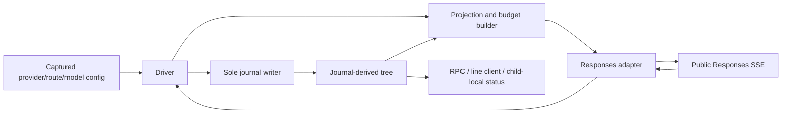
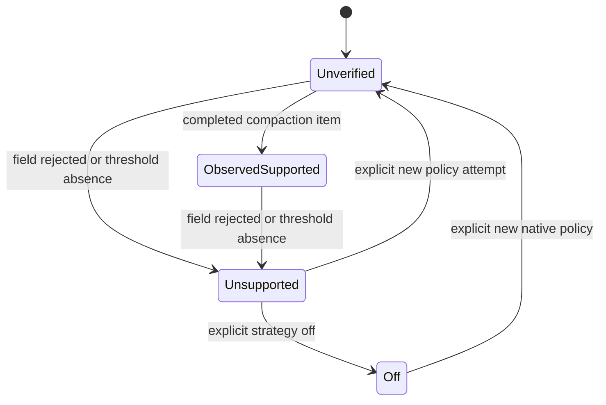
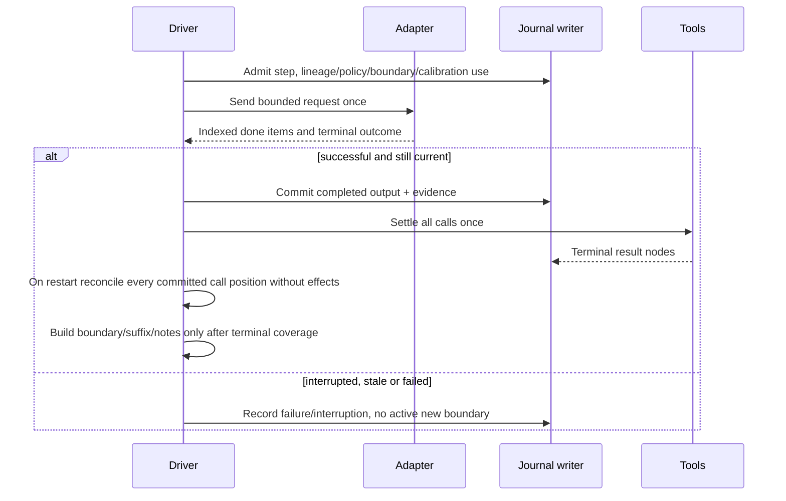
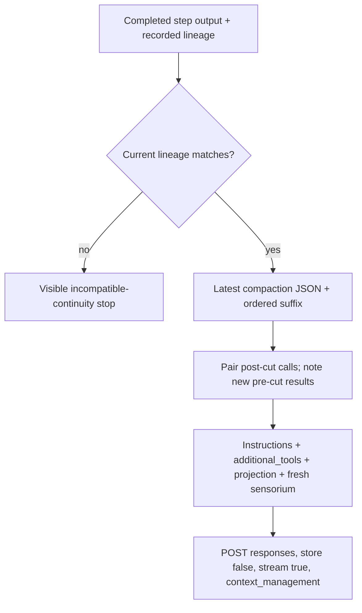

# Design

## Triage

| Trigger | Applies? | Evidence |
|---|---|---|
| T1 Components | Yes | Config → driver → request builder → adapter → journal/RPC/client; existing seams at `user_config.dart:240`, `driver.dart:559`, `request_builder.dart:179`, `chatgpt_adapter.dart:529`. |
| T2 State | Yes | New opaque step output and capability evidence; existing completed output at `driver.dart:656`. |
| T3 Concurrency | Yes | Streaming completion, cancellation and tool execution overlap journal appends (`driver.dart:707`, adapter `_onSse`, writer guarded append). |
| T4 Boundaries | Yes | External Responses protocol, additive step schema, provider event/request interfaces and client status. |
| T5 Volume | Yes | Conversation traversal currently grows with history (`request_builder.dart:249`); ciphertext and output need bounds. |
| T6 Risk | Yes | Paid uncertain requests, loss of continuity, opaque provider data and rewind correctness. |

TIER: FULL

## Context

See [proposal](proposal.md) for scope and M2 exit criteria. Existing code emits opaque reasoning from `response.output_item.done` (`lib/src/provider/chatgpt_adapter.dart:529,562`), but ignores compaction items. Completion already uses usage rather than its output array (`:596`). Preserve that parser direction: do not add a Content-Type prerequisite or reconstruct from terminal output. `lib/src/loop/driver.dart:712,825` currently treats opaque output as reasoning. `request_builder.dart:259–329` rebuilds the entire conversation and inserts each tool result immediately after its call, irrespective of output-index boundaries. Its usage baseline (`:273–281`) matches captured instructions but has no compaction identity. Config currently offers only model-id window overrides (`lib/src/config/user_config.dart:263–277`); `lib/src/loop/driver.dart:34–42` prefers those then backend metadata. These are modification sites, not delivered native-compaction features.

Constraints: Dart 3.x AOT, no Rust core, no embedded script runtime, no durable session authority outside the tree; secure credentials remain the explicit exception. This is M2, not a broad sensorium, tokenizer, scratch-tool, UI or package project. Kehai orchestrates this lifecycle, including configured cross-model review. No apply has run in this resumed session. The owner requested an explicit design stop before implementation.

### Evidence retained from completed research

Sources below were supplied by the owner and checked in the prior session; this session does not repeat source retrieval or paid probes. Web documents have no pinned commit; date of saved evidence/live observation: **2026-11-02**.

1. [OpenAI compaction guide](https://developers.openai.com/api/docs/guides/compaction): server-side compaction is requested on `POST /responses` with `context_management: [{type: "compaction", compact_threshold: ...}]`, works with `store:false`, returns an encrypted compaction item in the stream, and permits dropping input preceding the latest compaction item in later requests.
2. [Responses create reference](https://developers.openai.com/api/reference/resources/responses/methods/create): `compact_threshold` minimum is 1000.
3. [Token-sharing models and inference](https://developers.openai.com/siwc/token-sharing-open-source/models-and-inference) and [preview limitations](https://developers.openai.com/siwc/token-sharing-open-source/preview-limitations): public `api.openai.com/v1/responses`, `store:false`, `stream:true`, no `previous_response_id`; the unsupported-field list does not include `context_management`. **Neither page promises or denies compaction on this route.** Absence from that list is not a capability guarantee.
4. **Redacted live-check summary**, copied from `.git/kehai-scratch/compaction-research/live-check-summary.json` before deleting that temporary research directory: owner-approved, two requests, model `gpt-6.1-sol`, threshold 1000. Request 1: HTTP 200, terminal `response.completed`, output item types `compaction, message, compaction`, message `READY`, usage input 1145/output 104. Request 2: carried the first response's output forward, HTTP 200, completed with answer `ORBIT-7` (the test marker), usage input 1186/output 8. Attribution assigned 1140 input tokens to the **latest** compaction item and zero to the earlier compaction/message. No credentials, item ids or ciphertext are retained here. No Content-Type header; terminal response output was empty, so items came only from `response.output_item.done`. No refresh, retry, redirect or standalone compact call. These transport details and marker text are owner-provided observation alongside the saved JSON event/usage summary. **This proves current observed behavior only, not route support as a documented contract.**
5. Owner dogfood evidence: four overflows, approximately 187–228k, latest approximately 212k, despite an advertised 500k. These are not measurements of a replacement exact window.

No upstream login, hashline or session-format implementation is copied or changed here; their pinned references remain in the architecture source map and existing ADRs. This change learns native compaction from the official protocol sources above, not the Codex client backend.

## Decisions

### D1: Inline provider-native compaction, not a separate summarizer

- **Choice:** Add typed optional native policy to `ModelRequest`, an opaque compaction conversation item, and an explicitly typed compaction event/part. Serialize `context_management` only for enabled native policy. Retain token-sharing instructions, `additional_tools` first, encrypted reasoning include, `store:false`, `stream:true`, and no previous-response id. Native compaction happens as part of ordinary model steps; do not create a background compaction worker or send a probe at startup.
- **Rejected:** `/responses/compact` as a separate RPC needs another paid operation, splice/retry ownership and route qualification. Local-summary replacement changes semantic authority and loses the provider continuity behavior observed here. Both are outside this delivery.
- **Reversal cost:** Medium: additive request/event and journal values must stay readable; strategy dispatch permits a later explicitly designed alternative.

### D2: Configuration and safety policy

- **Choice:** Add strict user-config `providers.<provider>.compaction`, `providers.<provider>.routes.<route>.compaction`, and `providers.<provider>.routes.<route>.models.<model>.compaction`, each containing optional `strategy` and `threshold`. Merge each field from most-specific to least-specific, then built-in defaults. Provider id is `openai`, current route id `chatgpt-account`. Strategy vocabulary and default/minimum threshold are owned by the context-compaction spec. `local_summary` is recognized but errors as unimplemented; `off` disables new compaction, not existing opaque continuity. No repository/role override or live reload. Record effective policy and provenance in each step's admission beside model/effort, including unsent or failed steps.
- **Choice:** For native policy define a local **submission safety ceiling = ceil(1.25 × effective threshold)**, not a context-window claim. Ordinary measured/full-history submissions above that ceiling or known-window/request-byte limits stop locally. **One calibration submission per newly committed boundary** is allowed when compacted size is unknown: omit the discarded-prefix upper bound from admission arithmetic, require estimated retained non-opaque content (instructions, tools, suffix, result notes and fresh sensorium) at most half the effective threshold and no greater than a configured route window, and retain the serialized-request cap. This does not assert a bound on opaque tokens: show unknown compacted usage and the explicit calibration exception. Record that boundary's calibration attempt in step admission before sending; failure, missing usage or death never grants another allowance for the same boundary. Only compatible completed usage or a new committed boundary restores normal progress. Large suffix/result notes refuse calibration visibly. For example, a 120k-input/6k-output compaction is allowed a small calibration request despite its obsolete 126k prefix estimate. A calibration overflow stops without resend.
- **Choice:** At completion evaluate reported input tokens, or explicitly conservative estimated input if usage is missing on an ordinary request. At/above threshold without an item marks unsupported, records the evidence quality and stops before the next request, even if previously observed-supported. Below threshold absence is normal. During calibration with unknown opaque size, missing usage alone cannot prove threshold crossing: record `calibration usage unavailable`, remain observed-supported from the boundary, and stop before another same-boundary request. Field rejection proves unsupported immediately; unrelated errors do not. No silent retry without the field.
- **Choice:** A successful boundary becomes observed-supported. Capability status is a fold of committed step evidence for the current lineage/policy; an unresolved unsupported status blocks native submission across resume. Changing policy explicitly permits a fresh unverified attempt (returning to an old failed policy reuses its failure evidence); rewind removes only evidence anchored after the target. `off` is an explicit owner recovery option with ordinary overflow guards, never automatic fallback.
- **Choice:** A child independently resolves the launched model's route policy from the parent's captured provider-policy configuration, passed as a validated bounded internal launch payload; it does not reread mutable config to change the parent's selected policy. Preserve existing effort inheritance and no-nested-agent policy. Child policy/evidence belongs to the child journal, not the parent lineage.
- **Rejected:** A hardcoded 180k/212k replacement window extrapolates observations; using 500k as a guard would repeat the failures. A silent default-off route hides unavailable compaction. A fixed policy inherited across all child models defeats per-model configuration.
- **Reversal cost:** Medium for config and additive admission schema; low for built-in threshold tuning. The safety ceiling is conservative application policy, not evidence of true capacity. Large single inputs can still stop locally; the owner must reduce them or configure a qualified policy.

### D3: Journal authority and eligible boundaries

- **Choice:** Keep the four-field journal and v1 RPC framing. Add output entries `{type:"compaction", item:<complete JSON>}` to a completed step's existing `output` list. Record a request lineage alongside admission: provider id, route id, model, captured instructions identity (including role/workspace content), and canonical digest of tool definitions. Record policy and boundary id used by that request plus capability evidence on completion. Calibration use is an admission-time fact folded from surviving steps, consumed even when the request later fails; changing policy does not reset the same boundary allowance. Use existing single-step completion append and guarded publication; a received item is not an active boundary before completed state is durable. No ciphertext in notices, logs or model-visible status; journal privacy is the same as encrypted reasoning, not a reason to create a side store.
- **Choice:** The request builder selects the latest surviving completed boundary in conversation order **before** testing compatibility; it never searches backward for an older compatible boundary. Validate the selected item and every opaque reasoning/compaction suffix item's recorded provider/route/model/instruction/tool lineage. If any differs from the current request, stop before sending. This prevents an older compatible cut from leaking a newer incompatible opaque item in its suffix. Otherwise forward the full selected JSON unchanged plus all subsequent eligible items. JSON values, including encrypted strings, survive identically; transport whitespace/key formatting is not token content. Top-level instructions/tools and fresh sensorium are regenerated from captured inputs. Replay reconstructs the same logical projection; clock and sensorium remain explicitly request-only.
- **Choice:** Incompatible continuity never causes automatic full-prefix resurrection. Tell the owner to rewind before the incompatible opaque item or start a new session. This intentionally includes changed captured workspace instructions/tools; reuse under changed instructions is unqualified. A new threshold/off setting alone does not invalidate continuity, but changes policy evaluation.
- **Choice:** Rewind/fork use existing tree operations, not a special compaction rollback. Old sessions have no boundary and keep full-history reconstruction. New payloads are additive; no journal version migration. Old binaries that ignore new output variants are not safe writers for compacted sessions; document upgrade-only writing and fail visibly if a supported reader encounters an unknown output kind, rather than silently reconstruct incomplete continuity. This release does not claim backward writing by older binaries.
- **Rejected:** Deleting pre-boundary journal entries, an authoritative cached summary file, or a global `latestCompaction` pointer breaks rewind or duplicates authority.
- **Reversal cost:** Medium for additive stored variants and lineage semantics; high if canonical history were deleted, which is explicitly forbidden.

### D4: Stream ordering and tool results across a cut

- **Choice:** Extend `_onItem` on `response.output_item.done`; preserve output positions with the existing ordered-part collector. Collect every compaction item (not just one), deduplicate by item id/index, and fail conflicting duplicate identity/position. An item missing required compaction identity/encrypted-content shape fails sanitized protocol validation; do not inspect ciphertext. Keep text deltas' streaming behavior, and collect done-message text only when that item's text was not provided in deltas; reconcile rather than double append. Ignore terminal `output` as an alternate item source, so empty terminal output is harmless. Successful HTTP SSE processing has no Content-Type dependency.
- **Choice:** A boundary can be before, between or after tool calls in the same response. Finish the successful step and settle **all** its calls once through the existing runtime before any next request. Compute the cut in original response-item order, not in the builder's currently interleaved call/output order. Calls after the cut retain paired function outputs. A result from a call before the cut did not exist when the server made the boundary: append a deterministic user recovery note containing its call id/name and the **verbatim central result envelope**, including handles. Do not send an orphan function output, re-execute the call, or reinsert the omitted call prefix. These notes are derived from terminal call/result nodes, not another persisted transcript. Ordinary outputs wholly before earlier boundaries are not re-injected. The last compaction in a step wins; two such items with an intervening message match the observed check.
- **Choice:** Close the pre-runtime admission crash gap explicitly (new work, not a capability of today's `jobs/recovery.dart`). Before accepting a prompt on attach, and after rewind reconciliation, enumerate **every call position in surviving completed step output**, not just existing call nodes. Existing nodes retain job recovery and terminal results; for a missing node append a guarded terminal cancelled call/result with reason `interrupted_before_admission`, a central cancellation envelope stating `execution not recorded; not replayed`, and the original call key/id/name/input/model reference. Recovery never executes the call or claims an effect occurred. If admission/result metadata conflicts, stop recovery visibly instead of overwriting. Use current writer turn and source-step reference; repeated attach is idempotent, and a rewind removing a recovery node triggers the same deterministic no-effect reconstruction if its source step survives. If the source step is removed, reconstruct nothing. Normal runtime admission still owns live calls; the rewind reconciler skips its registered live keys. A boundary is stored at step completion but cannot be used for a request until all referenced calls have terminal outcomes or this recovery has completed. Thus pre-cut calls get D4 notes and post-cut calls get paired cancellation outputs even after death before the first or after only some admissions.
- **Choice:** Cancellation/incomplete/network/protocol failure prevents a new boundary from that step becoming eligible. Existing partial-text/recovery rules remain; no held call runs. Out-of-order indexed done events are sorted before commit, duplicate text/done data is counted once semantically, and there is no terminal-array fallback that can duplicate items.
- **Rejected:** Treating compaction as reasoning loses explicit boundary semantics. Cutting the currently interleaved item list can erase newly executed pre-cut call outputs; sending these as raw function outputs creates orphan references. Waiting for a special no-tool compaction response is not a provider guarantee.
- **Reversal cost:** Medium for the deterministic result-note projection and typed output variant; tests must pin ordering and pairing.

### D5: Honest route capacity and compaction accounting

- **Choice:** Separate backend-reported model metadata from effective route capacity. Add route-qualified `models.<id>.contextWindow` entries under the provider/route config hierarchy, with provenance user-configured estimate. Do not promote generic ChatGPT-account model metadata to effective capacity, including the misleading 500k value for `gpt-6.1-sol`. Existing top-level `models.<id>.contextWindow` remains parseable; for this route it is an unqualified hint and gets a visible migration notice to the new route-qualified path, not an effective guard. Other existing route behavior is preserved. Known route-qualified values, raw metadata and effective-source labels are separate fields.
- **Choice:** Extend request budget accounting with boundary identity as well as instructions identity. Never use pre-boundary usage as current compacted usage. Until compatible completed usage exists, display compacted used context as **unknown**, with separate estimated retained-content tokens in status; do not derive an opaque token count from ciphertext or keep the old prefix as a rejection baseline. D2 owns the bounded one-attempt calibration exception. On a completed request using the same boundary, normal usage-plus-uncovered-item accounting resumes; a response that creates a newer boundary needs fresh calibration. Unknown opaque size prevents a trustworthy total or percentage even when a route window is configured.
- **Choice:** Sensorium stays two request-only lines. Used estimates show `~`, unknown windows show `?` and no percent, estimated windows/percentages are visibly approximate. RPC materialization and line-client status expose provider/route/model, policy/provenance, capability reason, selected boundary id (not contents), capacity provenance and budget quality. A capability failure is also a terminal exchange notice readable by the next request/model after explicit recovery, not just debug logging. Reconnect rebuilds status from tree evidence. No broad sensorium sections are introduced.
- **Rejected:** Dividing encrypted bytes by three invents compacted usage; subtracting a pre-boundary prefix from aggregate usage invents per-item accounting; calling the observed overflow an exact capacity makes a different unsupported promise.
- **Reversal cost:** Medium for typed budget/status fields, low for presentation. A future tokenizer is evidence-gated, not a prerequisite.

### D6: Preserve non-transcript state and keep this change narrow

- **Choice:** Only the provider conversation projection is cut. Scratch nodes (present or future), result descriptors/chunks/pins, request admission/outcome correlation and child/job state are never rewritten by compaction. Existing filesystem scratch is neither summarized nor deleted by the feature. Handle access remains by the existing result APIs; native ciphertext does not guarantee model recall of every old handle, and this delivery does not invent an unbounded handle catalog. For a future scratch renderer, its input is the untouched live scratch subtree, rendered verbatim outside the compactable transcript in the request-only snapshot; it must never recover scratch from ciphertext. Test the preservation seam with synthetic tree scratch nodes without adding scratch tools now.
- **Choice:** Add a binding ADR during apply for the opaque-boundary/lineage/config/capacity contract, supplementing the current ADRs and updating architecture's historical no-compaction description to identify M2 behavior. Native Responses adaptation is Kehai policy code, not a reusable independent infrastructure package; ADR 0014 does not require packaging a small harness-specific projection.
- **Rejected:** Waiting for scratchpad tools blocks the urgent first M2 change; summaries of scratch violate agent ownership; building a generic compaction framework/package adds unsupported abstractions.
- **Reversal cost:** Low for seams; medium for the binding contract. Scratch/journal ownership remains locked.

## Diagrams (FULL)

### T1 — components

### T2 — capability state

Evidence belongs to surviving steps and policy identity; rewind/replay recomputes this diagram, never an external capability cache.

### T3 — completion and cancellation

### T4 — persistent boundary to wire

## State & Ownership (FULL)

| State | Owner (sole writer) | Lifetime | Invalidation / rebuild | Authoritative copy |
|---|---|---|---|---|
| Effective configuration/provenance | Engine startup config resolver | Engine run | Explicit restart/config selection; child receives captured snapshot | Validated input; selected values recorded per admitted step |
| Opaque compaction output/lineage | Engine via session writer | Surviving step | Replay; turn rewind/fork | Completed step output and admission in journal |
| Capability observations and reasons | Engine via session writer | Surviving steps/policy | Fold current lineage/policy; no global cache | Step outcome evidence |
| Candidate streamed items | Adapter/driver scoped response collector | One model attempt | Discard on failure/cancel; publish only guarded completed step | Disposable until durable completion |
| Selected boundary and projected conversation | Request builder | One build | Recompute from current tree/lineage | Tree; projection never persisted as a second transcript |
| Budget baseline and quality | Request builder | One build | Require instruction/lineage/boundary match | Recorded compatible usage + estimates |
| Scratch, results, requests, children/jobs | Existing owning engine/runtime via writer | Existing session lifetimes | Existing rewind/fork/recovery; untouched by compaction | Tree plus immutable result bytes |
| Displayed status | RPC/client projection | Connection | Fresh materialization on reconnect | Tree evidence and captured current policy |

## Failure & Visibility (FULL)

| Component | Fails / dies mid-operation → | Recovery | Retry safe? | Who finds out |
|---|---|---|---|---|
| Config/child launch | Invalid policy, reserved strategy or payload | Refuse before engine request; name path | Owner correction only | User, child typed error |
| Request builder | Mismatch, unknown output kind, oversized input or unsafe ceiling | Visible local stop; rewind/new session/policy guidance | No automatic mutation/resend | User and recorded exchange reason/model on recovery |
| Adapter | Field rejected or compaction absent at threshold | Commit sanitized unsupported evidence and stop | No field-removal retry | User/RPC and model-visible recovery notice |
| Adapter transport | Failed/incomplete/stalled response | Existing terminal failure/cancel; no eligible boundary | Existing proven-unstarted retry rules only, no new retry | User, recorded step |
| Journal writer | Storage failure at admission/completion | Do not publish boundary or execute calls before durable completion; existing reopen recovery | Never repeat uncertain paid/effectful work | User; interrupted evidence on resume |
| Tool runtime | Tool fails or cancels after cut | Record terminal central result; derive result note or paired output | Existing no-reexecute semantics | User and subsequent request |
| RPC/client | Disconnect after commit | Fresh materialization, not client-held boundary | Reconnect only | User sees reconstructed policy/status |

## Resource Bounds (FULL)

Existing transport caps remain authoritative; no cap is raised for compaction.

| Queue / buffer / cache / transfer | Bound | At the bound | Timeout | At 10x / 100x |
|---|---|---|---|---|
| SSE event / held arguments / sanitized error read | Existing 8 MiB / 8 MiB / 64 KiB | Existing protocol rejection / bounded error read | Existing provider idle deadline 300 s | Reject rather than allocate proportionally |
| Response collector, including encrypted items | Existing 4 MiB aggregate output cap; per-item identity table bounded by same bytes | Abort, no new boundary or held calls published | Same stream deadline | Malicious repeated events consume existing byte budget even if deduplicated |
| Serialized request including ciphertext, notes and tools | Existing 1 MiB request cap | Local visible context-overflow stop, never trim silently | Build cancellation follows exchange | Large notes/opaque items may refuse the next request |
| Native submission work | One active exchange/request per engine; ordinary ceiling and one-per-boundary calibration allowance defined in D2 | Visible stop; no speculative worker queue | Existing deadlines/step limit | Children retain existing supervisor bounds |
| Boundary/capability lookup | No persistent cache; one linear scan of surviving steps, retain latest eligible boundary and latest relevant evidence | Same historical journal/tree footprint as current sessions | Cancellable build | At 100x history scan costs grow; use counters/perf fixture, no new quadratic full-prefix recomposition after selecting cut |
| Canonical history/journal/results | Session-lifetime growth, intentionally not bounded by compaction | Existing disk/storage errors visible; no compaction GC | Existing storage rules | Capacity remains operator/session concern; transcript pruning is not a storage feature |
| Scratch and handle transfer | Existing scratch/result limits; only required pre-cut terminal result envelopes, not all result bytes | Existing central truncation + final request cap | Existing tool/result deadlines | Paging/search retain full bytes; no unbounded handle list injection |
| Child captured policy launch payload | 8 KiB UTF-8 JSON maximum, base64-encoded internal argv; validate total native command-line size before launch | Explicit child-launch configuration error before spawning | Existing child startup deadline | Reject overlarge policy snapshot/argv; no silent field omission |
| Status/notice | Scalar provenance/status/reason; existing sanitized error message cap 500 characters | Fixed composed messages, never ciphertext/raw server text | Not applicable | No per-event log/notice accumulation |

## Flow & State Gaps (FULL)

- **Rewind while stream/tool completion is pending:** existing expected-state/turn guards prevent stale append. Boundary eligibility depends on surviving completed state; stale callbacks never resurrect it. Rewind request/outcome correlation retains existing non-reexecution guarantees.
- **Death after item-done but before response completion:** candidate is disposable; no usable new boundary. Death after backend completion but before journal commit remains uncertain and is never retried automatically.
- **Death after completed-step commit but before all calls settle:** D4 extends recovery beyond existing nodes to every committed call position; notes/pairs are derived only after terminal outcomes exist. A boundary does not imply the tool effects completed.
- **Several boundaries/out-of-order done events:** order by output index, last eligible one wins; reject conflicting index/id evidence rather than guess. Stable unindexed ordering follows existing provider contract; an unindexed compaction item is rejected because a trustworthy cut cannot be established.
- **No item at small input:** unverified is honest; do not label the route unsupported merely for a normal sub-threshold response. A threshold-qualified completed response without an item is visible unsupported, even if HTTP 200.
- **No usage after compaction:** D5 reports total use unknown; D2 permits one bounded calibration attempt, then stops if usage remains unavailable. No discarded-prefix or ciphertext-size token count is substituted. Rewind invalidates later baseline naturally.
- **Changing AGENTS/tools/model:** D3 blocks incompatible continuity. This is deliberately stricter than ordinary full-history replay; tell the owner the recovery instead of silently forwarding opaque state under new assumptions.
- **Resume and fork:** fold policy-specific evidence and boundaries from the surviving tree; no extra compact endpoint, fresh support probe, side-store repair or automatic paid turn.
- **Result handle recall:** canonical descriptors and access survive; opaque provider semantic retention is not independently provable. Keep required newly executed call outputs explicit via D4, test old handle resolution, and do not promise the encrypted summary remembers every historic identifier.
- **Future scratch:** untouched nodes remain authoritative. Future snapshot rendering must read them verbatim independently of compacted body history; no representation-dependent scratch rewrite is introduced here.

## Mechanism Ledger (FULL)

| Mechanism | Built? | Why (harm nobody catches / expensive later) | Evidence that would change the call |
|---|---|---|---|
| Typed opaque boundary + recorded lineage | Yes | Wrong route/model/cut silently corrupts continuity; stored contract expensive later | Official cross-lineage compatibility could relax guard in a later reviewed change |
| Runtime evidence/visible unsupported status | Yes | Route docs do not guarantee support; HTTP success can otherwise hide ignored policy | Documented capability negotiation might replace observation |
| Conservative threshold/ceiling | Yes | Four real overflows preceded advertised window | Qualified route measurements may tune defaults, not invent exact windows |
| Pre-cut new-result recovery notes | Yes | Current builder pairs outputs at calls; cutting there loses effects not yet known to compaction | Provider-guaranteed tool-safe cut would simplify projection |
| Background compactor, speculative splice or startup paid probe | No | Inline Responses handles work; extra ownership/retry risk unjustified | Measured latency or supported separate route contract |
| Automatic retry without native field | No | Can duplicate admitted paid work; hides failure | Explicit proven-unadmitted contract plus separately approved retry design |
| Local summarizer/tokenizer/package | No | Owner scope and insufficient need; honest estimates suffice | Separate evidence-gated change |
| Durable capability cache / second transcript | No | Duplicates authority and becomes stale after rewind | No present justification |
| Committed-call recovery scan | Yes | Driver commits output before runtime admission; current job recovery scans only admitted nodes | Atomic joint completion/admission redesign could replace the scan |
| Ciphertext logging/decryption | No | Privacy and no semantic need | Never needed for this contract |
| New scratch tools/handle catalog | No | Later roadmap entry owns scratch UI; canonical handle access already exists | Concrete discoverability requirement in later design |

## Risks / Trade-offs

- [Route behavior may change] → unverified versus observed status, field/absence failure visibility, no support claim from docs silence.
- [Conservative estimates stop viable requests] → use bounded calibration rather than the obsolete prefix estimate; unknown opaque size remains a real residual risk, with no automatic overflow resend.
- [A single tool result or prompt crosses the ceiling/request cap] → explicit local stop; native compaction cannot rescue input that cannot be submitted. Central truncation/handles remain available.
- [Strict captured-instruction lineage interrupts sessions after workspace edits] → explicit recovery guidance and test it; relaxing opaque compatibility needs evidence, not convenience assumptions.
- [Ciphertext persistence grows journal / old executable incompatibility] → existing bounded response ingestion, upgrade-only writer documentation, preserved full history; no destructive migration.
- [Existing full-history request construction scales poorly] → choose the boundary before expensive result composition, linear metadata scan, bounded projection, 10x/100x fixture; optimize only with measured need.
- [Native summary may forget details] → canonical history, results and agent scratch remain independently accessible; native continuity is not a semantic losslessness promise.

## ADRs

- **In force, constraining this change:** 0001/0002 (tree/results), 0004/0005/0008 (Dart, journal/RPC framing), 0007 (perception and future preservation), 0009 (official subscription protocol authority), 0010/0011 (guarded calls/ordered conversation), 0012/0013 (captured workspace/child inputs and effort), 0014 (evidence-gated independent infrastructure). Their M1 no-compaction clauses are historical scope, not a prohibition on M2.
- **To record during apply:** new supplemental ADR for provider-native opaque continuity, lineages, policy hierarchy and qualified capacity. Update architecture index and M2 behavior without editing accepted ADRs or `docs/sensorium-spec.md`.

## Open Questions

None blocking. The exact ChatGPT-account effective window remains intentionally unknown; further owner-approved long-change dogfood measures usefulness, not a substitute exact limit.
