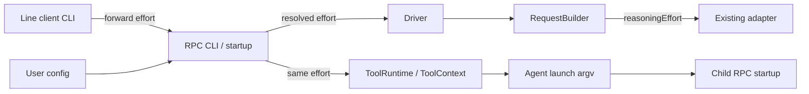
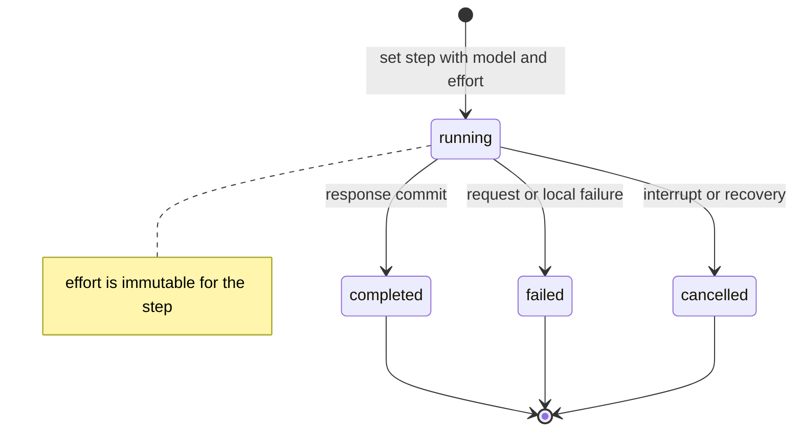
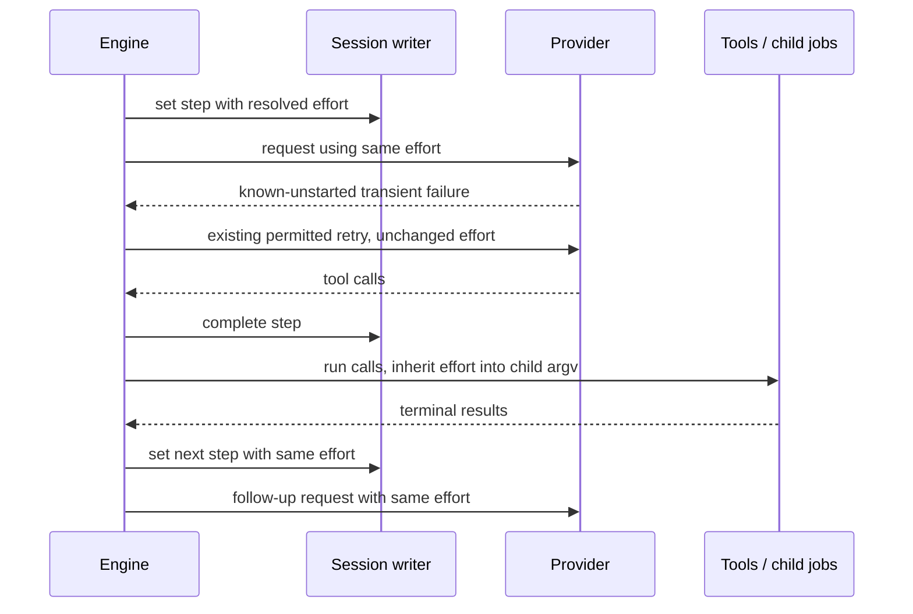
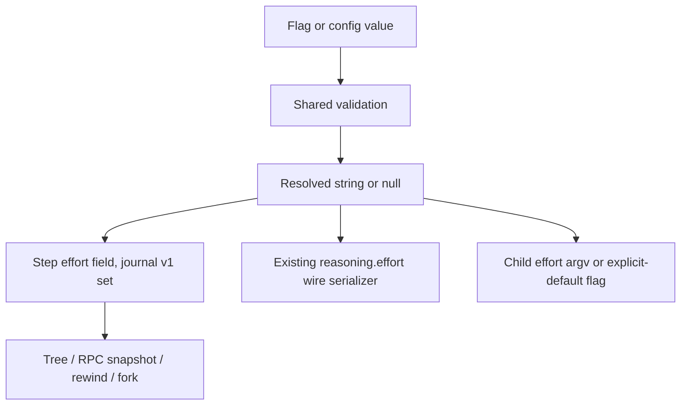

# Design

## Triage

| Trigger | Applies? | Evidence |
|---|---|---|
| T1 Components | Yes | CLI → RPC startup → driver/builder → adapter; runtime → child process (`cli.dart:193`, `rpc_command.dart:175`, `tools/agent.dart:139`). |
| T2 State | Yes | Add effort to persistent step admission (`loop/driver.dart:545`). |
| T3 Concurrency | Yes | Requests retry (`loop/driver.dart:582`); supervised children launch asynchronously (`tools/agent.dart:138`). |
| T4 Boundaries | Yes | User JSON, CLI child arguments, step data and Responses wire body (`chatgpt_request.dart:58`). |
| T5 Volume | Yes | One small field per step in growing journal history. |
| T6 Risk | Yes | Effort may affect latency/usage; silent downgrade would misrepresent execution. |

TIER: FULL

## Context

See [proposal](proposal.md) for scope. Code/planning share `F:/Dev/Orca/Workspace/kehai`. `openspec list --json` initially showed no active changes; fetched `origin/main` at `434f8a29b6026ba8e8403f76105c12005e3eee34` holds archives for entries 1–5 and the permission-prompt prerequisites. This is the M1 entry-6 bridge delivery, counted once in M2, not milestone promotion.

Observed baseline at that revision:
- `lib/src/provider/provider.dart:151–178` already exposes optional `ModelRequest.reasoningEffort`; `lib/src/provider/chatgpt_request.dart:58` emits it under `reasoning.effort`, with `summary: auto` and omission for null. We reuse this adapter contract, not infer a new service protocol.
- `lib/src/config/user_config.dart:109–120,175–193,219–226` loads a strict user-owned config once, with optional model but no effort.
- `lib/src/cli/cli.dart:139–154,189–194,391–443` owns separate line-client/RPC parsers, dispatch on leading options, forwarding and engine launch.
- `lib/src/cli/rpc_command.dart:111–142,162–184` loads config, chooses model and constructs runtime/driver. Model may fall back to a historical step; effort deliberately does not copy that policy.
- `lib/src/loop/request_builder.dart:175–181` omits effort from its constructed request. `lib/src/loop/driver.dart:545–563` records the step before building, then retries the same built request at `582–589`.
- `lib/src/tools/runtime.dart:197,333,609–622` carries the model to tool context; `lib/src/tools/agent.dart:139–152` passes a model to an isolated child engine. Effort needs an analogous immutable runtime input.
- `test/config/config_test.dart:33–94` covers strict config/defaults; `test/loop/request_builder_test.dart`, `test/loop/driver_test.dart`, `test/tools/agent_tool_test.dart`, `test/cli/cli_test.dart` are nearby test seams.

Constraints: Dart 3.x AOT, no Rust core or embedded script runtime, no durable session state outside the tree; external secure credentials remain the explicit exception and user config remains an external input. Preserve central result truncation/full-result handles, unified jobs, four-field journal and native Windows without WSL. Broader sensorium, nocterm, compaction, LSP, jj checkpoints, full plugin protocol, MCP, Anthropic OAuth, pricing registry and themes stay M2+. This bridge adds only reasoning effort. It does not change login, edit anchors or session-format algorithms; no behavior from upstream login/hashline/pi implementations is newly adopted.

## Decisions

### D1: Shared validated values, optional by default

- **Choice:** Define one shared effort vocabulary/parser (a small config-level module, e.g. `lib/src/config/effort.dart`) reused by user config and both CLI parsers. Allowed values are in the spec. Use nullable strings through the existing optional provider field; absent is provider default, while the string `none` is explicit. Validate CLI with `ArgParser` allowed values and config with its existing `ConfigError` path. Invalid config remains fatal even when a flag would override it. Update leading-option dispatch so `kehai --effort ...` starts the client.
- **Rejected:** Accept arbitrary opaque strings and leave all validation to the backend; this incurs avoidable requests for typos and makes config errors harder to locate. Also reject a required Kehai default such as `high`: it silently changes existing usage and latency.
- **Reversal cost:** Low for extending the vocabulary; medium for changing default/precedence after users depend on it. Values express selectable syntax, not a claim that every model supports every value; backend rejection stays visible.

### D2: Resolve once per engine run, then propagate the same scalar

- **Choice:** Add `effortFlag` to RPC startup and resolve flag over config, otherwise null, before creating a fresh session or issuing a provider request. Use the same rule on resume; no `_lastEffort` lookup. Pass the result into `ExchangeDriver` and `RequestBuilder`, and set `ModelRequest.reasoningEffort` for every build, including estimates. The retry loop reuses that request unchanged. Runtime and `ToolContext` receive the same result for child launches.
- **Rejected:** Re-read config at every step or let each consumer resolve independently; changing config mid-exchange could desynchronize wire requests, step records and children. Reject deriving effort from old steps: old history is evidence, not current user policy.
- **Reversal cost:** Low internally, medium for precedence changes. A future live-change command would require a separate explicit contract.

### D3: Child launch pins inherited effort, including null

- **Choice:** Pass explicit selected values as child `--effort`. For inherited null add an internal child-only flag, e.g. `--effort-default`, so child startup skips config effort selection while still validating config normally. Refuse the flag outside `--child`, and refuse combining it with `--effort`. Store the explicit-default boolean in `ChildSpec`; it distinguishes missing input from inherited null without extending public allowed values. A child started directly without this internal flag follows ordinary flag/config precedence. Every child the parent launches receives exactly one of the selected-value or inherited-default forms, regardless of role model mapping. Preserve `roles.dart` `roleRoster` and its no-nested-agents policy (skills-agents-commands design D9): no child is offered `agent`. Descendants, if nested agents are ever allowed, must inherit the same way through the same launch argv. Verify this composability by driving the launch seam twice: initialize a child-mode runtime with its inherited value and have that runtime build child argv from that value, for both selected effort and inherited default, without enabling nested execution. No environment variable, repository frontmatter or role-specific effort setting is added.
- **Rejected:** Omit a child flag for null and let it reload config: if config changes between parent start and child launch, the child silently selects a different effort. Reject a second parent-settings side file or a new RPC configuration handshake; a single argv scalar/flag already fits the child launch boundary. Also reject enabling nested agents merely to test inheritance: that changes the independent roster policy; a repeated launch-seam test proves argv composition without widening execution authority.
- **Reversal cost:** Medium: child argv is an internal process contract; older session data stays readable and no live cross-version child protocol is promised.

### D4: Persist selected input at step admission

- **Choice:** Add `effort: <string|null>` beside `model` in the existing single step-admission `set`, before request construction or streaming. Explicit null means backend default requested, not that the actual internal backend level is known. Do not omit null through Dart's null-aware map syntax here. All outcomes retain the admission field; completion/recovery merge only existing lifecycle data. Historical steps lacking it remain untouched. Standard replay/rewind/fork carries the field with the step; journal format and RPC version remain unchanged because this is additive body data, not a new operation/path/root.
- **Rejected:** Record effort only after successful completion or in session `meta`: the former loses failed/unsent steps; the latter cannot represent settings from different engine runs or rewind correctly. Reject recording the inferred actual model effort: omission gives no evidence of it.
- **Reversal cost:** Medium for the additive stored field; changing its meaning later requires explicit compatibility handling. No accepted ADR is edited; an additive ADR records this shared step/child contract during apply.

### D5: Qualify the real Kehai workflow without a second harness

- **Choice:** First branch commit `1eafae419b9b8cdbe9de327145a7c5b09663b99a` sets `review.cross_model: false`; retain required pre-ship review. Use only the installed Kehai `specwright-reviewer` role for design and pre-ship reviews, through validated Specwright review recording. Implement test-first in Kehai on explicit apply authorization; run pinned mise checks; ship/archive/merge under configured PR gates and `sh1ny` fencing. Record receipts and friction here, never claim the user-verified milestone criterion passed from planning alone.
- **Rejected:** Launch Codex/Claude CLI for reviews or create a planning-only rehearsal PR; neither proves the self-hosting acceptance criterion.
- **Reversal cost:** Low for review routing config after this dogfood delivery; high if an external harness substitutes for the required evidence, because the lifecycle would not qualify.

## Diagrams (FULL)

### T1 — component flow

### T2 — step state

### T3 — stable value over tools and retries

### T4 — data boundaries

## State & Ownership (FULL)

| State | Owner (sole writer) | Lifetime | Invalidation / rebuild | Authoritative copy |
|---|---|---|---|---|
| User config effort | User | Across runs | Load/validate at startup | User home config; never repository files |
| Resolved effort | RPC startup | One engine run | Re-resolve only on next startup | Immutable run scalar |
| Builder/runtime copies | Engine constructors | Same run | Reconstructed at startup | Derived from resolved scalar, not independent defaults |
| Step effort | Session writer via driver | Step history | Existing replay/rewind/fork | Tree reconstructed from journal |
| Child inherited input | Parent agent launcher | Child lifetime | Each launch pins value/default | Child argv initializes its run scalar |

## Failure & Visibility (FULL)

| Component | Fails / dies mid-operation → | Recovery | Retry safe? | Who finds out |
|---|---|---|---|---|
| CLI/config | Invalid setting | Refuse before effects, fix input | New explicit launch | User sees usage error or config-path diagnostic |
| Step admission | Writer/storage failure | Existing storage stop; no request before successful admission | No automatic resend | User sees storage failure |
| Request builder | Local overflow | Step already contains effort; existing stop | No automatic resend | User sees stopped exchange |
| Adapter | Backend rejects model/effort combination | Existing sanitized failure | Existing retry policy only, no downgrade | User sees failure, step retains selected input |
| Parent/child | Process dies or config changes | Existing job cancellation/recovery; explicit inherited argv prevents config drift | No relaunch | User sees job outcome; child history retains effort |
| Resume | Prior step still running | Existing finalization merges cancelled/interrupted without replacing effort | No resend | User sees recovered cancellation |

## Resource Bounds (FULL)

| Queue / buffer / cache / transfer | Bound | At the bound | Timeout | At 10x / 100x |
|---|---|---|---|---|
| Effort scalar | One of six short strings or null | Reject outside vocabulary | None needed | Constant per run/request |
| Child launch transfer | One scalar option or one default flag | Existing argv launch failure | Existing job deadline | Constant per child; existing concurrency caps unchanged |
| Step field | One scalar per existing step admission | Existing disk/storage failure stops engine | Existing writer behavior | Linear in steps; journal history deliberately retained, no eviction |
| Request transfer/stream | Existing provider body/output limits | Existing visible rejection | Existing provider idle deadline | No additional queue, buffer or per-request task |
| Retry/tool/job work | Existing loop and supervisor limits | Existing bounded retry/busy behavior | Existing retry/job deadlines | No effort-specific retries, queues or cache |

The setting adds constant space per runtime and step, no growing side collections. At larger history sizes the existing journal materialization costs remain; no compaction/index work is justified by a short field.

## Flow & State Gaps (FULL)

- Admission then crash: effort is in the same atomic step `set`; recovery changes state only. Torn-tail handling remains unchanged.
- Config edits while running: no live reload. Child effort is pinned explicitly, including null; other child policy continues to come from validated user config.
- Resume after a changed selection: historical steps retain their effort; new steps reflect current startup resolution. No backfill or hidden carry-forward.
- Interrupt/retry/out-of-order callbacks: effort never changes after driver construction. Existing write gate, tokens and job ownership guards remain authoritative; no second writer is added.
- Invalid config despite valid override: refuse startup as today for all invalid config; no partial config parsing loophole.
- Role picks a model that rejects effort: fail visibly, do not infer an alternative, downgrade or silently retry.
- Fork/rewind: field is turn-anchored within each step; generic tree operations suffice. A fork's new engine resolves current settings, not history.

## Mechanism Ledger (FULL)

| Mechanism | Built? | Why (harm nobody catches / expensive later) | Evidence that would change the call |
|---|---|---|---|
| Shared value vocabulary | Yes | Prevents CLI/config accepted-value drift at public input boundary | Provider adds supported syntax |
| Explicit inherited-default marker | Yes | Traceable config-edit race would otherwise change child requests silently | New versioned settings handshake replaces argv |
| Admission-time effort field | Yes | Completion-only loses failed/unsent requests; stored schema expensive later | Future per-request changes need new semantics |
| New effort retry/downgrade | No | Would conceal unsupported settings and alter existing effect-safety rules | Explicit future feature/spec |
| Per-model capability registry | No | Not needed to transmit user selection; rejection already visible | Repeated observed interoperability friction |
| Live change command/per-role overrides | No | Expands public state/precedence unnecessarily | Separate user-requested capability |
| Feature side store/cache | No | Violates tree ownership, no performance need | None for a second authoritative store |

## Risks / Trade-offs

- [Some values are not supported by every model] → Fixed vocabulary validates syntax only; preserve visible provider rejection rather than promise universal compatibility.
- [Provider default is opaque] → Record null as selection, not actual backend reasoning level; do not infer historical values.
- [Internal-default flag could become public clutter] → Child-only validation and tests; document it as internal only.
- [Missing propagation seam] → Test CLI-first dispatch, direct RPC, config, resume, multiple steps, safe retry and child/default inheritance separately, then an integrated local fake-service run.
- [Dogfood friction tempts scope expansion] → Record it for M2; stop for user decision if a required workflow gate is genuinely unsupported, never bypass review.

## ADRs

- **In force, constraining this change:** ADR 0001 (one tree/config external input), ADR 0008 (v1 journal/rewind/fork), ADR 0011 (step ownership and RPC v1), ADR 0012 (child-engine launch and repository frontmatter not policy). All read; none edited.
- **To record during apply:** ADR 0013, additive reasoning-effort selection, step field and child inheritance contract; update architecture index and applicable boundary text in the same task. It supplements rather than supersedes the existing layouts; no accepted decision is reversed.

## Dogfood evidence and friction

Planning and the authorized apply attempt run in Kehai on `feat/dogfood-first-m2-change`. Groups 1–4 were committed before the group-5 attempt (starting HEAD `ab5fa1d`). Group 5 added local integration coverage and attempted qualification on 2026-11-01. After the user clarified the standing local/CI validation policy, the orchestrator's single-file local checks passed. Task 5.2's validation-policy amendment is recorded in `534face`; fresh internal design approval remains required before recording group 5 complete. Pre-ship review, delivery PR, remote full-suite CI, archive and merge are separate outstanding delivery gates, not claimed complete here.

Observed planning friction to seed M2 (not implementation scope):
- A chained gate command prompted/was interrupted. User requires exactly one command per bash call; subsequent calls comply, using tool working-directory parameters instead of shell `cd` prefixes.
- Initial edit anchor `4A7D` was rejected; the tool accepted the full `17#4A7D` anchor. No file changed on rejection.
- A commit message under `.git/` was denied by repository guard; `.git/kehai-scratch/` was accepted. The protected path was not modified.
- Generic `explore` agent role was unavailable; only installed Specwright roles are runnable. Discovery continued read-only in the parent; no alternate harness launched.

Group-5 apply/test/platform receipts (2026-11-01):
- Added `test/client/effort_process_test.dart`, using the existing line-client subprocess fixture, isolated `TestHome`/workspace/role/session and loopback `FakeOpenAi` only. It launches the public line client with leading `--effort high` (config `low`), and separately without an effort selection. Each case reads a local file, approves the existing `agent` permission prompt, launches a real `specwright-reviewer` child mapped to `gpt-fake-mini`, and completes the parent's follow-up. All four actual request bodies and all four replayed steps (three parent, one child) must agree with the selected scalar or explicit null. Config is edited after startup in both cases; the child's tools must still exclude `agent`. This fake reviewer execution tests inheritance, not design approval or review quality. No paid backend was used; no production behavior was changed for group 5.
- Native Windows, pinned Dart 3.13.7, no WSL: the implementer's focused integration run passed **2 tests** in 27 seconds. Its initial run failed because the fixture did not answer the line client's existing agent permission prompt; this was a fixture failure, **not** a missing-effort red confirmation. The fixture now answers `1` and closes/awaits the client so it shuts down its engine/jobs. The orchestrator independently reran this file with `-j 1`: **2 passed** in 26 seconds.
- Historical failed local full-suite attempt: `mise run check` exited 1 after format and analysis passed. `test/hooks/hooks_test.dart: a slow job settle does not hold the call past the grace` exceeded its 3-second wall-time assertion at **3.480569 seconds**. Last captured progress was `+1001 ~24 -1`, not a final suite receipt. On resume, the orchestrator first ran `mise exec -- dart test test/hooks/hooks_test.dart -j 1 --reporter expanded` alone: **11 passed**, exit 0, in 11 seconds, including the unchanged assertion. Per the user's instruction, the earlier overrun is treated as load-induced and recorded as observed under local full-suite load, not a feature regression. No unrelated code or assertion was changed, weakened or skipped.
- **Standing validation split:** the full test suite runs on GitHub Actions only, never locally. Local tests run one named test file per call with `-j 1`, sequentially; local quality gates are `mise run format:check` and `mise run analyze`. The repository guard now refuses `mise run check`, `mise run test`, and `dart test` without a test file. No full-suite command was retried after the user clarified this policy. Before merge, require both ordinary delivery PR CI on Linux/Windows and an explicit full-suite Actions run against the delivery revision: manually dispatch the existing Nightly workflow on the delivery branch, verify its checked-out head SHA, and record its run URL and both platform matrix outcomes. Nightly runs unfiltered `dart test`; ordinary PR CI excludes slow tests and cannot alone discharge full-suite qualification. Rerun qualification if later delivery changes invalidate that revision. Both remote gates remain pending, not claimed satisfied by these local receipts.
- Orchestrator quality gates: `mise run format:check` passed (277 files, 0 changed); `mise run analyze` passed (`No issues found!`). Each file below was independently run as its own `mise exec -- dart test <file> -j 1 --reporter expanded` call, never as a multi-file invocation or in parallel with another local test run:

| Local test file | Passed | Skipped |
|---|---:|---:|
| `test/hooks/hooks_test.dart` | 11 | 0 |
| `test/client/effort_process_test.dart` | 2 | 0 |
| `test/config/config_test.dart` | 16 | 0 |
| `test/loop/request_builder_test.dart` | 12 | 0 |
| `test/loop/driver_test.dart` | 21 | 0 |
| `test/tools/agent_tool_test.dart` | 3 | 0 |
| `test/jobs/agent_effort_test.dart` | 3 | 0 |
| `test/cli/effort_test.dart` | 15 | 0 |
| `test/tools/runtime_test.dart` | 24 | 0 |
| `test/cli/cli_test.dart` | 17 | 0 |
| `test/rpc/process_test.dart` | 6 | 1 (Unix-only SIGINT case on Windows) |
| `test/client/process_test.dart` | 6 | 0 |
| `test/tools/attach_config_test.dart` | 4 | 0 |
| `test/jobs/agent_job_test.dart` | 13 | 0 |
| `test/jobs/agent_run_test.dart` | 16 | 0 |
| `test/jobs/agent_resume_test.dart` | 4 | 0 |

- These **173 passing tests across 16 single-file runs**, plus one platform skip, cover every effort test-map row and nearby CLI/runtime/child-process regressions. They are targeted local receipts, **not** a full-suite pass.
- The implementer separately ran `mise run openspec:validate` (23 items passed, 0 failed) and `mise run secrets` (no leaks found, approximately 63.20 MB scanned). The orchestrator independently repeated both after the evidence update: OpenSpec validation passed **23 items, 0 failed**, exit 0; secrets passed with **no leaks found**, exit 0 (approximately 63.13 MB scanned).
- CI inclusion inspected, **not remotely executed**: `.github/workflows/ci.yml` runs `dart test --exclude-tags slow` on `ubuntu-latest` and `windows-latest` for PRs/main; `.github/workflows/nightly.yml` supports manual dispatch and runs unfiltered `dart test` on the same matrix. The new ordinary `test/client/*_test.dart` file has no slow tag or platform skip, so both existing workflows discover both cases without workflow changes. Linux was unavailable locally and remains **unverified**. Ordinary PR CI and the explicit Nightly full-suite run against the delivery revision are **pending**. Scheduled default-branch results are not qualification of the delivery revision; the run URL, verified head SHA and both matrix results must be captured before merge.

Additional apply friction / unsupported or outstanding steps:
- The earlier prefixed temporary-directory `mise run check` call was denied; it was not repeated unchanged. Before the standing-rule clarification, the literal `mise run check` then ran and produced the timing failure above. After clarification no prohibited local full-suite command was run.
- The initial fixture timeout killed the line client before its owned engine had shut down, producing Windows directory-deletion errors. Normal/error cleanup now closes input and awaits the client. The implementer's final process inventory found no remaining test/client/engine processes from that attempt; unrelated existing MCP/editor/Flutter processes were left alone. All orchestrator single-file commands completed in the foreground.
- Groups 1–4 supplied feature-red evidence. Group 5 adds integration qualification of existing behavior; its fixture timeout is not counted as feature-red evidence. The isolated hooks rerun resolves the reported local blocker without an unrelated fix.
- This evidence edit invalidates the earlier design approval. Task 5.2 requires a fresh validated Kehai-internal design review of the updated artifacts before the group commit; `review.md` records its verdict. No external reviewer CLI substitutes for it. No local result or internal review claims remote CI, a delivery PR/merge, or Nikolay's user-verified milestone acceptance.

These receipts do not substitute for Nikolay's user-verified milestone acceptance.

## Open Questions

None blocking. The vocabulary, omission default, resume behavior and child inheritance above are explicit planning defaults for review; no provider capability-discovery claim is made.
